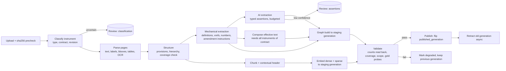

# Contract ingestion, chunking and knowledge graph: audit and target design

Date: 2026-10-08. Status: **proposal for approval. No production code, database or index was changed.**

## 0. Basis and limits of this audit

- **Source read:** working tree `C:\SaaS` on branch `integrate/key-date-eot` @ `a179ca9e`, which has about 290 uncommitted files. Four files on the ingestion path differ from HEAD: `retrieval/service.py`, `retrieval/reconcile.py`, `contract_clause/agent.py` and `contracts_ingest.py`. Re-check the line numbers below against the branch you implement on.
- **Method:**
  - I read the code: five parallel read-only investigations plus my own checks of the highest-impact claims.
  - I nothing ran: no tests, no live Qdrant, no FalkorDB, no production data.
  - The graphify graph (`graphify-out/graph.json`, 2026-08-13) is two months stale. I used it only for orientation, not as evidence.
- **Labels:**
  - **Implemented:** present and wired into the upload path.
  - **Partial:** present but incomplete, unwired, or defective.
  - **Absent:** not found.
  - **Unverified:** depends on runtime or production state I could not observe.
- `[V]` marks a claim I re-checked line by line myself. All other claims come from a sub-investigation's code read.
- All paths are relative to `backend/rbac_backend/` unless stated otherwise.

---

## 1. Current architecture

```
Upload (routers/contracts.py: upload-session / upload-multipart / upload-chunk)
  -> FileObjectService.store_path            local + S3, key /{org}/{project}/contracts/{upload_id}_{file}
  -> documents(uploadType=contract), contracts, contract_versions(v1 always), document_versions
  -> Redis contract_ingest_queue (job_id = upload_id, 3 retries, dead-letter)
  -> ContractService.process_ingest_job
       ContractIngestor.ingest_file  (LEGACY / "v1" path)
         PageExtractionEngine (pdfplumber; OCRmyPDF for pages <40 chars)  -> contract_ocr_pages
         ContractTextPreprocessor (strip headers/footers/page numbers)
         ContractCategorizer (LLM gpt-4o-mini -> FIDIC *topic* keys)       -> documents.contract_categories
         ClauseExtractor (regex; optional LLM span extractor, off by default)
         split_long_clause (4000 chars, no overlap)
         embeddings -> Qdrant default collection (document_vectors) + Mongo document_vectors
         ContractGraphService (Writer B) -> FalkorDB Document/Section/Clause
       _run_clause_indexing_safe  (CLAUSE-FIRST path, best effort, no user context)
         ClauseChunkingAgent: OCR pages -> ClauseExtractor -> sub-items -> tables/BOQ
           -> Mongo contract_clauses -> ModificationDetector -> Qdrant ns contract_clauses
           -> ClauseGraphService (Writer C) -> FalkorDB Contract/ContractDocument/Clause
  -> job + document "completed"

Separate, mostly unwired: Contract Master (contract_documents instruments, classification facts,
applicability events, legal effects, projection_status) -> contract_scope_resolver -> drafting universe.
```

Two parallel clause pipelines and two FalkorDB contract graphs exist side by side. Neither pipeline knows the instrument type of the document it is processing.

## 2. Phase 1 audit: findings by question

| # | Question | Status | Evidence and notes |
|---|---|---|---|
| 1 | Upload, classify, parse, store | **Partial** | Upload, storage and queue are solid (`routers/contracts.py:275-821`, `contract_ingest_queue.py:191-455`). **No duplicate precheck for contracts:** `precheck_upload` is called only for correspondence (`routers/documents.py:752`), and an identical re-upload creates a new contract, new clauses and new vectors. **The instrument type is never set at upload.** `ContractDocumentType` (`models/contract_document.py:71-96`) is set only by operator confirmation in Contract Master. Every upload gets `ContractVersion` v1 (`contract_service.py:362-386`). |
| 2 | PDF/DOCX/tables/OCR | **Partial** | PDF: pdfplumber per page, OCRmyPDF for pages under 40 chars, batches of 25 (`services/extraction/engine.py:106-122`). DOCX: paragraphs only, `doc.tables` ignored, the whole file becomes one page (`contracts_ingest.py:255-263`). XLSX BOQ: **Absent**. pdfplumber table grids are extracted and then **dropped** for contracts (`contract_page_store.py:32-47`). The unified extraction quality gates (numeric, reading order, column roles) apply only to general documents. The "Docling" service is not Docling and nothing calls it. **Probable defect:** OCR retry with `retry_pages` re-writes every page, overwriting earlier OCR text with empty native text (`engine.py:226-246`, `contracts_ingest.py:1048-1051`). |
| 3 | Chunk creation, size, linkage | **Partial** | Clause-based, not token windows. Long clauses split at 4000 chars on paragraph boundaries, falling back to a hard character cut. `CHUNK_OVERLAP=350` and `MIN_CHUNK_LENGTH=100` are defined but unused (`contracts_ingest.py:74-76`). Chunks link to `document_id` and `contract_id`. Legacy `contract_id` equals `document_id` (`:2094`). |
| 4 | Clauses and subclauses independent | **Implemented (regex)** | `ClauseExtractor.CLAUSE_PATTERNS` (`contracts_ingest.py:557-572`). `1.1` and `1.1.1` are separate records. `(a)`/`(i)` become child records `8.4(a)(i)` (`subitem_detector.py`, `agent.py:607-644`). Parents are derived from the number (`storage_service.py:128-162`), so a parent record may not exist. Headings whose title contains a period do not match. A document with no detected headings becomes one "Complete Document" clause. |
| 5 | Chunk metadata | **Partial** | `ContractClause` (`models/contract_clause.py:31-124`) carries scope, hierarchy, page_start/end, char offsets into the *joined cleaned text*, quality flags, `is_current`, `is_authorised_for_ai`, checksum. **Absent:** chunk or schema version on clause points, printed page, bounding boxes, heading breadcrumb, effective date. `summary` and `keywords` are never populated. |
| 6 | Qdrant embeddings and indexes | **Partial, with defects** | `text-embedding-3-small`, 1536 dims. Single dense vector, cosine. **No payload indexes** (no `create_payload_index`, no `is_tenant`). Defects are in §3 (D1, D2, D3). |
| 7 | Dense / sparse / BM25 / hybrid | **Partial** | Dense: Implemented. Sparse vectors and BM25 index: **Absent**. "BM25-lite" is a Python scorer over capped Mongo scans (`retrieval/service.py:731-841`). RRF exists only under the `RAG_FUSION` strategy and in `ContractService._assemble_results` (k=60). Exact clause-number lookup: **Absent as a direct route**; it is a regex hint plus a rerank boost (`service.py:1296-1317, 1628-1635`) with hard-coded topic-to-clause maps. The LLM reranker exists but is off by default. |
| 8 | FalkorDB graph | **Partial** | One global graph, `contraclaim`. Writer B (`contract_graph_service.py`): Document, Section, Clause, scoped by org and project, read by `find_related_clauses`. Writer C (`contract_clause/graph_service.py`): Contract, ContractDocument, Clause, HAS_SUBCLAUSE, MODIFIED_BY, SUPERSEDED_BY. **Nothing reads Writer C.** Its Clause nodes carry no org or project, and its edges are matched label-less. Letter graph: `Letter{normCode}` is global by design. Its `CITES` and `REPLIES_TO` edges carry `owner_document_id`. **No Letter-to-Clause edges** in FalkorDB. Claims, events, delays and variations live only in Mongo (`evidence_graph_service.py`). |
| 9 | Definitions, obligations, notices, entitlements, amendments, exceptions | **Absent / Partial** | Definitions, obligations, notices, entitlements and exceptions: **Absent** at ingestion. They appear only as LLM prompt sections in contract appraisal and are re-derived at request time. Amendments: `ModificationDetector` uses keyword windows around `Clause N.N` (**Partial**). Its links are **not persisted to Mongo**, `is_current` is never changed automatically, and on real uploads it effectively never fires (see D4). |
| 10 | Citations: clause no, printed page, coordinates | **Partial** | Clause number and PDF page index: Implemented (`retrieval/models.py:85-97`, `models/evidence_ledger.py:44-66`). Printed page: **Absent**; the cleaner deliberately strips it (`contracts_ingest.py:371, 414-420`). Bounding boxes: **Absent** for contracts. |
| 11 | Incremental upload, replacement, deletion, amendment | **Absent / Partial** | No version chain. Re-ingest upserts clauses and points but **never deletes orphans**. Legacy points get new uuid5 IDs when text changes, and the old points stay. `cascade_delete_cleanup` does **not** cover `contract_clauses`, `contract_ocr_pages`, the `contract_clauses` Qdrant namespace or any contract graph node. FalkorDB has no clause retraction path, and a test pins that gap (`tests/integration/test_g29_clause_state_material_influence_falkor.py:504`). Manual Supersede and Verify update Mongo only, so Qdrant flags go stale. |
| 12 | Status, failures, retries, idempotency, RBAC, isolation | **Partial** | Redis retries, heartbeat and dead-letter: Implemented. Stage checkpoints: **Absent**; a retry reruns OCR, LLM calls and embedding. Clause indexing failures are swallowed and the job still says `completed`. A contract with no project gets zero clauses and still shows completed. Writer B swallows FalkorDB errors, yet the job reports `graph_indexed=True`. Token and cost accounting for ingest LLM calls: **Absent**. RBAC on routes is Implemented (`PolicyService.authorize`, `build_scope_query`). Clause indexing at ingest runs with `current_user=None`, so its authorization is a no-op and scope comes from the document row. |

### Existing tests

These tests cover the clause path: `tests/test_contract_clause_{agent,storage,improvements,subitems,extraction,phase3,boq,index,retrieval_integration}.py`, `test_clause_chunking_authority_red.py`, `test_clause_graph_writer_authority_red.py`, `test_golden_contract_qa.py` (4 cases), `test_contract_graph_{containment,retrieval}.py`, `test_contract_vector_containment.py`, `test_contract_retrieval_authority.py`, and the opt-in real-FalkorDB `tests/integration/test_graph_*_falkor.py`.

**None of them uses a real Qdrant for clause points, a real contract PDF, or the real categorizer output.** That is why D1 to D5 below pass CI.

## 3. Defects found during the audit (fix before building anything new)

These are defects in shipped code, not missing features. Each is a silent-failure pattern of the kind `CLAUDE.md` warns about.

| ID | Defect | Evidence | Confidence |
|---|---|---|---|
| **D1** | Clause Qdrant point IDs are 40-hex SHA1 strings (`clause_uid`) passed straight to `PointStruct(id=...)`. Qdrant accepts only unsigned integers or UUIDs. Split clauses produce `"{uid}:split:2"`, which is also invalid. The failure is swallowed (`agent.py:357-362`), and retrieval silently falls back to legacy chunks. | `[V]` `storage_service.py:191-194`, `embedding_service.py:82`, `vector_client.py:246` | High from the code read. Prove it with a real-Qdrant test, or by counting points in the `contract_clauses` namespace in production. |
| **D2** | The clause `document_type` comes from `contract_categories[0]`, which holds FIDIC **topic** keys ("general", "payment"), not GCC/SCC. As a result, the `== "GCC"` modification detection misfires, `MODIFIED_BY` edges point at phantom `{contract_id}:GCC:{no}` nodes, and the embedding prefix says "Document: general". | `[V]` `agent.py:495`, `agent.py:423`; `contract_categorizer.py:10-31` | High |
| **D3** | `VectorClient` is an lru_cache singleton that **rewrites its own default `collection_name`** whenever it ensures a namespace. After one clause-index call, un-namespaced searches can hit `contract_clauses`. | `[V]` `vector_client.py:89,170,174,186,192`; `dependencies.py:21` | Medium-high. Needs a runtime repro. |
| **D4** | If OpenAI embedding fails, `EmbeddingClient` returns 32-value SHA256 pseudo-vectors instead of raising. In production this either writes garbage vectors or triggers the `_dim{N}` fallback collection. | `[V]` `retrieval/embeddings.py:43-55` | High (code). Production impact Unverified. |
| **D5** | Drafting evidence universe: letter drafting, the LangGraph letter pipeline and arbitration context read clauses only through `resolve_authorized_project_universe`. That function requires `projection_status == CURRENT` (`contract_scope_resolver.py:237`). The only code that sets CURRENT is `ContractReprojectionWorker` and `PostPromotionSequencer.mark_projection_current`, and **no non-test code, script or migration calls either one**. Normal uploads never create a `contract_documents` instrument at all. | `[V]` greps over `backend/`, `scripts/`, `migrations/` | High from the code read, which suggests these workflows get **zero** contract clauses. Production data is Unverified: run a read-only count of `contract_documents` by `projection_status`. |
| **D6** | Arbitration clause agents query `contract_clauses` with `organization_id`, but clause rows store `org_id`. The query returns zero rows, and the agents fall back to regex-filtered legacy `document_vectors`. | `agents/deterministic.py:1027`, `_scope_query:1272-1280` | High |
| **D7** | Mongo clause readers use an unsorted `.limit(60)` *before* relevance scoring, so on a large contract the governing clause can be cut off. | `letter_drafting/context.py:323`, `letter_pipeline.py:1814-1922`, `arbitration_drafting/context.py:1895-1915` | High |
| **D8** | The OCR retry overwrites previously OCR'd page text. | `engine.py:226-246`, `contracts_ingest.py:1048-1051` | Medium-high. Needs a repro. |
| **D9** | Deleting or re-ingesting a document leaves orphaned clause rows, clause points and graph nodes. Supersede, Verify and Merge leave stale Qdrant flags. `regenerate_embedding` sets `pending` and nothing consumes that status. | §2 row 11 | High |
| **D10** | Writer B reports `graph_indexed=True` after swallowing a FalkorDB transport error. | `[V]` `contract_graph_service.py:221-224` | High |
| **D11** | The letter graph is cross-tenant. `graph_codes_denied` resolves supporters by normCode without an org filter (`publication_policy.py:498`). `delete_letter` removes every outgoing edge of a node shared by normCode, including other owners' edges. | Graph sub-audit | Medium. Already known as a design risk in `CLAUDE.md`; the peer-edge deletion is new. |

**Consequence:** today the system's contract intelligence reaches users mainly through `contract_iterative_qa`, used by Contract QA, claims assessment and appraisal. That path likely runs on *legacy* chunks because of D1. It re-derives notices, time bars and entitlements with an LLM on every request. Letter, arbitration, variation and EOT drafting get little or no clause evidence (D5, D6), or rely on hand-entered `contract_master` dates.

## 4. Missing ingestion-time capabilities

1. **Instrument identity:** instrument type (GCC/PCC/SCC/ER/BOQ/addendum/corrigendum/drawing schedule), revision, effective date, precedence rank and the contract that owns it, all decided at upload with a review step. The Contract Master model already exists for this but is not wired to upload.
2. **Cross-document contract assembly:** one `contract_id` per contract, not per upload, so PCC and GCC clauses can be joined.
3. **Structural fidelity:** printed page labels, bounding boxes, heading text breadcrumb, DOCX and XLSX tables, a table cell model, and a BOQ arithmetic check (qty × rate = amount).
4. **Defined terms**, and links from each term's uses to its definition.
5. **Explicit cross-reference parsing and resolution** (Clause, Sub-Clause, Schedule, Annex, Appendix, "paragraph (b) above").
6. **Amendment lineage:** persisted modification instructions (replace, delete, insert, amend), the resulting *effective clause text* per contract, and the supersession graph.
7. **Typed provisions:** obligations, entitlements, notices and time bars, conditions precedent, exceptions, remedies and LDs, payment, variation, EOT, dispute resolution, scope, records. Each must be stored with verbatim spans and an epistemic basis.
8. **Hybrid retrieval:** dense plus sparse in Qdrant, exact clause routing, parent reconstruction for the clause path, and payload indexes.
9. **Publication model:** index generations, atomic switch, retraction, rollback.
10. **Durable orchestration:** stage checkpoints, per-stage metrics, token and cost budgets, review queues, completion that reports honestly.
11. **Evidence graph links:** Letter, Notice, Claim, Event and Variation nodes linked to Provision nodes with provenance, scoped by tenant.

## 5. Design principles (non-negotiable)

1. **Authoritative text is immutable.** `text_raw` is the verbatim span from the page store, located by page and offsets. Cleaning, summaries, enrichment and AI output live in *separate fields or records* and never replace it.
2. **Every derived assertion carries a basis:**
   - `SOURCE_TEXT`: a verbatim quotation.
   - `MECHANICAL`: deterministic parser output, reproducible from code version plus input hash.
   - `AI_INFERRED`: model, prompt version, confidence, and spans that justify it.
   - `HUMAN_VERIFIED`: who and when, and which assertion it confirms or overrides.

   Retrieval and drafting must be able to filter by basis.
3. **No legal conclusions at ingestion.** Ingestion records *what the text says and where*, for example "Clause 20.1 requires notice within 28 days of awareness". It never records conclusions such as "the contractor is time-barred" or "PCC prevails here". Precedence is stored as the *declared order of precedence clause*, and conflicts as *candidate conflicts* for review.
4. **Fail visible.** A stage that is skipped or degraded marks the document `degraded` with reasons. `completed` means every required stage verified its own write: count read back, not count attempted.
5. **One pipeline, one graph writer per graph, one payload builder per namespace.** Retire the duplicates instead of adding a third.
6. **Tenant scope is stamped on every row, point, node and edge and filtered on every read**, including in the graph.

## 6. Chunk and metadata schema (`contract_provision.v2`)

### 6.1 Identity

| Identity | Formula | Stable across |
|---|---|---|
| `contract_id` | Contract Master aggregate (one per contract, many instruments) | Uploads |
| `instrument_id` | `contract_documents._id` | Re-ingest of the same instrument |
| `instrument_revision_id` | `uuid5(NS, instrument_id + "|" + sha256(file))` | Identical bytes |
| `provision_key` (logical clause) | `{contract_id}:{instrument_type}:{normalized_clause_path}[#dupN]` | Revisions. This is what amendments target. |
| `provision_id` (one clause in one revision) | `uuid5(NS, instrument_revision_id + "|" + provision_key)` | Re-ingest of the same bytes **with the same parser version** |
| `chunk_id` / Qdrant point id | `uuid5(NS, provision_id + "|" + part_no + "|" + chunk_schema_version)` | Valid UUID, which fixes D1 |
| `index_generation` | Monotonic per instrument revision | Publication unit |

Section chunks without a clause number use `normalized_heading_slug + ordinal-within-parent` instead of a global `chunk_index`. That keeps them stable when upstream detection shifts.

### 6.2 Mongo `contract_provisions` (one row per clause or sub-item; the evolution of `contract_clauses`)

```
_id: provision_id, schema_version: "contract_provision.v2", parser_version, index_generation
org_id, project_id, contract_id, instrument_id, instrument_revision_id, instrument_type, precedence_rank
provision_key, clause_no, clause_no_normalized, clause_path[], parent_provision_id, level, provision_kind (clause|sub_item|table|schedule|definition_entry)
heading_text, heading_breadcrumb[] (["20 Claims, Disputes and Arbitration", "20.1 Contractor's Claims"])
text_raw (verbatim, immutable), text_normalized (whitespace/hyphenation only), text_hash
spans: [{page_index, page_label, char_start, char_end, bboxes:[[x0,y0,x1,y1]...]}]
tables: [{table_id, caption, columns[], rows[][], cell_bboxes?, arithmetic_check}]
references_out: [{raw, target_key, resolution: resolved|ambiguous|unresolved, basis}]
defined_terms_used: [term_id]
provision_types: [{type, basis, confidence, model?, prompt_version?, status}]   (classification, not interpretation)
effective: {status: original|amended|deleted|replaced, effective_text_id?, amended_by:[instruction_id]}
quality: {extraction_method, confidence, review_state: auto|needs_review|verified|rejected, reasons[]}
access: {is_authorised_for_ai, classification_basis}
human: {manually_edited, verified_by, verified_at, edit_history_ref}
lifecycle: {is_current, superseded_by_revision_id, retracted_at}
created_at, updated_at
```

### 6.3 Qdrant `contract_provisions_v2` (one collection; tenant via payload)

- **Vectors:** named `dense` (1536, cosine) and `sparse` (BM25 with the `IDF` modifier). The production Qdrant version is 1.12.5, which supports both and the Query API's prefetch plus RRF fusion. Confirm against the running version before building.
- **Payload indexes:** `org_id` (keyword, `is_tenant=true`), `project_id`, `contract_id`, `instrument_id`, `instrument_type`, `clause_no_normalized`, `provision_types`, `index_generation`, `is_current`, `is_authorised_for_ai`.
- **Payload:** IDs, scope, `clause_no`, `heading_breadcrumb`, `page_labels`, `part_no/part_total`, `basis`, `chunk_schema_version`, `embedding_model`, `text_hash`. **No full text in the payload.** Hits are resolved through Mongo under a scope query (single source of truth, and no stale text).
- **Embedded text:** a contextual header plus `text_normalized`, for example `"[PCC | Sub-Clause 20.1 Contractor's Claims > (a)] ..."`. The header is generated, versioned and stored as `embedding_input_hash`. The authoritative text is untouched.
- **Long clauses:** split at about 1,200 tokens with about 120 tokens of overlap, at sentence or sub-item boundaries. Every part carries `provision_id`, and retrieval *always reconstructs the full provision* (capped, with explicit truncation markers) before drafting. That extends `_expand_contract_clause_results` to the clause path.

### 6.4 Chunking strategy comparison

| Strategy | Current | Proposed |
|---|---|---|
| Clause-aware | Regex, two duplicate pipelines | One parser: regex, then layout heading cues, then LLM boundary repair for low-coverage documents, with coverage validation |
| Parent-child | From number only; parent may be missing | Explicit `parent_provision_id`; synthesize the parent shell if absent |
| Hierarchical section | Numbers only | Heading breadcrumb with text |
| Contextual enrichment | Light prefix with the wrong doc type (D2) | Versioned header with instrument type, breadcrumb and defined-term glossary hints. Never overwrites text. |
| Table-aware | Caption regex; BOQ regex over flattened text | Cell model from pdfplumber, python-docx and openpyxl; BOQ arithmetic validation; table rows as child provisions |
| Long-clause subdivision | 4000 chars, no overlap, hard cut | Token-aware, overlap, full-parent reconstruction |
| Exact clause index | Absent (rerank boost) | Mongo unique index `(org_id, contract_id, instrument_type, clause_no_normalized, index_generation)`, plus a deterministic query router that runs before vector search |
| Lexical + semantic | Dense plus a Python scorer over capped scans | Qdrant dense + sparse with RRF, then the optional reranker |

## 7. Contractual extraction schema (Phase 2)

Every extracted item is a row in `contract_assertions`:

```
assertion_id (uuid5 of provision_id + type + span + extractor_version), assertion_type, org_id, project_id, contract_id,
provision_id, spans[] (verbatim quotes with page_label + offsets), fields{...type-specific...},
basis: SOURCE_TEXT|MECHANICAL|AI_INFERRED|HUMAN_VERIFIED, extractor{name, version, model?, prompt_version?},
confidence, review_state, supersedes_assertion_id?, index_generation
```

| Category | Type-specific fields | Primary method | Graph | Validation | Retrieval use |
|---|---|---|---|---|---|
| Hierarchy and precedence | `instrument_type, rank, declared_by_provision` | MECHANICAL from the "priority of documents" clause; human confirm | `(:Instrument)-[:RANKS_ABOVE {source}]->(:Instrument)` | Exactly one declared order per contract, else review | Every drafting workflow: resolve which text governs |
| Clauses and sub-clauses | §6.2 | MECHANICAL | `HAS_PROVISION`, `HAS_CHILD` | Coverage ≥ 98 % of the page text; no gaps or overlaps; numbering monotone | All |
| Definitions | `term, definition_span, scope (contract/instrument/clause)` | MECHANICAL ("X" means / shall mean) plus AI for irregular cases | `(:DefinedTerm)-[:DEFINED_IN]->(:Provision)`, `(:Provision)-[:USES_TERM]->(:DefinedTerm)` | One active definition per term and scope; conflicting definitions go to review | Inject definitions of the terms used in the retrieved clauses |
| Obligations | `obligated_party (role), action, trigger, deadline_ref, modality (shall/must/may)` | AI_INFERRED with verbatim span | `(:Obligation)-[:IMPOSED_ON]->(:PartyRole)`, `-[:STATED_IN]->(:Provision)` | Span must contain the modal verb; party must resolve to a defined role | Letter compliance, SOD defences |
| Rights and entitlements | `beneficiary, entitlement (time/cost/profit/suspend/terminate), preconditions[]` | AI_INFERRED | `(:Entitlement)-[:CONDITIONED_ON]->(:Condition)` | Each precondition must have a span | Claims, EOT, variation, SOC |
| Notices and deadlines | `from_role, to_role, trigger_event, period{value, unit, business_days?}, form, consequence_text_span` | MECHANICAL regex for periods, plus AI for trigger and consequence | `(:NoticeRequirement)`, `-[:STARTS_ON]->(:TriggerEvent)` | Period parsed numerically; the consequence is quoted, never concluded | Time-bar calendars, notice letters, key dates |
| Conditions precedent | `condition, gated_right, span` | AI_INFERRED | `(:Condition)-[:PRECEDES]->(:Entitlement)` | Must cite a conditional connective in the span ("subject to", "provided that", "shall not be entitled unless") | Claims and defences |
| Exceptions, exclusions, limitations | `limits (provision/entitlement), kind (cap/exclusion/carve-out), amount?` | AI_INFERRED; amounts MECHANICAL | `(:Limitation)-[:LIMITS]->(…)` | Amount and currency parsed; "notwithstanding" detected MECHANICALLY | SOD, risk |
| Remedies, liability, recovery, LDs | `remedy, rate, cap, trigger` | MECHANICAL amounts plus AI | `(:Remedy)` | Rate × cap consistency check | Claims quantum, LD defence |
| Risk allocation | `risk_event, bearer_role, relief` | AI_INFERRED, review required | `(:Risk)-[:BORNE_BY]->(:PartyRole)` | Always `needs_review` | Appraisal, EOT causation |
| Variation and valuation | `instruction_route, valuation_method_order[], rate_source (BOQ)` | AI plus MECHANICAL BOQ linkage | `(:Procedure{kind:variation})`, `-[:VALUED_BY]->(:BOQItem)` | BOQ item IDs must resolve | Variation register, claims |
| Payment and measurement | `cycle, certification_period, payment_period, retention %, advance, measurement_method` | MECHANICAL numbers plus AI | `(:Procedure{kind:payment})` | Numeric ranges sane | IPC bills, interest claims |
| EOT and delay | `eot_events[], notice_ref, particulars_ref, programme_requirement, concurrency_text_span` | AI plus cross-references | `(:Entitlement{kind:eot})` linked to notices | Must link to a NoticeRequirement if the text references one | EOT, hindrance register |
| Disputes and arbitration | `tiers[], periods, seat, rules, appointing_authority` | AI plus MECHANICAL | `(:Procedure{kind:dispute})` | Each tier has a span | SOC, SOD, rejoinder |
| Scope inclusions, exclusions, interfaces | `item, inclusion/exclusion, interface_party, ER_ref` | AI, mostly from ER | `(:ScopeItem)` | Reference to the ER section must resolve | Variation (is it extra?), defences |
| Evidence and record keeping | `record_type, frequency, recipient, retention` | AI | `(:RecordRequirement)` | Span | Claims evidence checklists |
| Cross-references | `raw, target_key, resolution` | MECHANICAL | `(:Provision)-[:REFERS_TO {raw, resolution, basis:MECHANICAL}]->(:Provision)` | An unresolved reference is a review item, never a guessed edge | Retrieval expansion |
| Possible contradictions | `provision_a, provision_b, dimension (period/amount/party), values` | MECHANICAL comparison of extracted numeric fields; AI only to *nominate* | `(:CandidateConflict)-[:BETWEEN]->(…)` | Always `needs_review`; wording is "candidate inconsistency", never a conclusion | Reviewer queue, appraisal |
| SCC/PCC modifications and amendment history | `instruction (replace/delete/insert/amend), target_key, new_text_span, issued_by_instrument, effective_date` | MECHANICAL instruction parser plus AI for free-form amendments | `(:AmendmentInstruction)-[:AMENDS {kind}]->(:Provision)`, `(:Provision)-[:EFFECTIVE_VERSION_OF]->(:Provision)` | Target must resolve. The effective text is *composed* by applying instructions in precedence and date order; a failed composition goes to review. | Every workflow: retrieve the **effective** clause, with lineage cited |

**Epistemic display rule:** drafting prompts receive `SOURCE_TEXT` quotations as evidence. `AI_INFERRED` assertions appear only as *navigation hints* (which clauses to read), never as quotable facts, unless their `review_state` is `verified`.

## 8. Knowledge graph schemas (Phase 4)

All nodes carry `org_id` and `project_id` (and `contract_id` where it applies) and are keyed with them. All writes go through one writer per graph. All reads filter by scope inside the query, before `LIMIT`, reusing the existing `graph_expansion_scope` fence.

### A. Contract Rules Graph (graph `contraclaim_rules`, or labels prefixed in `contraclaim`; decision Q3)

- **Nodes:** `Contract`, `Instrument{type, rank, revision_id}`, `Provision{provision_key, provision_id, generation}`, `DefinedTerm`, `PartyRole`, `Obligation`, `Entitlement`, `Condition`, `Limitation`, `Remedy`, `Procedure{kind}`, `NoticeRequirement`, `TriggerEvent`, `AmendmentInstruction`, `ScopeItem`, `BOQItem`, `CandidateConflict`.
- **Edges:** `HAS_INSTRUMENT`, `RANKS_ABOVE`, `HAS_PROVISION`, `HAS_CHILD`, `REFERS_TO`, `DEFINED_IN`, `USES_TERM`, `STATED_IN`, `IMPOSED_ON`, `CONDITIONED_ON`, `LIMITS`, `AMENDS`, `EFFECTIVE_VERSION_OF`, `SUPERSEDED_BY`, `VALUED_BY`, `BETWEEN`.
- **Every edge carries:** `basis`, `status (explicit|inferred|unverified|verified|rejected)`, `assertion_id`, `source_provision_id`, `source_span_ref`, `extractor_version`, `index_generation`, `created_at`.

### B. Project Evidence Graph (scoped; replaces the global `Letter{normCode}` sharing for new writes)

- **Nodes:** `Letter{doc_id, letter_no_norm, org, project}`, `Notice`, `Instruction`, `Event`, `Delay`, `Programme`, `Drawing`, `Submission`, `Approval`, `Variation`, `Claim`, `Defence`, `EvidenceItem`.
- **Edges:** `REPLIES_TO`, `CITES`, `NOTIFIES`, `INSTRUCTS`, `EVIDENCES`, `CLAIMS_UNDER`, `DEFENDS_WITH`, `CAUSED`, `APPROVES`.
- **Cross-graph edges:** `(Letter|Notice|Claim)-[:INVOKES {basis, span}]->(Provision)`, where the letter's text cites a clause. `-[:SATISFIES_CANDIDATE]->(NoticeRequirement)` is always `inferred` and needs review.
- **Source of truth:** the existing Mongo `project_events` / `event_links` (append-only, with confidence and spans) stays authoritative. FalkorDB is a *projection* rebuilt from Mongo, which finally implements the "should mirror" comment in `evidence_graph_reconciliation_service.py:45`.

### Mechanics

- **Deterministic cross-reference parsing:** a regex grammar over `(Sub-)?Clause|Article|Schedule|Annex(ure)?|Appendix|Part|paragraph` plus a number and optional `(a)(i)`, resolved against the `provision_key` index *within the same contract* and following precedence. Ambiguous matches produce an `unverified` edge plus a review item, never a guessed target.
- **Entity resolution:** defined terms are matched exactly with case and plural normalization. Party roles map to the contract's own definitions ("the Employer" means X). Letter numbers use the normalized form. No fuzzy merging across tenants.
- **Duplicate prevention:** MERGE on the full scoped key and generation.
- **Amendment lineage:** `AmendmentInstruction` nodes are immutable, and the effective text is composed from them.
- **Incremental update:** publishing a new generation writes new nodes and edges stamped with the generation, flips the instrument's `published_generation`, then *retracts* the old generation's nodes and edges asynchronously. Readers filter on the published generation, so a half-written generation is never visible.

## 9. Storage responsibilities

| Store | Owns | Never |
|---|---|---|
| **S3 / file objects** | Original bytes, immutable, addressed by sha256 | Derived data |
| **MongoDB** (source of truth) | Instruments, revisions, page store (text, labels, bboxes, tables), provisions, assertions, amendment instructions, effective-text compositions, ingest runs and stage checkpoints, review queue, publication pointers, audit | Vector similarity |
| **Qdrant** (derived index) | Dense and sparse vectors per chunk, minimal filterable payload | Authoritative text, review state, anything not rebuildable from Mongo |
| **FalkorDB** (derived projection) | Rules graph and evidence graph for traversal and expansion | Authoritative text; tenant-unscoped nodes for new writes |
| **Redis** | Queue, leases, rate limits, token budgets | Durable state |

Qdrant and FalkorDB must be fully rebuildable from Mongo by one command, which also serves as the rollback mechanism.

## 10. Ingestion orchestration (Phase 5)



**Dependencies and parallelism:**
- Parse runs per page, in parallel.
- Structure needs every page of the instrument.
- Mechanical extraction and chunking run in parallel after Structure.
- Embedding runs in parallel with AI extraction.
- Effective-text composition needs every instrument of the contract (a contract-level barrier). It is triggered when any instrument publishes and is recomputed incrementally.
- The graph build needs mechanical extraction plus composition. AI assertions can be added in a later sub-generation.
- Validation needs every stage. Publication is atomic per instrument revision.

**Controls:**
- **Run record** `contract_ingest_runs`: `{run_id, instrument_revision_id, parser_version, stages:{name:{status, attempts, started, finished, input_hash, output_count, readback_count, tokens_in/out, cost, error}}}`. A stage whose `input_hash` and version are unchanged is skipped on retry, which gives checkpointing and saves OCR and LLM cost.
- **Idempotency:** deterministic IDs (§6.1). Stage outputs are written under `(run_id or generation)` and are upserts.
- **Retries:** per stage, with jittered backoff that does not block the worker (re-enqueue with `not_before`). The dead-letter list gets a re-drive endpoint and a dashboard count.
- **Metrics:** per-stage duration, pages, OCR pages, provisions, coverage %, assertions by basis, tokens, cost, review items. Exported to the existing observability stack.
- **Token budgets:** per org and per instrument, with a hard cap. Exceeding the cap marks AI extraction `skipped_budget`, which is visible, and the mechanical layers still publish.
- **Review queues:** `contract_review_items {kind, target, reasons, proposed, state}` with an API and UI tab. Verified decisions are `HUMAN_VERIFIED` assertions that survive re-ingest (keyed by `provision_key`, and re-attached when the `text_hash` still matches, otherwise flagged "source changed").
- **Version replacement:** a new upload of the same instrument becomes a new `instrument_revision`. The old revision stays queryable for history, with `is_current=false` after publish.
- **Rollback:** set `published_generation` back to the previous value, since old generations are retained N days before retraction.
- **RBAC and isolation:** ingestion runs as a *system principal bound to the document's org and project* (recorded), not `current_user=None`. Every write asserts scope equality with the instrument. Every read goes through `build_scope_query` or the eligible-universe fence.
- **Deletion:** extend `cascade_delete_cleanup` to provisions, assertions, page store, Qdrant v2 points by `instrument_id`, and graph nodes by `instrument_id`, with read-back counts.

## 11. Validation and quality control

- **Structural:**
  - Text coverage, where the sum of provision spans divided by the non-boilerplate page text is at least 0.98.
  - No overlapping spans.
  - Numbering monotone per level.
  - Every `parent_provision_id` resolves.
  - Table arithmetic (qty × rate = amount within ±1 unit).
  - Page-label continuity.
- **Referential:** every `REFERS_TO` and `AMENDS` target resolves or is flagged. Every assertion span is a substring of its provision's `text_raw` (an exact check, which rejects hallucinated quotes).
- **Write read-back:** Qdrant point count for the generation equals the expected chunk count. Graph node and edge counts equal the expected counts. Otherwise the document is `degraded` (the Qdrant-401 lesson).
- **Scope:** sampled reads under a foreign org return zero, run as a CI test with real Qdrant and FalkorDB containers.
- **Gold probes at publish:** for each new contract, auto-generated probes such as "fetch clause X by number" and "search heading text of X" must return X in the top 3.
- **Drift:** `parser_version` and `chunk_schema_version` bumps trigger a backfill plan, not silent mixed generations.

## 12. Benchmark plan (Phase 6)

**There is no demonstrated benefit yet.** Every "expected" figure below is a hypothesis until it is measured. The repository holds no real contract PDFs, and the golden QA set has four synthetic cases.

**Corpus:** with owner approval, take 3 real contracts (one FIDIC-based, one MoRTH/EPC, one metro/UPMRC) covering GCC, PCC/SCC, ER, BOQ (PDF and XLSX), one addendum and one scanned instrument. Store them outside git and pin them by sha256.

**Gold set, built manually, with two annotators on 20 % for agreement:**
- clause boundaries and numbering (all of one GCC part, about 150 clauses);
- 100 sub-clauses;
- all definitions in clause 1;
- 60 obligations or entitlements;
- 40 notice requirements with periods;
- every SCC/PCC modification instruction and its effective text;
- 100 cross-references;
- 50 retrieval questions labelled with their governing clauses, including "after amendment" questions;
- 10 BOQ pages with cell values.

| Metric | Method | Target (proposal) |
|---|---|---|
| Clause boundary accuracy | Boundary F1 at ±1 line | ≥ 0.97 |
| Sub-clause completeness | Recall of gold sub-items | ≥ 0.95 |
| OCR / table extraction | CER on scanned pages; cell accuracy; amount exact-match | CER ≤ 2 %; amounts 100 % or flagged |
| Definition extraction | Precision and recall | ≥ 0.95 / 0.90 |
| Obligations and entitlements | Precision and recall, verbatim-span validity 100 % | ≥ 0.85 / 0.75 |
| Amendment and precedence | Effective-text exact match | ≥ 0.95, remainder flagged |
| Cross-reference resolution | Accuracy among resolved; unresolved rate | ≥ 0.98 / ≤ 5 % |
| Graph edge precision | Sampled audit by basis | Explicit ≥ 0.99; inferred reported, not gated |
| Citation accuracy | Clause number, page label and span correct | ≥ 0.98 |
| Search recall@5 / MRR | 50 questions; current vs v2 dense vs v2 hybrid | Report all three; v2 hybrid must beat current |
| Exact clause lookup | 100 % for valid numbers | 100 % |
| Latency | p50/p95 retrieval incl. parent reconstruction | p95 ≤ 800 ms |
| Ingestion duration and cost | Per page and per contract, tokens, $ | Report; budget per contract |
| Reprocessing | Re-ingest identical bytes: 0 new IDs, 0 orphans; changed bytes: old generation retracted | Exact |
| Isolation | Cross-org and cross-project probes over Mongo, Qdrant and FalkorDB | 0 leaks |

**Harness:** `tests/benchmarks/contract_ingestion/` with a fixture manifest (sha256, gold JSON). It runs against disposable Qdrant, FalkorDB and Mongo containers (the pattern of the existing `CORRESPONDENCE_QDRANT_TEST_URL` and `RUN_EXTERNAL_INTEGRATION_TESTS`) and emits a JSON scorecard per run, so current and v2 are compared on identical inputs. The baseline run of the *current* pipeline comes first; it also proves or disproves D1 to D5.

## 13. Implementation roadmap

### P0: Make the current pipeline honest and reachable (about 2 to 3 weeks)

| Item | Files | Acceptance criteria | Risk |
|---|---|---|---|
| P0.1 Real-store baseline harness and first benchmark run of the current pipeline | `tests/benchmarks/…`, `tests/integration/` | Scorecard committed; D1, D3, D5 proven or disproven against real Qdrant and real Mongo | Needs owner-provided contracts |
| P0.2 Fix D1: UUID point IDs for clause points | `contract_clause/embedding_service.py`, `index_service.py` (split ids), `retrieval/vector_client.py` | Real-Qdrant test: upsert succeeds and point count equals clause count; the swallowed failure becomes `degraded` | Existing clause points (if any) need re-index, a dry-run plan first |
| P0.3 Fix D4: no fake embeddings outside tests | `retrieval/embeddings.py` | Raises in production config; tests inject a fake explicitly | Ingest failure becomes visible, which is the intent |
| P0.4 Fix D3: immutable collection per call | `retrieval/vector_client.py` | Test: a namespace call does not change the default-collection search | Low |
| P0.5 Fix D2: carry the instrument type separately from topic categories | `contract_clause/agent.py`, `contract_categorizer.py`, upload form plus `routers/contracts.py` | Instrument type supplied at upload (required select, with the filename suggestion pre-filled) or `UNCLASSIFIED`; modification detection runs only on a confirmed non-GCC instrument | UX change; legacy rows need backfill by operator |
| P0.6 Fix D5/D6/D7: drafting reaches clauses | `contract_scope_resolver.py` or wire `ContractReprojectionWorker`; `arbitration_drafting/agents/deterministic.py`; the three `.limit(60)` readers | **Owner decision Q1.** Then: a letter/arbitration integration test with an uploaded contract receives the governing clause; readers query by relevance (vector or exact) instead of an unsorted limit | Touches the authority model (G-series tests); must keep fail-closed semantics |
| P0.7 Honest completion: clause indexing, graph and embedding outcomes in job status and UI; Writer B stops claiming success | `contract_service.py`, `contracts_ingest.py`, `contract_graph_service.py`, `models/contract_models.py`, `ClauseIndexTab.tsx` | A forced Qdrant or FalkorDB failure gives `completed_degraded` with reasons, visible in the UI | Status consumers must accept the new value |
| P0.8 Fix D8 (OCR retry overwrite) and D9 (deletion and orphan cleanup, Qdrant flag sync on Supersede, Verify and Merge) | `extraction/engine.py`, `contracts_ingest.py`, `document_service.py`, `contract_clause/index_service.py` | Retry keeps prior OCR text; delete leaves zero rows, points and nodes (read-back); a flag edit is reflected in the Qdrant payload | Deletion is irreversible; dry-run counts first |
| P0.9 Contract duplicate precheck | `routers/contracts.py`, `duplicate_detection_service.py` | Identical bytes in the same project give 409 with a link to the existing contract | Low |

### P1: Contract-aware structure, amendments, hybrid retrieval (about 4 to 6 weeks)

| Item | Files (new marked +) | Acceptance criteria |
|---|---|---|
| P1.1 One pipeline: `contract_provision.v2` schema, stable IDs, generation publication; retire the legacy `document_vectors` writer and Writer C (or merge them) | `contract_clause/*`, `contracts_ingest.py`, +`services/contract_publication.py` | Re-ingest of identical bytes: 0 new IDs, 0 orphans; rollback test |
| P1.2 Page store v2: page labels, bboxes, table cells for PDF, DOCX and XLSX | `extraction/engine.py`, `contract_page_store.py`, +`extraction/docx_tables.py`, +`extraction/xlsx_boq.py` | Citation shows the printed page; BOQ arithmetic check |
| P1.3 Hybrid retrieval: Qdrant v2 collection with dense + sparse, payload indexes, `is_tenant`, Query API RRF; exact clause router; parent reconstruction on the clause path | `retrieval/vector_client.py`, `retrieval/service.py`, +`retrieval/clause_router.py` | Benchmark recall@5 and MRR beat the P0 baseline; exact lookup 100 % |
| P1.4 Mechanical extraction: definitions, cross-references, numeric periods and amounts, amendment instructions, persisted | +`services/contract_knowledge/{definitions,xrefs,amendments,numbers}.py`, +`models/contract_assertion.py` | Gold-set precision and recall per §12 |
| P1.5 Effective-text composition and precedence (needs P0.5 instrument types and Contract Master wiring) | +`contract_knowledge/effective_text.py`, `contract_scope_resolver.py` | Effective text matches gold ≥ 0.95; lineage cited in drafting |
| P1.6 Rules graph v2, single writer, scoped, with provenance on every edge; retraction by generation | `contract_clause/graph_service.py` (rewrite), `contract_graph_service.py` | Real-FalkorDB tests: scope, retraction, edge provenance fields non-null |
| P1.7 Stage run records, checkpoint skip, metrics, token and cost accounting, non-blocking retries, dead-letter re-drive | `contract_ingest_queue.py`, `contract_service.py`, +`contract_ingest_runs` | A retry after an embedding failure skips OCR (asserted by OCR call count) |

### P2: Typed provisions and the evidence graph (about 6 to 8 weeks, gated on P1 benchmark results)

| Item | Acceptance criteria |
|---|---|
| P2.1 AI typed assertions (obligations, entitlements, notices, CPs, limitations, remedies, payment, variation, EOT, disputes, scope, records). `strict=True` LLM calls with deterministic fallback and degraded marking per `CLAUDE.md`; prompt version constants | Span validity 100 %; §12 precision targets; per-contract cost reported |
| P2.2 Review queue API and UI for classification, assertions, unresolved references, candidate conflicts | Verified decisions survive re-ingest |
| P2.3 Candidate contradiction detector (numeric field comparison) | Never auto-published as fact; always queued |
| P2.4 Project evidence graph projection from Mongo `project_events`/`event_links`; scoped Letter nodes; `INVOKES` edges from letters to provisions | Cross-org probes return 0; D11 closed for new writes; a migration plan for the legacy global Letter nodes |
| P2.5 Consumers switch to assertions: notice calendars into key dates and EOT, entitlement maps into claims, SOC and SOD, variation valuation route; remove per-request LLM re-derivation where an assertion is verified | Claims and appraisal token use per run drops (measured); drafted citations reference provision IDs and page labels |

## 14. Decisions needed from the owner before implementation

- **Q1 (blocks P0.6): drafting universe.** Either wire `ContractReprojectionWorker` and Contract Master promotion into normal upload, so the resolver's CURRENT gate becomes reachable, or let the resolver accept upload-path contracts under an explicit authority rule. This is an authority-model choice, not a bug fix.
- **Q2: instrument type at upload.** Mandatory select, or suggestion plus review queue?
- **Q3: graph layout.** A separate FalkorDB graph per concern (rules / evidence), or one graph with scoped labels? There is also the migration plan for global `Letter{normCode}` nodes.
- **Q4: corpus.** Which real contracts may be used for the benchmark, and where they may be stored.
- **Q5: AI extraction budget.** Per contract and per org, and which model.
- **Q6: legacy retirement.** When the `document_vectors` contract chunks and Writer C are retired. That requires a reindex of existing contracts, after a dry run.

## 15. Facts vs assumptions

- **Verified by my own read:** D1 (code path), D2, D3 (assignments exist), D4, D5 (no callers in `backend/`, `scripts/` or migrations), D10.
- **From sub-investigations' code reads, not re-verified:** D6, D7, D8, D9, D11, plus every line reference in §2 not marked `[V]`.
- **Not verified at all (runtime or production):**
  - whether production contracts have any points in `contract_clauses` (D1);
  - whether any `contract_documents` row is CURRENT (D5);
  - the production embedding failure rate (D4);
  - the actual Qdrant version's sparse/IDF support.

  Each has a read-only check listed in P0.1.
