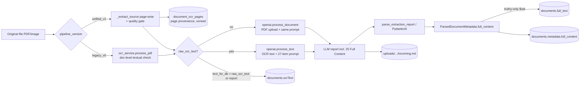
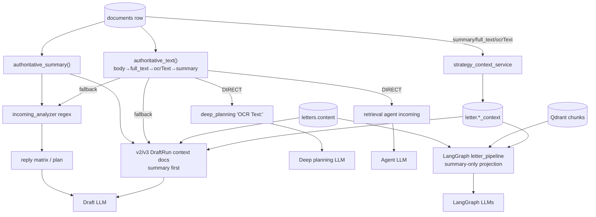
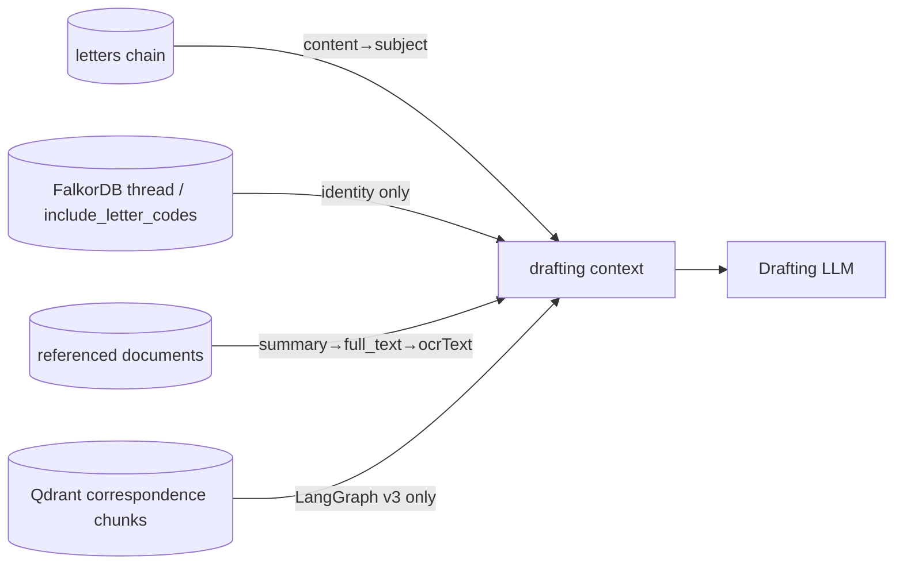
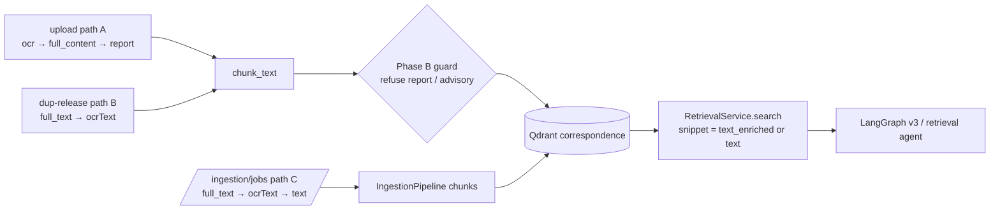
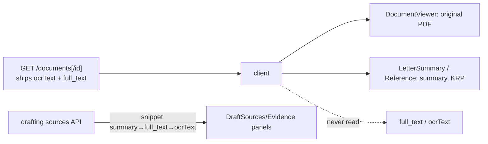
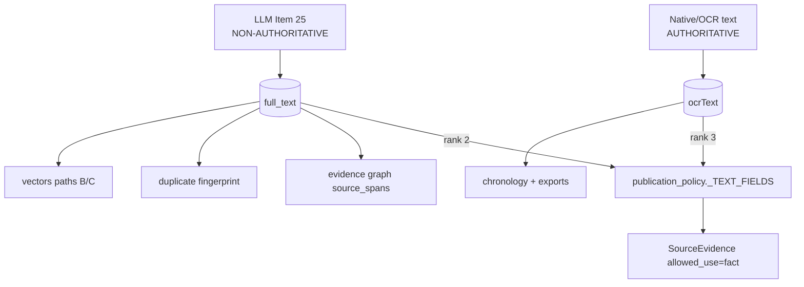
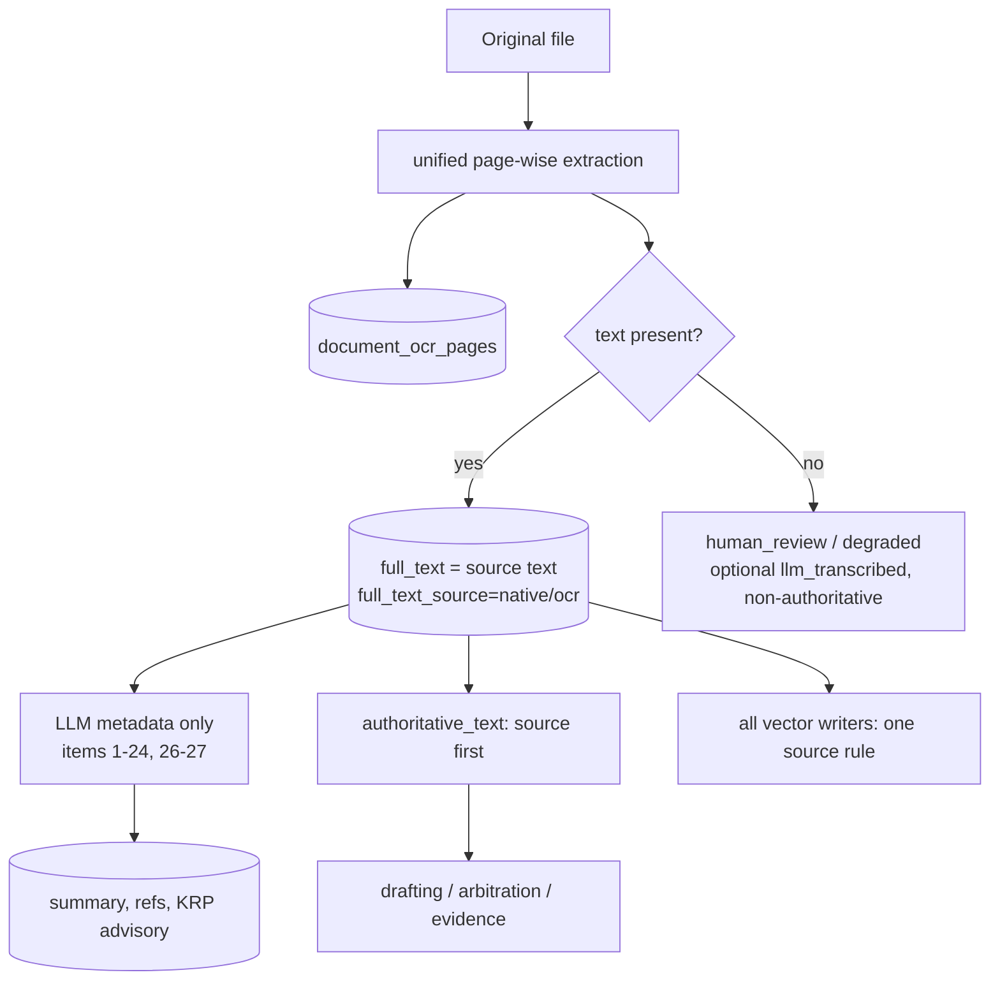

# Correspondence "Full Content" (Item 25) — usage audit

**Mode:** read-only investigation. No production source was modified.
**Date:** 2026-09-28
**Tree audited:** `C:\SaaS` on branch `integrate/key-date-eot` @ `a179ca9`, including its uncommitted working tree.
- The load-bearing lines were re-checked at `HEAD`, `main` and `release/contraclaim-rc1`, and are identical there: `_TEXT_FIELDS`, `updates["full_text"] = parsed_metadata.full_content`, the deferred-embedding order and the ingestion-pipeline order.
- Phase B (`C:\SaaS-fix-corr-qdrant`, `ef6a68f`) and prompt v4 (`C:\SaaS-fix-corr-prompt`, `44cb662`) were compared where relevant. Both still request Item 25.

**Navigation:**
- `graphify-out/` was last built 2026-08-13 and is stale, so it was not used for any conclusion.
- The graft index (built 2026-09-28) and live `rg`/`sed` reads of current source were used instead.
- Every edge cited below was read in source.

**Paths:** unless noted, paths are relative to `backend/rbac_backend/`.

---

## 1. Executive summary

1. **Item 25 is a retyped copy, not a pass-through.**
   - The prompt asks for `25) Full Content: [cleaned text of the full letter]` and tells the model to "preserve available headings, paragraphs, lists, tables, and references" (`services/openai_service.py:266,290`).
   - It is generated output, bounded by the 4096-token cap, and positioned **before** items 26/27 (tags).
2. **Storage keeps the LLM text in a separate field from the source text.**
   - `documents.ocrText` receives native/OCR text.
   - `documents.full_text` receives LLM Item 25.
   - `documents.metadata.full_content` receives Item 25 again, via the snapshot.
   - At the storage level, the LLM text does **not** overwrite OCR.
3. **At read time the LLM text outranks the source text.**
   - `publication_policy._TEXT_FIELDS = ("body", "full_text", "ocrText", "summary")` (`services/publication_policy.py:103`).
   - `authoritative_text()` / `consumable_text()` therefore return **LLM `full_text` ahead of OCR `ocrText`** for every consumer that reads "the document body".
   - The function is named *authoritative*, but it serves the non-authoritative representation first.
4. **Drafting mostly reads `summary` first** and reaches `full_text` only as a fallback.
   - Two paths use it directly as the primary body:
     - the retrieval agent (`agents/service.py:175`);
     - deep planning, which labels it `"OCR Text:"` (`routers/deep_planning.py:416-422`).
   - LangGraph v3 (`ai_workflows/langgraph/letter_pipeline.py`) never reads `full_text`. It reads `summary`, `Letter.content` and Qdrant chunks.
5. **RAG can embed Item 25.**
   - The normal upload path embeds OCR first (`document_processor.py:765`).
   - The duplicate-hold release path (`database_service.py:256`) and `POST /ingestion/jobs` (`ingestion/pipeline.py:302`) embed **`full_text` first**. The same letter's vectors therefore depend on which writer ran last.
   - Phase B's canonical writer blocks the whole *report* (Key Reply Points headings), but not Item 25 prose.
6. **Evidence-producing code treats Item 25 as source evidence.**
   - `evidence_graph_service.py:576,624` derives claim/delay/payment signals and `source_spans` from `metadata.full_content`.
   - Drafting and arbitration ledgers wrap `authoritative_text()` output as `SourceEvidence(allowed_use="fact")`.
   - Duplicate detection fingerprints `full_text` (`duplicate_detection_service.py:313`).
7. **The frontend never reads, displays or edits `full_text`.** The client has zero references. The API still ships the field in full on every `GET /documents[/{id}]`.
8. **No export writes `full_text`.** Chronology PDF/CSV exports include up to about 1000 characters of `ocrText`.
9. **The LLM-generated value is required only as a fallback**, when no native/OCR text exists. In that case the PDF is uploaded to OpenAI and Item 25 is the only body text the system gets.
   - Otherwise the *field* `full_text` is read (with an `ocrText` fallback everywhere), but the *LLM value* is never needed.

**Recommendation:** DROP ITEM 25 WHEN SOURCE TEXT EXISTS (Option B), and fix the read precedence in the same change. Converge on Option C once the no-text fallback has a deterministic replacement. Section 15 has the design.

---

## 2. Creation of Full Content

| Path | File / function | Prompt wording | Model / API | Output | Parser | Schema field |
|---|---|---|---|---|---|---|
| OCR-text path (the normal one) | `openai_service.py:136` `process_text`, called from `document_processor.py:818` | `_expanded_extraction_prompt` `:254-293`: "…preserve available headings, paragraphs, lists, tables, and references in 25) Full Content." + `25) Full Content: [cleaned text of the full letter]` | `config.openai_model` (default `gpt-4o`, `config/document_processing_config.py:113`), Chat Completions, `max_tokens=max(cfg,4096)`, `temperature=0.1` | numbered text report | `TextProcessingService.parse_extraction_report` `text_processing_service.py:265-271` (block 25/11/10 "Full content", regex fallback) | `ParsedDocumentMetadata.full_content` (`models/document_metadata.py:145`) |
| No-text path (PDF upload) | `openai_service.py:88` `process_document`, called from `document_processor.py:846` | same prompt, PDF attached as `input_file` | Responses API, `max_output_tokens=max(cfg,4096)` | numbered report | same parser | same |
| PydanticAI (off by default: `use_pydantic_ai=False`, `PYDANTIC_AI_ENABLED` env) | `pydantic_ai_service.py:175` `extract_metadata`, `_build_prompt` `:272`: `"25) Full Content: cleaned text of the full letter"` | same wording | PydanticAI agent, `max_tokens≥4096`, input trimmed to **12 000 chars** (`:39`) | structured `fullContent` | `_to_parsed_metadata` `:331`: `full_content = data.full_content or fallback_text` | same |
| Deterministic fallback (AI failed) | `document_processor.py:634` `_build_ocr_fallback_report`, `:699`: `f"25) Full Content: {text}"` | — (no LLM) | — | report containing **raw OCR verbatim** | same parser | same |

**What Item 25 is:** an LLM rewrite ("cleaned text") that is asked to keep structure. It is not a pass-through.
- In the regex fallback it *is* raw OCR.
- In PydanticAI, when the model leaves it empty, it becomes the trimmed input. That input is 12 000 chars of OCR, or the report.

**Additional facts:**
- When PydanticAI is enabled, **both** LLM calls run: first `process_text`, then the agent.
- Neither `process_text` nor `process_document` checks `finish_reason` or `status == incomplete`. **Truncation at the output cap is silent.**
- Item 25 is emitted before 26/27, so a long letter truncates the tags first and then the tail of Full Content, with no error.

---

## 3. Persistence

| Writer | Collection.field | Value | Overwrite semantics |
|---|---|---|---|
| `database_service.py:276-277` `_upsert_document_metadata` | `documents.ocrText` | kwarg `full_text` = `text_for_db = raw_ocr_text or extracted_content` (`document_processor.py:764`) | always `$set`. When `raw_ocr_text` is empty, **`ocrText` = the whole 27-item LLM report**, including Key Reply Points. |
| `database_service.py:296-297` | `documents.full_text` | `parsed_metadata.full_content` (Item 25) | `$set` **only if truthy**. A reprocess that yields no Item 25 leaves the previous LLM value in place (stale). |
| `document_service.py:1840-1841` (post-processing in `process_document_async`) | `documents.full_text` | `metadata.full_content` again | same truthy-only `$set` |
| `models/document_metadata.py:296-305` `extracted_metadata_updates` → `database_service.py:304`, `document_service.py:1856` | `documents.metadata.full_content` (nested snapshot, `model_dump`) | Item 25 | `$set` of the whole `metadata` subdocument |
| `services/metadata.py:114` `upsert_document_metadata_db_fixed` | `documents.full_content` (top level) | Item 25 | **dead**: no production caller (only in `__all__`) |
| `document_processor.py:759` → `file_service.save_summary` | `{uploads}/{org}/{project}/incoming.md` (or `outgoing.md`, `projectid.md`) | whole LLM report, Item 25 included | append-only, no publication gate, **no reader** |
| unified pipeline only: `DocumentPageStore` | `document_ocr_pages` / `document_extraction_heads` | per-page native/OCR text with provenance | versioned per run. **No drafting/RAG reader.** |

**Naming trap:** `save_document_data(full_text=...)` writes to **`ocrText`**, not `full_text`. `test_legacy_pipeline_equivalence.py:470` asserts that kwarg, not the Mongo `full_text` field.

**Human edits:**
- Neither field is editable. `DocumentUpdate` (`models/document.py:183-196`) and `DocumentSummaryMetadataUpdate` (`:199-217`) carry no text fields.
- Reprocess (`POST /documents/{id}/process`) overwrites `ocrText` and, when Item 25 is present, `full_text`.

**CAN LLM-GENERATED FULL CONTENT REPLACE OCR/NATIVE SOURCE TEXT? — PARTIAL.**
- It never overwrites `ocrText` in storage.
- It *shadows* `ocrText` at read time through `_TEXT_FIELDS`.
- When there is no OCR text, `ocrText` itself holds LLM output (the report).

---

## 4. Authoritative source text and the source-of-truth hierarchy

| Pipeline | Source text before the LLM? | Field / location | Complete? | Page provenance? | Persisted? | Used later? |
|---|---|---|---|---|---|---|
| `legacy_v0`, text-layer PDF | yes: `ocr_service.process_pdf` sidecar (`ocr_service.py:139-149`) | `raw_ocr_text` → `ocrText` | **Not always.** The document-level `is_pdf_textual` decision skips OCR for the whole file when *any* early page has text, so scanned pages in a mixed PDF are lost (`document_processor.py:377-392` docstring) | no | yes (`ocrText`) | only as fallback behind `full_text` |
| `legacy_v0`, scanned PDF | yes: OCRmyPDF sidecar (`ocr_service.py:155`) | same | yes, subject to OCR quality | no | yes | same |
| `legacy_v0`, OCR unavailable or sidecar failed | **no** (`return dest_path, None`, `ocr_service.py:136`) | — | — | — | `ocrText` = LLM report | yes: this is the case where Item 25 is the only body text |
| `unified_v1` (PDF / image / text) | yes: page-wise native + OCR (`_extract_source` `:395-446`), then the quality gate | `extraction.combined_text` → `ocrText`; per page → `document_ocr_pages` | yes (the page gate assesses every page) | **yes** (page store only) | yes | `ocrText` fallback only; page store unread |
| `unified_v1`, empty `combined_text` | no | — | — | — | PDF upload path, same as the row above | Item 25 only |
| single upload | → `DocumentService.process_document_async` → processor (either pipeline per job `pipeline_version`, `services/pipeline_routing.py`) | as above | | | | |
| bulk upload | `bulk_upload_service.py:636` → `MetadataProcessorService.process_document` → same `DocumentProcessor` | as above | | | | |
| reprocess | same processor | as above; `full_text` kept if the new Item 25 is empty | | | | |

**Read hierarchy (extracted mechanically):**

```
authoritative_text / consumable_text  (publication_policy.py:103,171-185)
  = "" if not is_consumable(doc)
  else body → full_text (LLM #25) → ocrText (OCR, or LLM report if no OCR) → summary (LLM #22)

Most drafting call sites wrap it:
  authoritative_summary(doc) → authoritative_text(doc) → subject
  (summary → full_text → ocrText → subject)
```

**Other fallbacks:**
- `document_processor.py:765` embedding: `raw_ocr_text or parsed_metadata.full_content or extracted_content`
- `database_service.py:256` deferred embedding: `doc.get("full_text") or doc.get("ocrText") or ""`
- `ingestion/pipeline.py:302` reindex: `for key in ("full_text", "ocrText", "text")`
- `strategy_context_service.py:252`: `summary or full_text or ocrText` (raw read, no policy call)
- `duplicate_detection_service.py:313-314`: `full_text or ocrText`
- `evidence_graph_service.py:576,624`: `metadata.full_content or document_data["full_text"]`
- `chronology.py:654-665`: `subject, summary, description, ocrText, ocr_text, full_content, content, text, filename`. The `full_content` read is dead because it only exists nested.
- `services/data_sync.py:24`: `document.get("full_text", "")` (standalone script against collection `contraclaim`, no callers)

---

## 5. Drafting workflow usage

| # | Workflow (entry) | Incoming letter body | Supporting docs | Previous correspondence | RAG | Summary | Full Content | Key Reply Points | References |
|---|---|---|---|---|---|---|---|---|---|
| W1 | v2 DraftRun `/api/letters/{id}/drafting/runs`, `/generate-draft` (`routers/letter_drafting.py:161,376` → `letter_drafting/service.py:136`; context `letter_drafting/context.py:57-137`) | `Letter.content` + request fields (`context.py:139-158`); `incoming_document_id` is **not** read by the context builder | `consumable_summary → consumable_text → subject`, 1000 chars (`context.py:189-193`), then 360 chars in the prompt (`generator.py:126-138`) | `letters` chain `summary→content→subject` (`context.py:547-552`); `Letter` has no `summary` field, so this is **content** | none (Mongo only) | yes, first | **fallback** (when summary empty) | no (not in payload) | graph codes: identity only |
| W1a | reply / background `/analyze-incoming` (`service.py:1326`, mode `background`) → `incoming_analyzer.py` (regex, no LLM) | `consumable_summary → consumable_text → content`, 2500 (`:242-246`) | — | — | — | yes | **fallback** | **yes**, into the deterministic reply matrix (`planning.py:106-114`), which reaches the LLM as `{plan}` | yes |
| W1b | strategy `/prepare-plan` (`service.py:1586`) | as W1 | as W1 | as W1 | — | yes | fallback | via plan | — |
| W1c | edit/regenerate `/revise-sections` (`section_editor.py`) | selected draft section only | — | — | — | — | **no** | — | — |
| W1d | exact reference `/retrieval/exact-reference` (`service.py:1234-1238`) | — | `authoritative_summary → authoritative_text → subject`, 1200 | `letters.content` | — | yes | fallback | — | yes |
| W2 | v3 engine `langgraph_v3` (`langgraph_engine.py`) and drafting queue | identical to W1 (reuses the context builder); `DraftGraphState` holds ids/flags only | = W1 | = W1 | — | = W1 | fallback | = W1 | — |
| W3 | `/api/ai-assistant/langgraph/{draft,background,strategy-plan}` (`routers/ai_assistant.py:411,422,434` → `letter_pipeline.py:144`) | `letter.content` (retrieval query `:208`; requirements fallback `:1003-1006`) | projection keeps **summary only** (`letter_pipeline.py:415-430`) | chain `summary→content→subject` (`:709-715`), plus **Qdrant chunks** (`:641-699`, `RetrievalService.search`, snippet 280/400) | **yes** | yes | **indirect** (only if the chunk was embedded from `full_text`) | no | graph codes only |
| W4 | `/api/ai-assistant/generate-draft` (`ai_service.py:183-256`, template, **no LLM**) | — | `authoritative_summary` or subject | — | — | yes | **no** | — | — |
| W5 | strategy context `/letters/{id}/strategy/context` (`strategy_context_service.py:51-166`) | letter chain `content` | `summary or full_text or ocrText` (`:252`), raw read; `full_text` also used for role inference (`:145`) | chain `content` | — | yes | **fallback**, then re-summarised by LLM, persisted to `letter.*_context`, and re-injected into W1/W3 | — | — |
| W6 | deep planning `/api/deep-planning/generate-draft` (`routers/deep_planning.py:832`) | `letters.ocrText[:1200]` (`:933`, likely empty) | `Summary:` + **`"OCR Text: " = authoritative_text(doc)[:4000]`** (`:416-422`) | similar letters: subject only | `document_vectors.text` (Mongo cosine) | yes | **DIRECT, labelled as OCR** | — | yes |
| W7 | retrieval agent `POST /api/v1/retrieval/agent` (`agents/service.py:36,124-175`) | `authoritative_text(doc)` untruncated | — | — | Qdrant snippets | no | **DIRECT (primary)** | — | — |

**LangGraph structural requirement:** none.
- No LangGraph state (drafting or arbitration) declares `full_text` or `document_text`.
- `DraftGraphState` (`langgraph_engine.py:49-70`) is deliberately text-free.
- `letter_pipeline.py` uses closure locals that carry `summary`.

**FIELD REQUIRED: no. LLM VERSION REQUIRED: no.**

---

## 6. Previous-correspondence usage

- **Conversation chain** (`ConversationService.get_authorized_conversation_chain`, Mongo `letters`):
  - Uses `Letter.content`, falling back to `subject`.
  - `Letter` has no `summary` field (`models/letter.py`, `extra="ignore"`).
  - `content` is user-supplied; nothing copies `ocrText` or `full_text` into it.
  - **No Full Content.**
- **`include_letter_codes` / FalkorDB thread:** identity (code/label) only, no text.
- **Qdrant correspondence chunks** (W3 only): chunk `text` / `text_enriched`. That text is OCR on first upload, but **`full_text`** after a duplicate-hold release or an `/ingestion/jobs` reindex.
- **Referenced documents** (W1d, W5, W6): `summary`, then `full_text`, then `ocrText`.

**Verdict: INDIRECT/FALLBACK.** The historical letter's LLM Full Content reaches drafting only through a summary-less document fallback, through vectors written by the dup-release or reindex paths, or through deep planning.

---

## 7. RAG usage

| Writer | Text source | LLM Full Content embedded when |
|---|---|---|
| A. upload `_save_results` → `save_document_data` → `_create_and_store_embeddings` | `raw_ocr_text or full_content or extracted_content` (`document_processor.py:765`) | only when there is no OCR text. **Main:** falls through to the whole report. **Phase B:** `refuse_report_derived_text` refuses the report, but Item 25 prose passes. |
| B. duplicate-hold release `create_embeddings_for_document` | `full_text or ocrText` (`database_service.py:256`; Phase B `:266` unchanged) | **whenever Item 25 was non-empty**, i.e. almost always |
| C. `POST /ingestion/jobs` → `IngestionPipeline._extract_text` | `full_text, ocrText, text` (`ingestion/pipeline.py:302`) | **always first**. Writes flat points without `payload_schema_version`, and never goes through the Phase B builder |
| D. `data_sync.py` | `full_text` | always (dead script) |
| E/F/G. storage-sync resync, `VectorReconciler`, `scripts/reconcile_vectors.py` | re-embed stored chunk text | inherit A/B/C |

**Retrieval** returns chunk text only (`retrieval/service.py:874-878`). `_fetch_documents_meta` re-hydrates `title` and `letterNo`, not `full_text`.

**Key Reply Points:**
- Phase B excludes them from the payload (`ADVISORY_FIELDS`), from chunk text (`has_advisory_report_item`) and from whole text (`refuse_report_derived_text`).
- Main copies `key_reply_points` into Qdrant/`document_vectors` *metadata* (not embedded text) (`database_service.py:440-464`).
- Main's path-A fallback can embed the report *with* Key Reply Points.

**CAN LLM FULL CONTENT ENTER VECTOR TEXT? — CURRENTLY YES**, on paths B and C always, and on path A when there is no OCR text.

---

## 8. LangGraph / LangChain usage

- **LangChain:**
  - `LangChainVectorService.replace_document` embeds whatever text writer A/B passes in.
  - Splitting is `TextProcessingService.chunk_text` over that text.
  - Nothing is specific to `full_text`.
- **LangGraph letter:** `letter_pipeline.py` reads `summary`, `Letter.content` and Qdrant chunks. `langgraph_engine.py` has a text-free state.
- **LangGraph arbitration:** it has no state field for text. Nodes read through `authoritative_summary → authoritative_text` (`arbitration_drafting/context.py:726-732, 1061-1065`; `service.py:964-968`) and `_first(... "full_content" ...)` (`agents/deterministic.py:205`, `agents/llm.py:561`). `_first` also searches nested `metadata`, so it can reach `metadata.full_content` when `subject`, `summary` and `description` are all absent.

**Result:** FIELD REQUIRED = no (every read has an `ocrText` fallback). LLM-GENERATED VERSION REQUIRED = no.

---

## 9. Frontend usage

- `client/src` has **zero** references to `full_text`, `fullText`, `full_content`, `fullContent`, `ocrText` or `extracted_text`. The only hit is the unused helper name `fullTextSearch` (`services/search-api.ts:217`), and that endpoint has no backend route.
- The UI shows:
  - the **original PDF** (`DocumentViewer.tsx:79,92`, presigned URL or `/documents/{id}/download` blob);
  - the LLM **summary** (`LetterSummaryPage.tsx:519`, `ReferencePage.tsx:507`);
  - `key_reply_points`, keywords and clauses on the Letter Summary page.
- **Truncated snippets** on the drafting evidence panels come from `summary → full_text → ocrText`: `DraftSourcesPanel.tsx:173`, `DraftEvidencePanel.tsx:218,272`, and arbitration `ArbitrationDraftingPage.tsx:830`. So an Item 25 fragment is user-visible there when a document has no summary.
- **Editing:** none. `MetadataEditor` (`PUT /documents/{id}`) and the Letter Summary edit (`PATCH /documents/{id}/summary-metadata`) carry no text fields.
- **Waste:** `GET /documents/{id}` and `GET /documents` (up to 1000 rows) return `ocrText` and `full_text` in full, because `models/document.py:86-87` has no exclusion and there is no projection. The client downloads the text and ignores it.

---

## 10. Other contractual workflows

| Workflow | Use | Class |
|---|---|---|
| Evidence graph / project events (`evidence_graph_service.py:576,624,631-663`) | `metadata.full_content or full_text`, up to 20 000 chars for hashing and 12 000 for classification. Drives `document_class`, the `claim_type` and `delay_responsibility` fallbacks, payment/milestone/drawing refs and **`source_spans`** | **DIRECT**. This is the path by which EOT/delay/payment signals see Item 25. |
| Chronology suggested events (`chronology.py:654-665`) | `ocrText` + summary; `full_content` read is dead | none directly (the report arrives via `ocrText` when there is no OCR) |
| Claims, variations, key dates / EOT services | no reads of document text fields | none directly; indirect via evidence-graph events |
| Arbitration SOC/SOD/rejoinder ledger (`arbitration_drafting/context.py:727,1063`; `service.py:966`) | `summary → full_text → ocrText` | **FALLBACK** |
| Arbitration document index / understanding (`deterministic.py:205`, `llm.py:561`) | `subject → summary → description → full_content` | fallback (effectively `subject`) |
| Contract QA / claim assessment / appraisal | clause-first (`contract_clauses` namespace), `uploadType=contract` filter | **none** |
| Duplicate detection (`duplicate_detection_service.py:313`) | `full_text or ocrText` fingerprint | **DIRECT**. Two uploads of the same letter get different LLM paraphrases. |
| FalkorDB / Graphiti | summary, keywords, `key_reply_points`; no body text | none |

---

## 11. Export usage

| Export | Contains Item 25? |
|---|---|
| Chronology PDF (`chronology.py:1009-1025`) / CSV-as-xlsx (`:969-986`) | no. `description` holds up to about 900–1000 chars of **`ocrText`** + summary. When no OCR text existed, that `ocrText` is the LLM report. |
| Chronology DOCX | no |
| Documents XLSX (`export_service.py:21-39`) | no |
| Reports download | summary only |
| Letter draft DOCX/PDF, arbitration draft/bundle, bulk ZIP, email share | no (drafted body or original bytes). Bundle `relevance_note` can fall back to `full_content` but is effectively `subject`. |
| `incoming.md` / `outgoing.md` summary files | **yes** (the whole report), but not exported or read |

**EXPORTS USE IT: NO.** The single exception is indirect: chronology exports carry `ocrText`, which is the report when there was no OCR.

---

## 12. Token impact

**Measurements:**
- Tokenizer: `tiktoken` `o200k_base` (the gpt-4o encoding) in `backend/.venv`.
- Only one repository fixture has native text: `client/public/letter1.pdf`. It is 1 page, 216 words, **372 tokens**.
- The other two sample letters (`GLM-SAM-KNPCC-05-UPMRC-OL-2025-4763.pdf`, 2 pages; `Kanpur-LET-JVTI-CPM-01278-E01.pdf`, 3 pages) are scanned. This machine has no local OCR (no tesseract or ocrmypdf), so they could not be measured.

**Projection:**
- Multi-page figures are **estimates**: measured light page (372) to an assumed dense contractual page (~500 words ≈ 650 tokens).
- Item 25 output ≈ source-text tokens (a "cleaned" copy that keeps structure).
- Items 1–24 plus 26–27 are estimated at **600–1 200 tokens**. Summary v4 is chronological, and Key Reply Points is a list.

| Letter | Item 25 output (est.) | Left for items 1–24, 26–27 under the 4096 cap | Outcome |
|---|---|---|---|
| 1 page | 370–650 | 3 450–3 700 | fits |
| 3 pages | 1 100–1 950 | 2 150–3 000 | fits |
| 5 pages | 1 850–3 250 | 850–2 250 | **at risk** on dense letters: 26/27 tags truncated first |
| 10 pages | 3 700–6 500 | 0–400 | **truncated**: tags lost, Item 25 tail lost, silently (no `finish_reason` check) |

- **With Item 25 removed**, the report needs about 600–1 200 output tokens regardless of page count. The 4096 cap then becomes a comfortable ceiling.
- The saving is about **370–650 output tokens per page**. That is roughly 40–85 % of the output on a 3–10 page letter, and the saved tokens are output tokens, the slower and costlier side.
- Input tokens are unchanged: the OCR text is still sent.

---

## 13. Risk assessment

| Risk | Present today? | Evidence |
|---|---|---|
| Truncation | **yes**, silent, on long letters | 4096 cap; Item 25 precedes 26/27; no incomplete check (`openai_service.py:115,166`) |
| Paraphrase / omitted paragraphs / "cleaned" wording | inherent in the prompt ("cleaned text") | `openai_service.py:290` |
| Altered numbers, dates, letter numbers, clause wording | possible; not measured | no paired fixture exists (section 17) |
| Loss of tables / layout | possible; the prompt asks to preserve them in Markdown | `:266` |
| Loss of page provenance | **yes**: `full_text` has no page mapping. The page store is unused downstream. | section 4 |
| Hallucinated text | possible; the model is not constrained to spans | — |
| PydanticAI 12 000-char trim becoming `full_text` | yes when enabled and Item 25 is empty | `pydantic_ai_service.py:39,331` |
| Stale `full_text` after reprocess | yes (truthy-only `$set`) | `database_service.py:296` |

**Is Full Content treated as source evidence or convenience text? It is treated as SOURCE EVIDENCE.**

**⚠ FLAG — evidence-producing workflows consume LLM-retyped text as if it were the source:**
1. `publication_policy.authoritative_text()` returns `full_text` ahead of `ocrText`, and callers wrap it as `SourceEvidence(allowed_use="fact")`. See `letter_drafting/context.py:195-205` and `letter_drafting/service.py:1239-1248`, plus the arbitration ledger.
2. `routers/deep_planning.py:416-422` inserts it into the prompt under the label **"OCR Text:"**.
3. `evidence_graph_service.py:576-663` builds `source_spans` and claim/delay signals from it.
4. Duplicate detection fingerprints it.
5. Vector paths B/C embed it, so RAG citations can quote LLM prose as letter text.

---

## 14. What breaks if Item 25 is removed and `full_text` is populated from native/OCR text

**Classification:**
- **B (FIELD REQUIRED, LLM VALUE NOT REQUIRED)** for every reader.
- **C (ONLY REQUIRED AS FALLBACK)** for the no-source-text case.
- **E (dead)** for `services/metadata.py` `full_content` and `data_sync.py`.

Exact code paths affected:

1. **No-text files** (legacy with OCR unavailable or a failed sidecar, `ocr_service.py:136`; unified with empty `combined_text`):
   - The PDF is uploaded, and no body text exists except Item 25.
   - Without it, `full_text` is empty and `ocrText` = the report (with Key Reply Points).
   - `authoritative_text` then returns the **report** to drafting as fact.
   - Main's path-A embedding embeds the report; Phase B refuses it, so the document gets 0 vectors.
   - **Needs a deterministic replacement before Item 25 goes** (Option C).
2. **`database_service.py:296-297` and `document_service.py:1840-1841`**: must write `full_text` from the source text rather than `metadata.full_content`. Otherwise existing rows keep their old LLM `full_text` forever, because the `$set` is truthy-only.
3. **`pydantic_ai_service.py:331`**: `or fallback_text` would put a **12 000-char-truncated** input into `full_content`.
4. **`text_processing_service.py:265-271`** parser: tolerates absence (`Optional`). Keep item numbers 26/27 unchanged; the parser keys on them.
5. **Existing data**: every stored row carries LLM `full_text` and `metadata.full_content`. It needs a backfill/unset, or `_TEXT_FIELDS` must stop preferring it.
6. **Existing vectors**: those written by paths B/C carry LLM text and need a reindex.
7. **Tests pinning current behaviour**:
   - `test_metadata_critical.py:160,226` (parser `full_content`)
   - `test_publication_policy_consumers.py:124` (`body → full_text → ocr` precedence)
   - `test_document_processor.py:145` (mock report)
   - the `*_authority_red.py` fixtures that pass `full_content=SOURCE_TEXT`
8. **Prompt versioning**: `METADATA_EXTRACTION_PROMPT_VERSION` (prompt v4 branch) must bump.

**Nothing breaks** in: the frontend, exports, LangGraph state, Contract QA, chronology (reads `ocrText`), FalkorDB and Graphiti.

---

## 15. Recommended architecture

**Option A — keep Item 25.**
- Benefit: body text exists even when there is no OCR.
- Costs:
  - 370–650 output tokens per page;
  - silent truncation above about 5 dense pages;
  - tags lost first;
  - LLM prose served as source.
- **Not recommended.**

**Option B — drop Item 25 when source text exists (recommended next step).**
- **Extraction:**
  - Compose the prompt without Item 25 when `raw_ocr_text` is non-empty (the `process_text` path).
  - Keep it only on the PDF-upload (no-text) path.
  - Keep numbering 26/27 unchanged.
- **Persistence:** `full_text = raw_ocr_text` (unified: `extraction.combined_text`), and record `full_text_source ∈ {native, ocr, llm_retyped}`.
- **Reads:**
  - Make `authoritative_text` prefer the authoritative source: `body → ocrText(if source≠llm_report) → full_text → summary`.
  - Alternatively, put the source-kind check in the accessor.
  - Relabel deep planning.
- **Vectors:** make paths B and C use the same source rule as A.
- **Code touched:** `openai_service`, `pydantic_ai_service` prompt/`_to_parsed_metadata`, `document_processor._save_results`, `database_service._upsert_document_metadata` + `create_embeddings_for_document`, `document_service` post-process write, `ingestion/pipeline._extract_text`, `publication_policy._TEXT_FIELDS`, plus the tests in §14.7.

**Option C — never ask the LLM for Full Content.**
- Always build text deterministically from native/OCR extraction.
- For no-text files, replace the PDF-upload path with the unified pipeline's page-wise OCR / fallback ladder.
- If that still yields nothing, mark the document `human_review_required` / `degraded` and do **not** substitute LLM text as fact. A vision-model transcription could be stored as `full_text_source=llm_transcribed` and gated as non-authoritative.
- **Target state.** It depends on the unified pipeline being globally accepted and legacy_v0 being retired.

---

## 16. Migration requirements

1. Add a `full_text_source` provenance field. Populate new writes from the source text.
2. **Backfill:** for rows with non-empty `ocrText` that is not report-derived (`has_advisory_report_item` false), set `full_text = ocrText` and `full_text_source = native|ocr`. Unset `metadata.full_content` or mark it `llm_retyped`.
3. Rows whose `ocrText` is report-derived (the no-OCR case): mark them `full_text_source=llm_retyped` and queue them for unified re-extraction.
4. Reindex correspondence vectors written by paths B/C (Phase B backfill plan `docs/audits/correspondence-qdrant-backfill-plan.md` is the natural carrier).
5. Recompute the duplicate-detection fingerprints and evidence-graph `source_spans` for affected documents.
6. Project `ocrText` / `full_text` out of `GET /documents` list responses. The client doesn't use them.
7. Bump the extraction prompt version and update the pinned tests.
8. Run the migration dry run (`migrate_database --fail-on-warning`) inside the backend container, per CLAUDE.md.

---

## 17. Mermaid diagrams

Diagrams are hand-built from the verified call paths above. Graphify is stale.

### Graph 1 — creation and persistence



### Graph 2 — incoming letter to drafting



### Graph 3 — previous correspondence



### Graph 4 — chunking, Qdrant, RAG



### Graph 5 — frontend reads



### Graph 6 — as-is source of truth



### Graph 7 — to-be (Option B → C)



---

## Section 17 (brief) — native/OCR vs LLM Full Content fixture comparison

**Not performed; no evidence available.**
- No fixture in the repository pairs a real letter's source text with a stored LLM Item 25.
- The test reports use placeholders ("Full text", "Cleaned full letter body here.").
- The two scanned samples could not be OCR'd on this host.
- `letter1.pdf` native text: 216 words, 32 lines, 3 currency amounts, 1 date.
- A paired comparison needs Item 25 values from staging Mongo (`documents.full_text` vs `ocrText`), compared by length, paragraph count, dates, amounts and reference codes. That is a read-only query, recommended before the Option B change.

---

## Final report

| Question | Answer |
|---|---|
| ITEM 25 CREATED BY | `services/openai_service.py:254-293` (`process_text`, `process_document`); `services/pydantic_ai_service.py:272` (when enabled); `document_processor.py:699` (regex fallback, raw OCR) |
| ITEM 25 STORED IN | `documents.full_text` (`database_service.py:297`, `document_service.py:1841`); `documents.metadata.full_content` (snapshot); `uploads/.../incoming.md` (report). Top-level `documents.full_content` only via the dead `metadata.py` writer. |
| AUTHORITATIVE OCR/NATIVE TEXT AVAILABLE BEFORE LLM | **PARTIAL**: yes when `raw_ocr_text` is non-empty; no when OCR is unavailable or empty (PDF-upload path); legacy can miss scanned pages of mixed PDFs |
| LLM FULL CONTENT OVERWRITES AUTHORITATIVE TEXT | **NO** in storage (separate field). It **outranks** OCR at read time, and when there was no OCR, `ocrText` itself holds the LLM report. |
| LETTER DRAFTING USES LLM FULL CONTENT | **FALLBACK**: summary first, then `full_text` before `ocrText`. **DIRECT** in deep planning and the retrieval agent. |
| REPLY DRAFTING USES IT | **FALLBACK** (`incoming_analyzer`, via plan) |
| BACKGROUND DRAFTING USES IT | **FALLBACK** (v2 `/analyze-incoming`); v3 `/langgraph/background`: **INDIRECT** (vectors only) |
| STRATEGY DRAFTING USES IT | **FALLBACK** (`strategy_context_service.py:252`; v2 `/prepare-plan`) |
| LANGGRAPH DRAFTING USES IT | **INDIRECT** (Qdrant chunks from paths B/C only) |
| PREVIOUS CORRESPONDENCE USES IT | **INDIRECT** (chain uses `letters.content`; referenced docs fall back to it; vectors) |
| RAG INDEXING USES IT | **SOMETIMES**: always on dup-release and `/ingestion/jobs`; on upload only with no OCR |
| CONTRACT QA USES IT | **NO** |
| CHRONOLOGY USES IT | **NO** (reads `ocrText`; the `full_content` read is dead) |
| CLAIMS/EOT USES IT | **INDIRECT** (evidence-graph events built from Item 25) |
| ARBITRATION USES IT | **INDIRECT** (ledger fallback `summary→full_text`) |
| FRONTEND DISPLAYS IT | **NO**. Shipped in `GET /documents` payloads but never rendered. Fragments appear only in drafting/arbitration evidence snippets when summary is empty (`DraftSourcesPanel`, `DraftEvidencePanel`, `ArbitrationDraftingPage`). |
| EXPORTS USE IT | **NO** |
| FIELD `full_text` REQUIRED BY ACTIVE CODE | **YES**. It is read by the policy accessor, duplicate detection, evidence graph, strategy context, dup-release and ingestion vectors, and every read has an `ocrText` fallback. |
| LLM-GENERATED VALUE REQUIRED | **FALLBACK ONLY** (no-source-text files) |
| IF ITEM 25 REMOVED, BREAKING PATHS | 1. No-OCR files: no body text, `ocrText` = report reaches drafting as fact, and 0 vectors in Phase B. 2. `database_service.py:296` / `document_service.py:1840`: stale LLM `full_text` kept (truthy-only `$set`) unless the writer switches source. 3. `pydantic_ai_service.py:331`: 12 000-char-truncated input becomes `full_content`. 4. Pinned tests (`test_metadata_critical`, `test_publication_policy_consumers:124`, `test_document_processor:145`, authority-red fixtures). 5. Existing rows and vectors keep LLM text until backfilled and reindexed. |
| CAN NATIVE/OCR TEXT REPLACE ITEM 25 | **PARTIAL**: yes wherever source text exists; not for the no-text path without an Option C fallback |
| TOKEN SAVING IF REMOVED | ~370–650 output tokens/page: ~0.4–0.65k (1p), 1.1–2k (3p), 1.9–3.3k (5p), 3.7–6.5k (10p). This removes the silent-truncation risk. Estimated from one measured page. |
| SOURCE-AUTHORITY IMPROVEMENT | Drafting "facts", evidence spans, duplicate fingerprints and vectors would cite the letter's actual text rather than an LLM retype. Page provenance becomes reachable. |
| RECOMMENDATION | **DROP WHEN SOURCE TEXT EXISTS** (Option B, with read-precedence fix), then converge on Option C |
| CONFIDENCE | **HIGH** for call paths and field flows (read in source). **MEDIUM** for token figures (one measured fixture). **LOW** for data-quality drift (not measured). |
| PRODUCTION SOURCE MODIFIED | **NO** |
