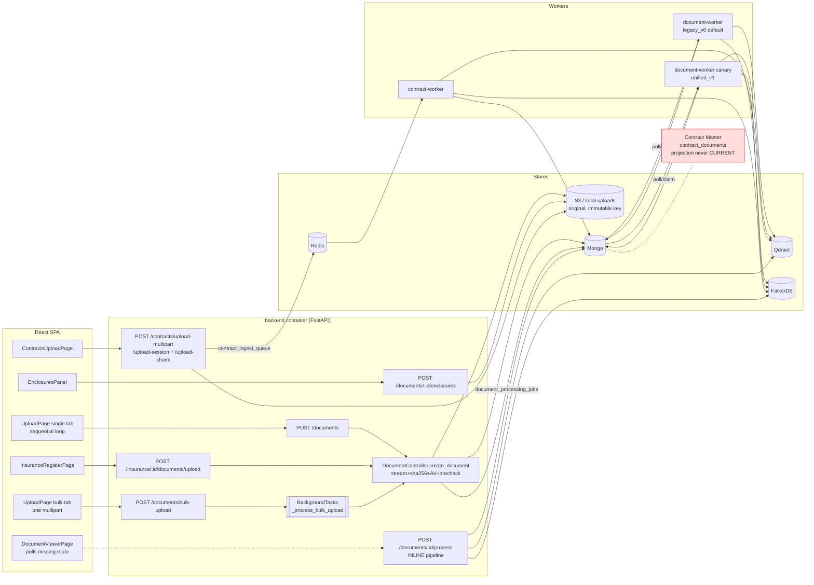
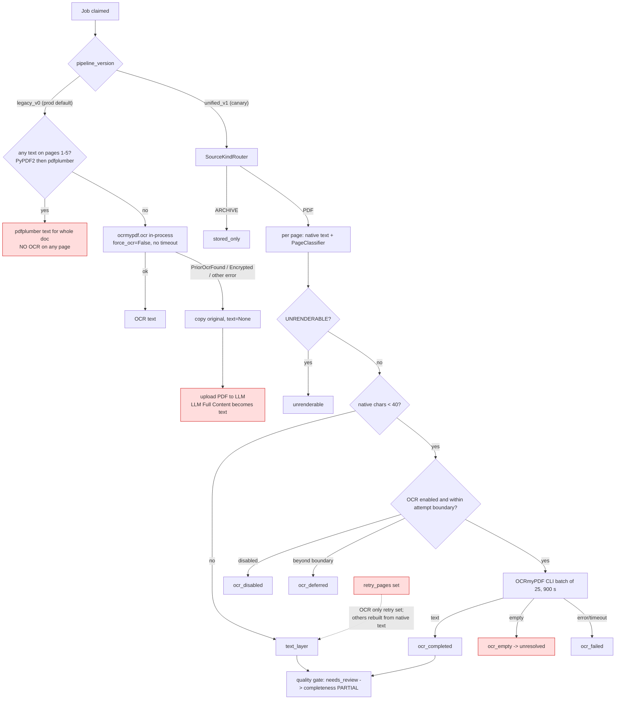
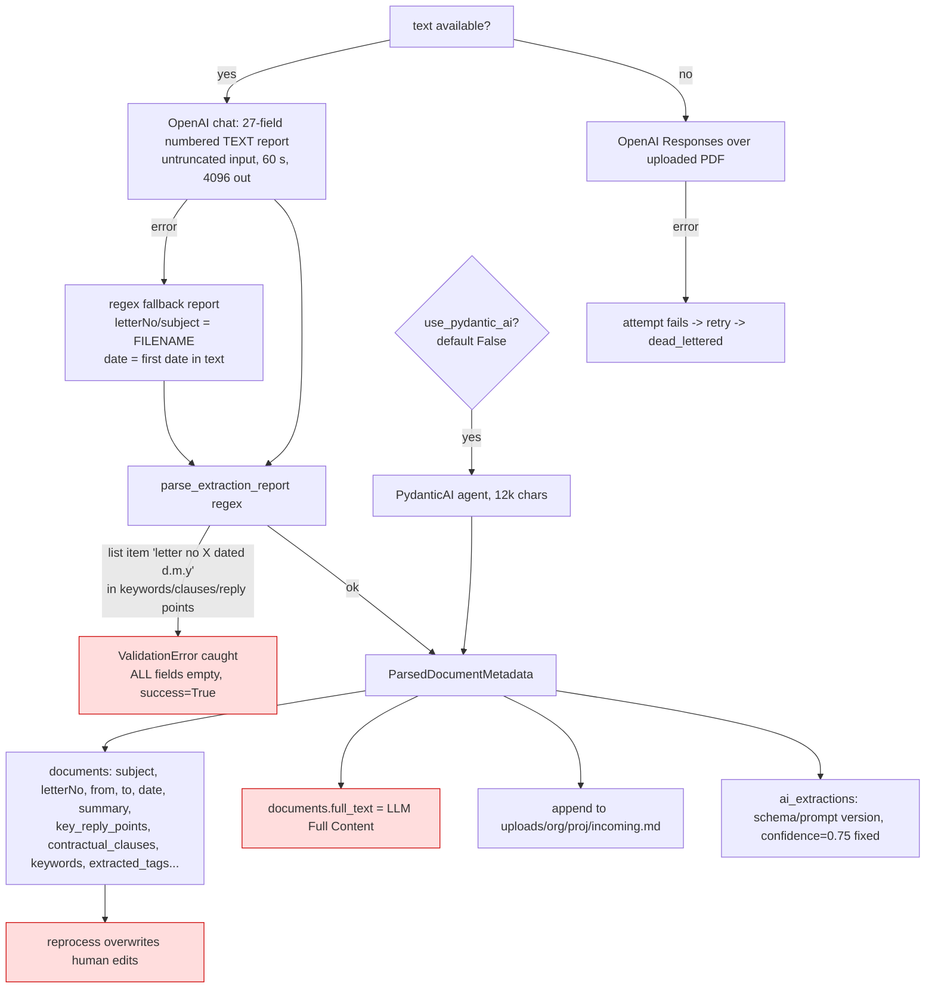
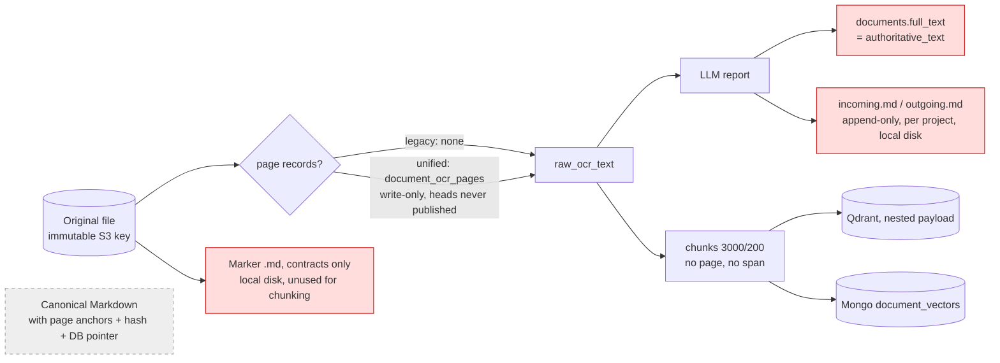
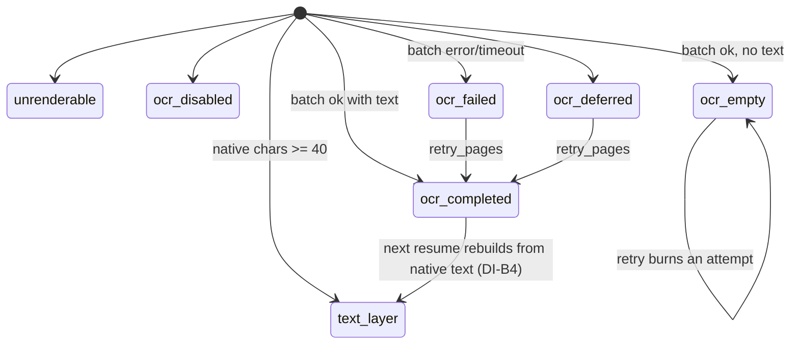
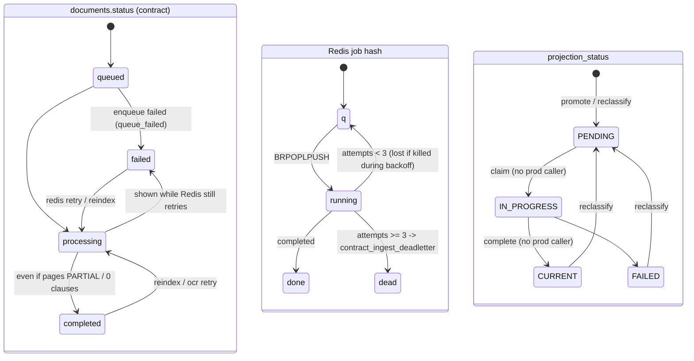
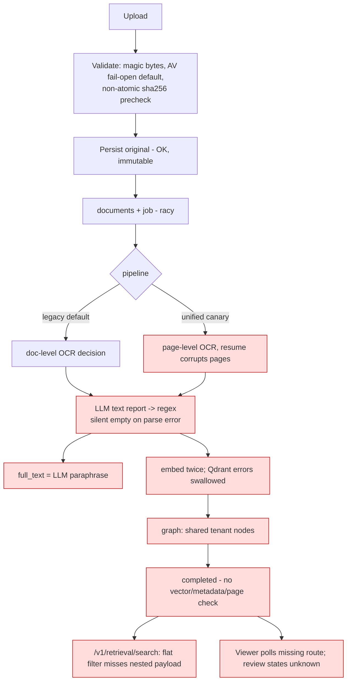
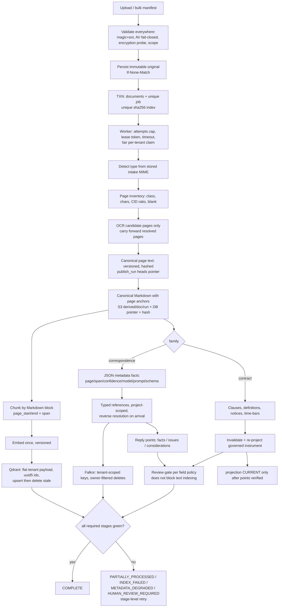

# Document Ingestion — Graphs

Read-only audit, 2026-09-27, working tree on `integrate/key-date-eot` @ `a179ca9` (dirty).

**Graphify output:** `docs/audits/document-ingestion-graphify/`. It is a focused AST graph (no LLM, 0 tokens) over 95 ingestion files: routers for documents, letters and contracts; `ingestion/`, `services/extraction*`, upload, bulk, OCR, metadata, references, duplicate detection, the contract ingest/queue/clause/promotion/reprojection modules, publication policy, graph and retrieval; plus `UploadPage.tsx`, `DocumentsPage.tsx` and the upload client services.
- `graph.html` is the interactive view, coloured by community with labels.
- `graph.json` is node-link JSON.
- `GRAPH_REPORT.md` covers god nodes, communities and cohesion.
- `labels.json` holds the community names.
- Size: 2100 nodes, about 4.7k edges, 98 communities.
- The main communities include: Letter API router, Extraction quality gate checks, Letter service, Graph ingestion, Contract clause index, Evidence ladder, Publication authority policy, Background job processor, FalkorDB letter graph, Contract Master API, Bulk upload service, Contract ingest queue worker, Extraction engine + page classifier, Page stores, Reference sync, Retrieval service, OCR service, Duplicate detection, Contract upload streaming, Metadata processor, Contract ingestor, Document processor + fallback ladder, Contract promotion, Qdrant vector client.

**Graphify limitation, which is itself a finding:** static edges stop at dynamic handoffs. There is no static path `upload_contracts_multipart → ContractIngestor`, `ContractIngestQueue → ContractIngestor` or `ContractIngestor → ClauseChunkingAgent`, because these go through Redis payloads and callbacks. The Graphify "surprising connections" (Python `UploadFile`/`Document` ↔ TSX pages) are name collisions, not real edges.

The Mermaid diagrams below were drawn by hand from the file:line evidence in the companion docs. Only real status constants are used.

---

## GRAPH 1 — Overall document ingestion architecture (AS-IS)



## GRAPH 2 — Single correspondence upload sequence (production default legacy_v0)

```mermaid
sequenceDiagram
  autonumber
  participant B as Browser (UploadPage)
  participant A as API /documents
  participant V as Validation+AV+precheck
  participant S as S3/local
  participant M as Mongo
  participant W as document-worker
  participant O as OCRService (legacy)
  participant L as OpenAI
  participant Q as Qdrant
  participant G as FalkorDB
  B->>A: POST multipart (one file; loop per file)
  A->>A: PolicyService.authorize(dms.document.upload) ×3
  A->>V: spool, sha256, magic bytes, AV (fail-open default), precheck_upload
  V-->>A: ok | 409 duplicate | letterNo match -> duplicate_status=pending
  A->>S: store original {org}/{proj}/{dir}/{Y}/{M}/{uploadId}_...
  A->>M: insert documents; $set sha256 (best effort)
  A->>M: insert document_processing_jobs {status: queued}
  A-->>B: 201 -> navigate to viewer
  B->>A: GET /documents/{id}/processing-status
  A-->>B: 404 (route missing) -> UI shows nothing
  W->>M: find_one_and_update queued|retrying -> processing (no attempts cap)
  W->>S: download whole file -> tmp/document_processing/<filename>
  W->>O: is_pdf_textual(first 5 pages)?
  alt any text
    O-->>W: pdfplumber text (no OCR for any page)
  else none
    O-->>W: ocrmypdf in-process (no timeout) | failure -> None
  end
  alt have text
    W->>L: process_text (27-field numbered report)
  else no text
    W->>L: upload PDF, Responses API
  end
  L-->>W: report | error -> regex fallback (filename as letterNo)
  W->>W: parse_extraction_report (exception -> EMPTY metadata, success)
  W->>M: documents.{ocrText, full_text=LLM Full Content, subject, ...}
  W->>Q: replace_document (delete then add; error -> 0, swallowed)
  W->>M: document_vectors (second embedding pass)
  W->>G: graph + evidence (swallowed); reference sync; sync_document_to_falkor (raises -> retry all)
  W->>M: job completed; documents.processing_status=completed (no vector check)
```

## GRAPH 3 — Bulk correspondence upload sequence

```mermaid
sequenceDiagram
  autonumber
  participant B as Browser (bulk tab)
  participant N as nginx (200m cap)
  participant A as API /documents/bulk-upload
  participant T as BackgroundTask (in API process)
  participant C as create_document
  participant M as Mongo
  participant W as document-worker
  B->>N: ONE multipart: CSV + up to 100 files
  N->>A: (413 if >200 MB although config allows 500 MB)
  A->>A: authorize; count/size checks; temp-copy files
  A->>M: bulk_upload_jobs {status: processing} (no org/user)
  A-->>B: job_id
  A->>T: schedule
  loop each CSV row, sequential
    T->>C: create_document(row) -> AV, precheck, store, insert, enqueue job
    C-->>T: ok | error (row failure recorded, loop continues)
    T->>M: rewrite full results array
  end
  T->>M: completed | completed_with_errors | failed
  Note over T: process restart = job stuck "processing", tail rows lost, temp files gone
  loop every 3 s, max 200 polls
    B->>A: GET /bulk-upload/{job_id}/status (no owner check)
    A-->>B: rows + processing_status/stage/duplicate_status
  end
  W->>M: each row's job processed independently (see Graph 2)
  Note over B: no per-file retry, no server cancel, no resume after refresh
```

## GRAPH 4 — Contract-document upload sequence

```mermaid
sequenceDiagram
  autonumber
  participant B as ContractsUploadPage
  participant A as /contracts/upload-*
  participant S as S3/local
  participant M as Mongo
  participant R as Redis
  participant W as contract-worker
  participant E as PageExtractionEngine
  participant Q as Qdrant
  participant G as FalkorDB
  participant K as ClauseChunkingAgent
  B->>A: multipart (<=5MB) or session + chunks
  A->>A: authorize per file; MIME pdf/docx; AV; NO duplicate precheck
  A->>S: {org}/{proj}/contracts/{uploadId}_{file}
  A->>M: documents(uploadType=contract,status=queued), contracts, contract_versions, sessions, contract_ingest_jobs
  A->>R: enqueue contract_ingest_job:{upload_id} (no-op if queued/running)
  W->>R: BRPOPLPUSH -> running (attempts+1, heartbeat)
  W->>E: pages (OCR <40 chars, batches of 25) -> contract_ocr_pages
  Note over E: completeness=PARTIAL ignored; DOCX bypasses engine
  W->>W: clean, categorize, Marker (unused), regex ClauseExtractor
  W->>M: document_vectors delete+insert
  W->>Q: clause payloads (uuid5 ids, rich page lineage)
  W->>G: upsert_contract_graph (sync, MERGE, no delete)
  W->>K: _run_clause_indexing_safe (errors swallowed)
  K->>M: contract_clauses upsert by clause_uid
  K->>Q: namespace contract_clauses, point id = SHA-1 hex (likely rejected)
  W->>M: documents.status=completed
  Note over M: contract_documents / projection untouched (PENDING forever)
```

## GRAPH 5 — OCR / extraction decision graph



## GRAPH 6 — Metadata extraction graph



## GRAPH 7 — Markdown generation / artifact lineage (AS-IS vs gaps)



## GRAPH 8 — Reference-linking graph

```mermaid
flowchart TD
  L[LLM prompt #6 references list] --> RP[reference_parser<br/>needs 'dated|dtd|dt' and 'no|number|#']
  RP --> N[normalize_letter_code: lower, non-alnum -> '-']
  N --> R1{"explicit documentId?"}
  R1 -- no --> R2["find letterNoNormalized == code<br/>scope: org + project<br/>org-only if source has no project"]
  R2 -- miss --> R3[case-insensitive exact letterNo]
  R2 & R3 -- hit --> LK[references / referencedBy<br/>bucket source=parser]
  R3 -- miss --> UQ[reference_sync_queue<br/>daily reaper 08:45, 200/run<br/>expires after 30 days]
  LK --> FG[("Falkor :Letter normCode<br/>SHARED across tenants")]
  FG --> TH[get_thread 6 hops -> drafting context<br/>graph_codes_denied has no org filter]:::bad
  DEL[delete_letter preserve branch<br/>deletes ALL outgoing edges] --> FG
  MAN[manual links bucket source=manual] --> LK
  NR["Not recognised: Ref. #91;1#93; lists, drawings, BOQ, VO, IPC/RA, EOT, attachments"]:::bad
  classDef bad fill:#fdd,stroke:#c00
  class DEL bad
```

## GRAPH 9 — Persistence map

```mermaid
flowchart LR
  subgraph Object["Object storage / disk"]
    S3A[S3 /org/proj/incoming|outgoing|contracts|enclosures<br/>ORIGINALS - authoritative]
    LD[local uploads/ + incoming.md + marker/ + ocr_batches/ + tmp/document_processing]
  end
  subgraph Mongo
    DOC[documents<br/>record + derived text/metadata, no revisions]
    FO[file_objects / document_versions]
    JOB[document_processing_jobs<br/>no indexes]
    PG[document_ocr_pages/_batches<br/>unified only]
    HD[document_extraction_heads<br/>never written]
    DVX[document_vectors]
    VSS[vector_sync_status<br/>no tenant fields]
    BJ[bulk_upload_jobs<br/>no org/user]
    RSQ[reference_sync_queue]
    CJ[contract_ingest_jobs / upload_sessions]
    CP[contract_ocr_pages]
    CC[contract_clauses]
    CDX[contract_documents + facts/applicability<br/>AUTHORITATIVE governance]
    CH2[chunks / ingestion_jobs<br/>manual P4 only]
    CHR[matter_chronology_events, ai_extractions, evidence graph]
  end
  subgraph Redis
    RQ[contract_ingest_queue/_processing/_deadletter]
    RL[rate:*, upload:concurrency:*, cache:*, sessions]
  end
  subgraph Qdrant
    QV[document_vectors collection<br/>two payload shapes]
    QC[contract_clauses namespace]
  end
  subgraph Falkor["FalkorDB graph 'contraclaim'"]
    FL[Letter / Document / Section / Clause<br/>CITES, REPLIES_TO, HAS_*]
  end
  S3A --> DOC --> DVX --> QV
  DOC --> FL
  CP --> CC --> QC
  CDX -. projection PENDING .- QC
```

## GRAPH 10 — Failure / retry state machines (real constants)

Document `processing_status` + job (correspondence):

```mermaid
stateDiagram-v2
  [*] --> queued : queue_document_processing
  queued --> processing : claim
  retrying --> processing : claim (run_after <= now; no attempts cap)
  processing --> skipped : lifecycle_state = deleted
  processing --> metadata_extracted : success and publishable
  processing --> human_review_required : success and not publishable
  processing --> retrying : failure, attempts < max (backoff min(300, 30*n))
  processing --> failed : failure, attempts >= max (job dead_lettered)
  processing --> retrying : stale recovery (heartbeat > 3600 s)
  metadata_extracted --> completed : checkpoint clean (vectors NOT checked)
  metadata_extracted --> partially_processed : checkpoint partial (unified)
  partially_processed --> processing : resume claim (retry_pages)
  human_review_required --> completed : later checkpoint overwrites
  processing --> stored_only : archive (unified)
  processing --> processing : inline /process failure leaves status stuck
```



Page status (unified + contracts):



Contract document + Redis job + Contract Master projection:


(In the Redis diagram `q`, `done` and `dead` stand for the hash values `queued`, `completed` and `failed`.)

## GRAPH 11 — Current AS-IS workflow (condensed)



## GRAPH 12 — Recommended TO-BE workflow


