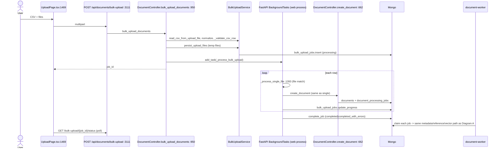
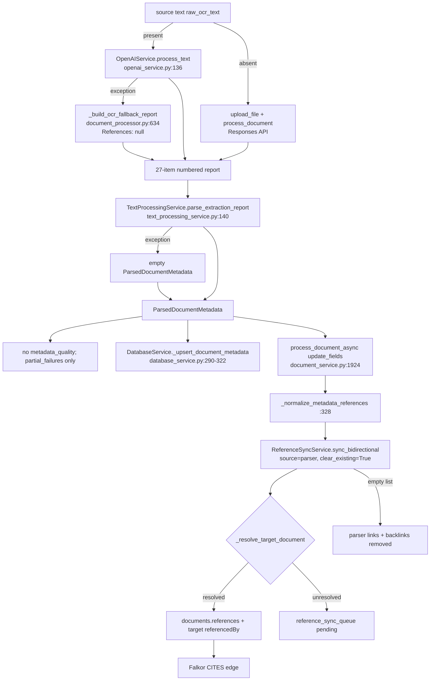
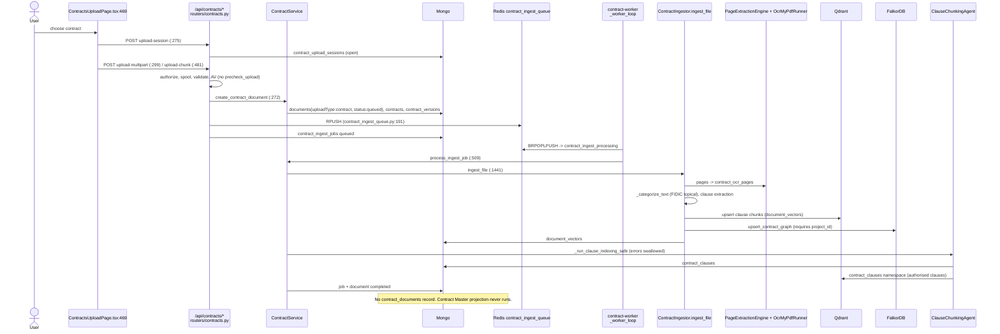

# Exact document and contract upload flow — current-tree audit

**Mode:** read-only investigation. No production source, prompts or tests were modified. Nothing was committed, pushed or deployed. This file is the only artefact written.
**Date:** 2026-10-01

## 0. What was audited

| | |
|---|---|
| WORKTREE | `C:\SaaS` (git root; app at `C:\SaaS\projectDMS`) |
| BRANCH | `integrate/key-date-eot` |
| HEAD | `a179ca9edd4d98266dba530c3e87df1a67135d5c` ("ops(release): a secret that reaches evidence rarely arrives verbatim") |
| TREE (HEAD) | `6c97f77deb0a51af18f364dce7489728fb62c6dc` |
| Working-tree state | **Dirty.** 90 tracked files modified (+11,053 / −3,088), 179 untracked source files under `backend/` and `client/src/`. Fingerprint of `git diff HEAD` + untracked backend/client sources: `sha256:6dcf626d6e996e91…` |

**The report describes the working tree, including uncommitted and untracked files.** A large part of the Contract Master code exists **only as untracked files**. Markers used throughout:

- **(C)**: committed at HEAD and unchanged.
- **(M)**: tracked, modified, uncommitted.
- **(U)**: untracked.

All paths are relative to `projectDMS/backend/rbac_backend/` unless prefixed `client/` or given as a repo-level file.

### Other lineages (none is an ancestor of HEAD; the merge-base of each with HEAD is `7370997`)

| Lineage | Head | Relevance | In current tree? |
|---|---|---|---|
| `reconcile/cl4a-onto-release-rc1` | `4fcd012` | CL-4A scope; hardened Contract Master router/promotion (PR #31) | **NO.** The WT carries an *older* copy of `contract_master_api.py`, `contract_promotion.py` and `contract_scope_resolver.py` than `4fcd012`. Other untracked Contract Master modules are byte-identical to `4fcd012` (ignoring CRLF). |
| `fix/contract-master-reprojection-runtime` (PR34) | `3ca0149` | Reprojection runtime, projection builder, source lease, governance guards | **NO.** |
| `local/phase-b-pr35-pr36-base` | `9a071c5` | `4fcd012` + PR35 + PR36 | **NO.** |
| `fix/correspondence-metadata-integrity` | `447d182` | item-label table, `metadata_quality`, authoritative-only link sync, KRP advisory handling | **NO.** |
| `fix/correspondence-qdrant-contract` (Phase B) | `ef6a68f` | canonical flat `correspondence.v1` Qdrant payload, reindex backfill | **NO.** |
| `fix/correspondence-summary-reply-points` | `44cb662` | Summary/KRP prompt v4 | **NO.** |
| `fix/correspondence-source-authority` | `5e4ab0a` | source text outranks LLM Item 25; truncation fail-visible | **NO.** |

Where one of these branches materially changes a flow, the text says **"NOT IN CURRENT TREE — implemented on …"**.

### Method

- The graft CLI was used for call-graph edges (`graft callers … --direction out`). The chains in §27 are graft output.
- The graft MCP server timed out, and the graft index (built 2026-09-29) does not cover every untracked file. Every file:line in this report was therefore confirmed by reading the source.
- Five read-only tracers covered: Flow A entry/jobs; Flow A extraction/metadata; Flow A references/vectors/graph; Flow B upload/clauses; Flow B Contract Master projection/Q&A.
- Findings with the highest impact were re-read by hand:
  - nested LangChain payload vs flat filter;
  - the fallback report's `References: null`;
  - the `Ref:` letter-number regex;
  - `AuthorizedContractScope.for_tests` in a production route;
  - no importers of the reprojection worker.
- Nothing was executed against a live database, Qdrant or Falkor. **Every finding is a code read, not a reproduction**, unless stated otherwise.

---

## 1. Executive summary

### Correspondence (Flow A)

**Pipeline shape**

- A single upload (`POST /api/documents`) and a bulk upload (`POST /api/documents/bulk-upload`) converge at `DocumentController.create_document` (`routers/documents.py:662`).
- That function creates the `documents` row and a durable job in `document_processing_jobs`.
- The `document-worker` container claims the job and runs `DocumentService.process_document_async` → `DocumentProcessor.process_document`.
- The default engine is **`legacy_v0`**.

**Metadata extraction**

- `OpenAIService.process_text` asks `gpt-4o` for a numbered 27-item report, which a regex parser (`TextProcessingService.parse_extraction_report`) turns into `ParsedDocumentMetadata`.
- PydanticAI is off by default.
- There is **no `metadata_quality`**, no `field_failures`, and no prompt-version constant in this tree.

**References**

- References are replaced wholesale on every run: `ReferenceSyncService.sync_bidirectional(source="parser", clear_existing=True)`.
- A degraded extraction therefore **deletes valid existing links**, their backlinks and their Falkor CITES edges.

**Vectors**

- Vectors are written through LangChain `QdrantVectorStore` in its default **nested** payload shape (`page_content` + `metadata.*`), into collection `document_vectors`.
- The scoped reader `RetrievalService.search` filters on **flat** `org_id` / `project_id`. Those keys do not exist on these points, so on a code read, uploaded correspondence is **not retrievable** by scoped search or drafting.
- The fix is **NOT IN CURRENT TREE — implemented on `fix/correspondence-qdrant-contract` @ `ef6a68f`**.

**Status**

- A document reaches `processing_status="completed"` even when embedding, the graph or the evidence graph failed.
- Those failures are visible only in `processing_metadata.partial_failures` or in debug logs.

### Contract (Flow B)

**Upload path**

- The only live upload is the **legacy** path: `/api/contracts/upload-session` + `/upload-multipart` | `/upload-chunk`.
- It writes `documents{uploadType:"contract"}`, `contracts` and `contract_versions`, then pushes to the Redis list `contract_ingest_queue`.
- The `contract-worker` container runs `ContractIngestor.ingest_file`, a **separate pipeline** that shares only the `PageExtractionEngine`.
- The ingest writes clause chunks to Qdrant `document_vectors` and to Mongo `document_vectors`, plus a best-effort clause agent into `contract_clauses` (Mongo and Qdrant namespace `contract_clauses`).

**Contract Master v1**

- Its code is **(U)**. The router is mounted, but v1 has **no upload endpoint**.
- An authoritative instrument (`contract_documents`) appears only through an operator migration: materialise → claim → adjudicate → promote.
- Promotion writes `projection_status=PENDING`, and **nothing reachable in the current tree ever writes `CURRENT`**.
- The runtime and builder that would do so are **NOT IN CURRENT TREE — implemented on PR34 `3ca0149`**.
- Consequences: Contract Master evidence search returns `valid_empty` for every instrument, and generic ingestion, reprocess, storage resync and vector reconcile have **no** governance guards.

**What users actually reach**

- The Contract Q&A page (`/contracts/qa`) does **not** use the Contract Master authority model.
- It calls `/api/v1/retrieval/contract-qa` against Qdrant `contract_clauses`, with a legacy fallback.

---

## PART 1 — Upload entry points

| Path | UI component | Frontend fn | HTTP endpoint | Router fn | Controller | Service | Queue | Worker | Final persistence |
|---|---|---|---|---|---|---|---|---|---|
| **Single correspondence** | `client/src/pages/UploadPage.tsx:664` (sequential per file) | `enhancedApi.uploadDocument` `client/src/services/enhanced-api.ts:1008-1051` | `POST /api/documents` (multipart) | `create_document` `routers/documents.py:2538` (M) | `DocumentController.create_document` `:662` | `DocumentService.create_document` `services/document_service.py:482` (M); `FileObjectService.store_path` `services/file_object_service.py:208` | `DocumentService.queue_document_processing` `document_service.py:860` → Mongo `document_processing_jobs` | `document-worker` → `periodic_document_processing_jobs` `services/background_jobs.py:448` | `documents`, `file_objects`, `document_versions`, `document_processing_jobs`, `document_audit_events`, `vector_sync_status`, `document_vectors`, Qdrant, Falkor |
| **Bulk correspondence** | `UploadPage.tsx:1469` (poll `:1492`) | `startBulkUpload` `enhanced-api.ts:1053`; `getBulkUploadStatus` `:1071` | `POST /api/documents/bulk-upload`; `GET /api/documents/bulk-upload/{job_id}/status`; `GET /api/documents/bulk-upload/template` | `routers/documents.py:3111`, `:3171`, `:3188` | `bulk_upload_documents` `:950` → `BackgroundTasks` → `_process_bulk_upload` `:1279` → `_process_single_file` `:1393` → **`create_document` `:662`** | same as single, plus `BulkUploadService` (`services/bulk_upload_service.py`) | same (called inside `create_document`) | same | same, plus `bulk_upload_jobs` |
| **Reprocess (user)** | `client/src/pages/DocumentViewerPage.tsx:227` (M) | `processDocument` `enhanced-api.ts:1562` | `POST /api/documents/{id}/process` | `process_document_endpoint` `routers/documents.py:2610` | `DocumentController.process_document` `:1472` | `process_document_async` `document_service.py:1586`, **synchronous in the request** | none | web tier | `documents` (ends `metadata_extracted`, never `completed`) |
| **Reprocess (internal)** | — | — | `POST /api/internal/documents/{id}/process` (X-API-Token) | `process_document_internal` `:2622` | same, `skip_authorization=True` | same | none | web tier | same |
| **Manual ingestion** | none found | — | `POST /api/ingestion/jobs`; `GET /api/ingestion/jobs/{job_id}` | `routers/retrieval_engine.py:124`, `:138` | — | `IngestionService.create_job` `ingestion/service.py:30` → `IngestionPipeline.create_job/process_job` `ingestion/pipeline.py:37/54` (M) | in-process `submit_background_job` | backend web process | `ingestion_jobs`, `chunks`, Qdrant (flat payload), `vector_sync_status` |
| Vector repair (superadmin) | — | — | `POST /api/storage-sync/resync-doc`, `/resync-bulk` | `routers/storage_sync.py:762`, `:777` (M) | — | `_resync_document_vectors` `:444` | none | request | Qdrant, `vector_sync_status` |
| Enclosure | `client/src/components/document-viewer/EnclosuresPanel.tsx:87` | direct `joinApiUrl` | `POST /api/documents/{id}/enclosures` | `routers/documents.py:2960` | `controller_add_enclosure` `:1832` | `DocumentService.add_enclosure` | none | none | `file_objects`, `documents.enclosures` |
| Insurance upload | — | — | `POST /api/insurance/upload` | `routers/insurance.py:335` (M) | calls `DocumentController.create_document` (`insurance.py:398`): converges with single | | | | |
| **Contract upload (legacy, the one the UI uses)** | `client/src/pages/ContractsUploadPage.tsx:469` | `createContractUploadSession` / `uploadContractsMultipart` / `uploadContractInChunks` `client/src/services/contracts-api.ts:124/146/206` | `POST /api/contracts/upload-session`, `/upload-multipart`, `/upload-chunk`; reindex `/{document_id}/reindex` | `routers/contracts.py:275`, `:299`, `:481`, `:821` (C) | — | `ContractService` `services/contract_service.py` (M) | Redis list `contract_ingest_queue` | `contract-worker` | see Flow B |
| Contract Master v1 | `client/src/pages/ContractMasterWorkspacePage.tsx` (U) | `client/src/services/contract-master-v1-api.ts` (U), no upload fn | **no upload endpoint** | `routers/contract_master_api.py` (U, mounted `main.py:25,233`) | — | — | — | — | — |

**Dead or unmounted code**

- `backend/rbac_backend/documents.py` (legacy router) is never mounted.
- `DocumentController._parse_and_validate_csv` (`:1092`) and `_decode_csv_content` (`:1049`) have no callers.
- `BulkUploadService.process_documents_with_metadata` (`bulk_upload_service.py:500`) has no callers.

---

# FLOW A — CORRESPONDENCE / NORMAL DOCUMENT UPLOAD

## PART 2 — Frontend to document record (single upload)

**Front end** (`UploadPage.tsx:655-681`)

- Files are uploaded sequentially.
- A missing letter number is **fabricated** as `AUTO-{yyyy}-{Date.now()}-{i}` (`:659-660`).
- `uploadDocument` posts FormData to `POST /api/documents` with: `file, organization_id, project_id, uploadType, date, subject, status, doc_status, letterNo, from, to, tags[], subTags[], ocrEnabled, compressionEnabled`.

| # | FILE:LINE | FUNCTION | INPUT → OUTPUT | DB WRITE | STATUS |
|---|---|---|---|---|---|
| 1 | `routers/documents.py:2536-2590` | route `create_document` | multipart → `Document` | — | — |
| 2 | `:2562` | `policy.authorize(current_user, "dms.document.upload", resource_type="project", …)` | 403 on deny | policy audit | — |
| 3 | `:688` | controller re-authorizes `Permissions.DOCUMENT_UPLOAD` | | | |
| 4 | `:701-702` | filename required, else 400 | | | |
| 5 | `:704-711` | `upload_concurrency_limiter.slot("user:{id}",3)` / `slot("org:{id}",20)` (`services/upload_limits.py:64`) | | | |
| 6 | `:712` → `services/upload_streaming.py:43-104` | `spool_upload_file` (max `GENERAL_UPLOAD_MAX_FILE_SIZE_MB`=100): temp file, sha256, sniffed MIME | `SpooledUpload` | — | — |
| 7 | `:714` → `upload_streaming.py:145` | `validate_spooled_upload`: non-empty, MIME ∈ `ALLOWED_DOCUMENT_MIMES` (`core/config.py:203`), no executable magic | 415 on fail | | |
| 8 | `:727-736` | `ArchiveIntakePolicy.requires_letter_number` | 400 if missing | | |
| 9 | `:741-749` | `AntivirusService.scan_file` if `ANTIVIRUS_ENABLED` (forced on in prod by config gate `config.py:838`) | 400 if infected | | |
| 10 | `:752` → `services/duplicate_detection_service.py:143-192` | **`duplicate_detection.precheck_upload(org, project, letter_no, sha256)`** | `exact_file_duplicate` → **409**; `possible_document_duplicate`; `unique` | `document_audit_events` (on block) | — |
| 11 | `:790-805` | third `authorize(resource_type="document_upload", meter_event_type=DOCUMENT_UPLOAD)` | usage meter | meter row | |
| 12 | `:811` → `:421-473` | `_write_spooled_to_providers` → `StorageKeyBuilder.build_document_key` (`services/storage_key_builder.py:37-58`): `/{org}/{proj}/{incoming\|outgoing}/{YYYY}/{MM}/{upload_id}_{letter_no\|stem}{ext}` → `FileObjectService.store_path` (dedupes on sha256+org+project+type) | `{file_object_id, storage_key, filepath_local, filepath_s3, …}` | **`file_objects.insert_one`** `file_object_service.py:333` | — |
| 13 | `:823` → `document_service.py:482-680` | `DocumentService.create_document` | `Document` | **`documents.insert_one`** `:611` (org, project, filename, filepaths, filetype, filesize, uploadType, letterNo, letterNoNormalized, date, subject, from, to, tags, subTags, status, ocrEnabled, createdBy, `lifecycle_state="active"`, `_revision=1`); notification `:618-640` (errors swallowed) | `lifecycle_state=active`; **`processing_status` absent** |
| 14 | `:838` → `file_object_service.py:371-412` | `attach_document_version(reason="upload")` | version_id | `document_versions.update_many/insert_one`; `documents.update_one{current_version_id,file_object_id}`; `file_objects.update_one{document_ids}` | |
| 15 | `:849-870` | attach sha256 and duplicate state | | `documents.update_one{file_object_id, current_version_id, storage_key, sha256, lifecycle_state=active\|duplicate_review, duplicate_status=pending?, duplicate_of?}`. **Exceptions are swallowed at `:869-870`.** | `lifecycle_state` |
| 16 | `:872-890` | audit `document.created` | | `document_audit_events` | |
| 17 | `:894-908` | if `ocr_enabled` and archive policy allows → `queue_document_processing` | job_id | see Part 4 | `processing_status=queued` |
| 18 | `:912-947` (M) | on error, `compensate_failed_creation` (`:262-363`) removes the row, versions and file-object links. Generic `Exception` → **500** | | `documents.delete_one`, `document_versions.delete_many`, audit | |

## PART 3 — Single vs bulk

**Bulk mechanics**

- **CSV parsing:** `BulkUploadService.read_csv_from_upload_file` (`bulk_upload_service.py:130-183`), then `clean_dataframe` (`:185-197`, `astype(str)`) and `normalize_csv_dataframe` (`:199-242`).
  - Required columns: `filename, upload_type, letter_no, date, ocr_enabled` (`routers/documents.py:984-990`).
- **Row validation:** `_validate_csv_row` (`:1143-1206`).
  - `upload_type` ∈ {incoming, outgoing}; `letter_no` and `date` required.
  - `ocr_enabled = _parse_boolean_field(row.get('ocr_enabled') or row.get('ocrEnabled') or 'true')` (`:1183`).
  - Failing rows are kept with `_validation_error`.
- **Files:** `persist_upload_files` (`bulk_upload_service.py:244-289`) copies them to `NamedTemporaryFile(prefix="bulk_upload_")`.
- **Limits:** `BULK_UPLOAD_MAX_FILES`=100 and `BULK_UPLOAD_MAX_SIZE_MB`=500 (`routers/documents.py:3138-3157`).
- **Job record:** `bulk_upload_jobs.insert_one` (`bulk_upload_service.py:298`) with `{job_id, total_files, processed_files, successful_uploads, failed_uploads, status="processing", results=[]}`.
- **Handoff:** `background_tasks.add_task(self._process_bulk_upload, …)` (`routers/documents.py:1028`) runs **in the web process after the response**.
- **Per row:** `_process_single_file` (`:1393-1470`).
  - Matches the file by exact name, then lowercase, then basename (`_build_bulk_file_lookup` `:1076-1091`).
  - Calls `self.create_document(background_tasks=None, …, emit_upload_notification=False)` (`:1434`).
- **Per-row result:** `DocumentProcessingResult{filename, success, document_id, error, row_number}`, written by `update_progress` (`bulk_upload_service.py:346`).
- **Completion:** `complete_job` sets `completed` or `completed_with_errors` (`:390`); `fail_job` sets `failed` (`:421`).

**Does bulk enter the same processing pipeline? YES.**

- Convergence function: `DocumentController.create_document` (`routers/documents.py:662`).
- Policy, spool, validation, antivirus, `precheck_upload`, storage, insert, versioning and `queue_document_processing` are all shared.
- Only the CSV and orchestration layer differs.
- One engine difference: `metadata_processor_service.py:92` calls `processor.process_document` without `pipeline_version`, so that path is always `legacy_v0`.

## PART 4 — Processing job and worker

**Collection:** `document_processing_jobs`. **No indexes** are declared for it in `core/database.py` or in any migration.

**Job schema** (`document_service.py:895-933`)

- `_id` (str ObjectId)
- `document_id, file_path, sha256, organization_id, project_id, upload_type, source_mime`
- `pipeline_version = resolve_pipeline_version(org, UNIFIED_EXTRACTION_ENABLED, canary)`
- `status="queued", stage="queued", attempts=0, max_attempts=3, requested_by`
- `created_at, queued_at, updated_at`
- `processing_state="queued"`, `expected_/resolved_/remaining_page_numbers=[]`, `page_attempts={}`, `resume_count=0`

Idempotence and follow-up write:

- An existing `queued|processing|retrying` job is reused unless `force` is set (`:872-893`). This is a non-atomic find-then-insert.
- The document is then updated with `{processing_status:"queued", processing_job_id, processing_error:None}` (`:934-946`).

**Worker startup**

- `worker.py:45-46` in the `document-worker` container (`docker-compose.prod.yml`, `command: python -m rbac_backend.worker`, `START_DOCUMENT_EXTRACTION_WORKERS=true`).
- The backend service has it `false` (`docker-compose.prod.yml:169`).
- `main.py:333-337` starts it only when the flag is set (default False, `core/config.py:446`).
- `DOCUMENT_WORKER_PIPELINE_VERSIONS` defaults to `legacy_v0`.
- `document-worker-canary` has 0 replicas by default.

**Loop and lease**

- `periodic_document_processing_jobs` (`background_jobs.py:448-474`) calls `process_next_processing_jobs(limit=3)` (`document_service.py:981`), then sleeps 1s if it processed anything, else 3s.
- **Claim:** `_claim_next_processing_job` (`:998`), a `find_one_and_update` (`:1019-1032`).
  - Filter: `status ∈ {queued, retrying}`, `run_after` absent or ≤ now, pipeline-version filter. Sort: `created_at` ascending.
  - Sets `status=processing, stage=claimed, started_at, heartbeat_at`, and `$inc attempts`.
- **Heartbeat:** `_heartbeat_processing_job` (`:1105-1120`), every `min(30, stale/2)` seconds.
- **Stale recovery:** `recover_stale_processing_jobs` (`:1032-1103`).
  - A `processing` job with a heartbeat older than `max(300, DOCUMENT_PROCESSING_STALE_AFTER_SECONDS=3600)` → `status=retrying, stage=recovered_stale`.
  - **It never checks `attempts` against `max_attempts`.**

**State transitions**

| Event | job.status / stage | documents.processing_status | line |
|---|---|---|---|
| queued | queued / queued | `queued` | 929, 938 |
| claimed | processing / claimed (attempts+1) | `processing` | 1019-1030, 1158-1168 |
| run | stages materializing → extracting → metadata_updated → [duplicate_classification] → syncing_references → syncing_falkor | `processing`, then `metadata_extracted` or `human_review_required` (1796-1800, written at 1924) | 1690, 1719, 1931, 1988, 2014 |
| success | completed / completed | **`completed`**, `processed_at` | 1207-1231 |
| page resume | retrying / awaiting_page_resume (+5s, resume_count+1) | `partially_processed` | 1268-1303 |
| human review | human_review_required | `human_review_required` (+ purge vectors and Falkor) | 1393-1441 |
| archive | stored_only | `stored_only` | 1443-1472 |
| failure, attempts < 3 | retrying, `run_after = now+min(300, 30·attempts)` | `retrying` | 1533-1566 |
| failure, attempts ≥ 3 | dead_lettered | `failed` | 1539, 1561 |
| soft-deleted document | dead_lettered / skipped_deleted_document | `skipped` | 1620-1655 |

## PART 5 — Text extraction decision

**Engine selector** (`services/pipeline_routing.py:20-35`)

- `LEGACY_PIPELINE="legacy_v0"`, `UNIFIED_PIPELINE="unified_v1"`.
- Unified is chosen only if `UNIFIED_EXTRACTION_ENABLED` is set (default **False**, `core/config.py:181-186`; prod compose `${UNIFIED_EXTRACTION_ENABLED:-false}`) or the org is in the canary list.
- **Default = `legacy_v0`.**
- The version is pinned on the job at creation (`document_service.py:910-914`) and read back by `pipeline_version_of(job)` (`:1754`).

```
DocumentProcessor.process_document (services/document_processor.py:449)
├─ file exists, size <= max_file_size_mb ?  else ProcessingResult(success=False)
├─ pipeline_version != "unified_v1"   (DEFAULT)                                   [:517]
│   └─ _extract_legacy (:377) -> OCRService.process_pdf (services/ocr_service.py:101)   [assumes PDF, no MIME dispatch]
│       ├─ OCR deps missing (import ocrmypdf + binaries, :38-62) -> copy file, raw_text=None
│       ├─ is_pdf_textual (:64): PyPDF2 then pdfplumber, FIRST 5 PAGES ONLY; any text => whole document "textual"
│       │   ├─ YES -> copy file; _extract_sidecar_text (pdfplumber page.extract_text, :288-313) -> source text
│       │   └─ NO  -> _run_ocr_with_sidecar (:237): ocrmypdf.ocr() IN-PROCESS (executor thread), force_ocr=False
│       │           ├─ PriorOcrFound -> copy + pdfplumber
│       │           ├─ Encrypted -> raise
│       │           └─ any other error -> copy original, return None (silent)
│       └─ no CID-placeholder check
└─ unified_v1
    └─ _extract_source (:395) -> SourceKindRouter.route(mime, name)
        ├─ PDF   -> OCRService.process_pdf_pagewise (:165) -> PageExtractionEngine.extract (services/extraction/engine.py:92)
        │    ├─ pdfplumber native text + tables + PageClassifier per page (:263-285)
        │    ├─ page native text < min_text_chars_per_page (40) and not UNRENDERABLE -> OCR candidate
        │    │    (capped by DOCUMENT_OCR_MAX_PAGES_PER_ATTEMPT, 0 = no cap; rest DEFERRED)
        │    ├─ OcrMyPdfRunner (extraction/ocrmypdf_runner.py): OUT-OF-PROCESS `ocrmypdf --pages … --sidecar`
        │    ├─ merge (engine.py:218-253): OCR text overrides native per page; PARTIAL if any page failed/deferred/empty
        │    └─ no CID-placeholder check
        ├─ IMAGE -> Tesseract runner      ├─ TEXT -> extract_text_file
        ├─ ARCHIVE -> STORED_ONLY, success=False (:566-575)   └─ other -> UnsupportedSourceKindError
        └─ _apply_quality_gate (:282) [+ fallback ladder if EXTRACTION_FALLBACK_ENABLED, default False]
           -> pages needing human review => publishable=False
```

`OCRService.__init__` imports `ocrmypdf` in-process (`ocr_service.py:41`) on **both** engines, because `DocumentProcessor.__init__` always builds it (`:90`). The pdfminer CID-placeholder trap is therefore armed even on `unified_v1`.

**Where each text artefact is created**

| Artefact | Created | Persisted |
|---|---|---|
| page text | `engine._merge` (`engine.py:218-253`) | `document_ocr_pages.raw_text` / `original_text` (`extraction_adapters/document_page_store.py:24,52-58`), `document_ocr_batches` |
| combined text | `engine.py:143`; rebuilt at `document_processor.py:373` | becomes `raw_ocr_text` (`:597`) |
| legacy raw text | `ocr_service.py:140/145` | `raw_ocr_text` (`document_processor.py:522`) |
| `ocrText` | `_save_results`: `raw_ocr_text or extracted_content` (`document_processor.py:763`). **With no source text, this is the LLM report.** | `documents.ocrText` (`services/database_service.py:277`) |
| `full_text` | LLM Item 25 "full content" (PydanticAI: the truncated input) | `documents.full_text` (`database_service.py:296-297`, overwritten again at `document_service.py:1840-1841`) |
| embedding text | `raw_ocr_text or full_content or extracted_content` (`document_processor.py:764-765`) | Qdrant + `document_vectors` |
| deferred-embedding text | `full_text or ocrText` (`database_service.py:256`): **LLM text preferred over source** | same |

There is **no canonical "source text" field**. `publication_policy._TEXT_FIELDS = ("body","full_text","ocrText","summary")` (`services/publication_policy.py:103`), so `authoritative_text` prefers the LLM's `full_text` over the source `ocrText`.

> Source-text authority is NOT IN CURRENT TREE — implemented on `fix/correspondence-source-authority` @ `5e4ab0a`.

## PART 6 — Metadata extraction

**Default path** (`DocumentProcessor._extract_and_persist`, `document_processor.py:783`)

1. **If source text exists:** `OpenAIService.process_text` (`services/openai_service.py:136`).
   - Chat Completions, `max_tokens ≥ 4096`, temperature 0.1, full text inlined.
   - `metadata_source = "openai_text_legacy_regex"`.
2. **If the OpenAI call fails:** `_build_ocr_fallback_report` (regex, `:634-703`).
   - `metadata_source = "ocr_fallback_regex"`, `partial_failures.ai_extraction` set.
   - `success` stays True.
3. **If there is no source text:** `upload_file` + `process_document(file_id)` (Responses API with `input_file`, `openai_service.py:42-134`).
4. **Parsing:**
   - If PydanticAI is enabled: `extract_metadata` (`services/pydantic_ai_service.py:175`). It is off by default: `use_pydantic_ai=False` (`config/document_processing_config.py:150`), and only env `PYDANTIC_AI_ENABLED` can turn it on.
   - Otherwise: **`TextProcessingService.parse_extraction_report`** (`services/text_processing_service.py:140`) → `ParsedDocumentMetadata` (`models/document_metadata.py:118`).
5. **Model:** `openai_model="gpt-4o"` (`document_processing_config.py:113`).
   - `OPENAI_RESPONSES_MODEL` and `PYDANTIC_AI_ENABLED` are read with `getattr(settings, …)`, but `Settings` has no such fields (`core/config.py:861`, `extra="ignore"`).
   - As a result, `backend/.env.example:53` `OPENAI_RESPONSES_MODEL=gpt-4.1` has no effect.
6. **Persistence:**
   - `_save_results` (`:745`) → `DatabaseService.save_document_data` (`database_service.py:161`) → `_upsert_document_metadata` (`:290-322`).
   - Back in `process_document_async`, an `update_fields` `$set` on `documents` (`document_service.py:1924`) overwrites most of the same fields again.

**Per-field map (default legacy path)**

| FIELD | EXTRACTION SOURCE | PROMPT ITEM | PARSER (`text_processing_service.py`) | DB FIELD |
|---|---|---|---|---|
| Date | LLM (regex in fallback) | 1 | `:196-203` + `format_date_ddmmyyyy` | `documents.date` (`database_service.py:313-322`; `document_service.py:1849-1853`) |
| Letter Number | LLM (fallback regex `document_processor.py:661-666`) | 2 | `:210` | `documents.letterNo`, `letterNoNormalized` (`document_service.py:1844-1846`) |
| From | LLM | 3 | `:216` | `documents.from` |
| To | LLM | 4 | `:222` | `documents.to` |
| CC | **not extracted**: no prompt item, no field | — | — | — |
| Subject | LLM | 5 | `:205` | `documents.subject` |
| References | LLM | 6 | `:245-251` `_list_from_block` → `_parse_list_block` (`:340`) → `parse_legacy_reference_text` (`services/reference_parser.py:36`) | `documents.reference` (`document_service.py:1834-1839`) → `sync_bidirectional` → `documents.references[]` / `referencedBy[]` |
| Summary | LLM | 22 (fallback 7) | `:253-255` `_summary_from_block` / `_extract_summary` `:370` | `documents.summary` |
| Key Reply Points | LLM | 24 (fallback 10) | `:286-297` | `documents.key_reply_points` (`database_service.py:302-303`) |
| Clauses | LLM | 23 (fallback 9) | `:270-279` | `documents.contractual_clauses` |
| Keywords | LLM | 18 (21 is also labelled "Key Words" → `additional_keywords`) | `:223-235` | `documents.keywords`, `additional_keywords` |
| Tags | LLM + controlled vocabulary | 26 | `:315-317`; `enforce_controlled_vocabulary` (`models/document_metadata.py:211`) | `documents.extracted_tags` |
| Subtags | LLM + controlled vocabulary | 27 | `:318-323` | `documents.extracted_subTags` |
| Full content | LLM retype | 25 | `:299-306` | `documents.full_text` (source stays in `ocrText`) |
| metadata_quality | **ABSENT** | — | — | — |
| partial_failures | runtime | — | `document_processor.py:807,830,915`; `database_service.py:208-221` | `documents.processing_metadata.partial_failures`; `document_processing_jobs.metadata.partial_failures` |

If `parse_extraction_report` raises, its catch-all returns an **empty** `ParsedDocumentMetadata()` (`text_processing_service.py:315-318`).

## PART 7 — Summary

**Prompt**

- Item 22 asks for a "4-6 line contractual/legal summary/fact of the matter suitable for vector search/RAG" (`openai_service.py:285`; same wording in `pydantic_ai_service.py:269`).
- The prompt has no chronology, source-grounding or no-external-information contract.

**Chain**

- Model reply → `_parse_numbered_blocks` (`text_processing_service.py:72`) → `_summary_from_block` (`:130`) → `ParsedDocumentMetadata.summary` → `documents.summary`.
- From there it is copied into the Qdrant payload and `document_vectors` metadata (`database_service.py:440-446`).

**Parser defect:** `_summary_from_block` (`:134`) and `_extract_summary` (`:383`) strip `^[\-\*\d\.\)\s]+`, which removes a leading date such as `01-08-2024` from each line.

**Consumers**

- Falkor node properties (`graph/graph_ingestion_service.py:135`, M).
- Evidence-graph content hash, stamped `prompt_version="existing_document_metadata.v2"` (`services/evidence_graph_service.py:581,595`).
- Letter drafting source evidence: `consumable_summary(doc) or consumable_text(doc)` (`services/letter_drafting/context.py:189-193`, M).
- Prior correspondence `summary or content`, promoted to `allowed_use="fact"` (`context.py:483-500, 547-551`).
- `incoming_analyzer.py:118` (as `main_request`).
- `arbitration_drafting/context.py:472,528`.

> **Prompt v4** (detailed and proportionate chronology, source-grounded, material dates and events, no external information; `METADATA_EXTRACTION_PROMPT_VERSION="existing_document_metadata.v4"`, `SUMMARY_EXTRACTION_INSTRUCTION`) is **NOT IN CURRENT TREE — implemented on `fix/correspondence-summary-reply-points` @ `44cb662`**. The current tree has no prompt-version constant at all.

## PART 8 — Key Reply Points

**Chain:** prompt item 24 → parser `text_processing_service.py:286-297` → `ParsedDocumentMetadata.key_reply_points` → `documents.key_reply_points`.

**Classification.** Key Reply Points are **AI-derived reply analysis, not source fact**. The current tree does not mark them as such anywhere, and there is **no exclusion from evidence**.

| Sink | Present? | Where |
|---|---|---|
| Mongo | yes | `documents.key_reply_points` (`database_service.py:302-303`); `documents.metadata` snapshot |
| Qdrant payload / `document_vectors` metadata | **yes, on every chunk** | `database_service.py:446` |
| Qdrant chunk text | yes when there is no source text: the whole LLM report (including KRP) is embedded | `document_processor.py:763-765` |
| Falkor | yes, `props["key_reply_points"]` | `graph/graph_ingestion_service.py:138-139` (M) |
| Drafting | yes: the reply-matrix agenda, `issue_type`, clause-applicability terms, user-direction prompts | `letter_drafting/planning.py:106-111`; `incoming_analyzer.py:113`; `clause_checker.py:84-88`; `user_direction.py:45,99-102` |
| UI | shown with no advisory label | `client/src/pages/LetterSummaryPage.tsx:523-831` |

**Exclusions from source evidence in the current tree: none.**

> KRP advisory handling (out of vectors, out of clause applicability, UI label) is NOT IN CURRENT TREE — implemented on `447d182`. The canonical Qdrant payload that excludes advisory fields is NOT IN CURRENT TREE — implemented on `ef6a68f`.

## PART 9 — References

**Call chain**

```
process_document_async (document_service.py:1586, M)
 -> DocumentProcessor.process_document -> _extract_and_persist -> parse_extraction_report
      item "6) References" -> _list_from_block -> _parse_list_block (text_processing_service.py:340)
          strips ^[\-–•*\d.)\s]+  (also strips LEADING DIGITS of a letter number)
          -> parse_legacy_reference_text (reference_parser.py:36): {letterNo, letter_no, date, raw} ONLY if a
             "dated|dtd|dt" marker is present; otherwise the raw string is kept
 -> ParsedDocumentMetadata.references (models/document_metadata.py:127, default [])
 -> _normalize_metadata_references (document_service.py:328) -> update_fields["reference"] (:1834-1839)
 -> documents.$set (:1924)
 -> ReferenceSyncService.sync_bidirectional(document_id, refs, source="parser", clear_existing=True)
        (document_service.py:1991; services/reference_sync_service.py:34-245)
      -> _normalize_payload (:432-490)   (a non-parsed sentence becomes the letterNo, :473-478)
      -> _resolve_target_document (:507-595):
           1. documentId within the source's org/project scope
           2. letterNoNormalized == normalize_letter_code(letterNo)   (single find_one)
           3. case-insensitive regex on letterNo (<=10 candidates) + normalized compare
           (NO check of date, lifecycle_state, duplicate_status, is_consumable, or ambiguity)
      -> _upsert_source_references (:597-651)   bucket replace by source
      -> _upsert_target_backlinks (:653-711) / _remove_target_backlinks (:713-743)
      -> enqueue_missing (:247-300) for unresolved references
 -> _sync_current_document_to_falkor(raise_on_error=True) (document_service.py:2012)
      -> graph_ingestion_service.sync_document_to_falkor (:373-411)
      -> Letter{normCode} -[:CITES|REPLIES_TO {owner_document_id, source}]-> Letter  (:449-575)
```

**Reference record fields**

| Aspect | Storage |
|---|---|
| source document | the document holding `references[]` |
| referenced letter number | display list `documents.reference[].letterNo`; resolved link `references[].letterNo` = the target's number |
| referenced date | **display list only** (`documents.reference[].date`, dd-mm-yyyy). **Not stored on the link.** |
| resolved document_id | `documents.references[].documentId` (`DocumentReference`, `models/document.py:10-18`) |
| status | the link has no status field. Unresolved references live in `reference_sync_queue.status` ∈ {pending, resolved, expired, orphaned} |
| direction | forward in the source's `references[]`; backlink in the target's `referencedBy[]` (same model, `documentId` = source) |
| link fields | `documentId, linkType (indirect\|direct), description, linkedAt, linkedBy, letterNo, source (parser\|manual), metadata` |
| graph edge | Falkor `(:Letter{normCode})-[:CITES {owner_document_id, source}]->(:Letter)`, **resolved references only**; `previous_letter_id` becomes `REPLIES_TO` |

**Scenarios**

| Case | Behaviour |
|---|---|
| **A. Found and resolved** | Forward link (`source=parser`, `linkType=indirect`); backlink on the target; matching queue rows set to `resolved` (`reference_sync_service.py:222-235`); Falkor CITES edge with `owner_document_id`; stale owned edges removed (`falkor_graph_service.py:304-340`). |
| **B. Found, unresolved** | No link and no graph placeholder (`graph_ingestion_service.py:521-525`). A `reference_sync_queue` row is upserted. The daily reaper (`services/scheduler.py:64`, 08:45) replays with a 30-day TTL, then marks it `expired`. A sentence-shaped letterNo can never resolve. |
| **C. None stated** | `references=[]` with `clear_existing=True` removes all parser-bucket links, backlinks and owned Falkor edges. Correct on first upload. |
| **D. Extraction failed or degraded** | **D1:** the processor raises → `metadata=None` → reference sync skipped, links kept. **D2:** the OpenAI call fails → `_build_ocr_fallback_report` hard-codes **`"6) References: null"`** (`document_processor.py:682`, verified), still `success=True` → `sync_bidirectional([], clear_existing=True)` → **valid parser links, backlinks and Falkor edges are wiped.** The same fallback's letter-number regex accepts `(Our )?Ref(erence)? …` (`:661-666`, verified), so the document can take a *cited* letter's number as its own. That value is written to `letterNo`/`letterNoNormalized` and the Falkor Letter MERGE lands on another letter's node. **D3:** the parser raises → empty metadata → same wipe as D2. |
| **E. Reprocess** | Same path. A degraded rerun replaces good links. `drain_reference_queue` and `controller_sync_references` (`routers/documents.py:2097-2130`) also sync with no authority check. |

**"Degraded extraction must not clear valid existing links": FAILS in the current tree.**

- The only gates are `derived_publication_authorized` (duplicate, publishable, consumable; `document_service.py:1872-1884, 1984`) and `clear_existing`. Neither considers `metadata_source` or degradation.
- There is also a field mismatch. `_upsert_document_metadata` keeps an old `reference` when the new value is empty (`database_service.py:293-296`), but `document_service` then overwrites it with `[]` (`:1834-1838`).

> Authoritative-only link sync is NOT IN CURRENT TREE — implemented on `fix/correspondence-metadata-integrity` @ `447d182` (`services/metadata_integrity.py`, absent here).

Canonical entity links (`services/document_relationship_service.py` (U), collection `entity_document_links`) take **no part** in upload or processing. They are used by the claims, BG, insurance, IPC, key-date and arbitration registers.

## PART 10 — Metadata quality

`field_failures`, `assess_metadata_quality`, `metadata_quality` and the values `complete`, `complete_with_warnings` and `partial_extraction` are **NOT IN CURRENT TREE — implemented on `447d182`** (`services/metadata_integrity.py`). No frontend or drafting reader exists here.

Signals that do exist:

- `documents.metadata_source` (`openai_text_legacy_regex` | `ocr_fallback_regex` | PydanticAI variants).
- `documents.processing_metadata.partial_failures`, with keys `ai_extraction` and `embeddings` only.
- `documents.processing_status`.
- `ProcessingResult.extraction_completeness`, which is **not** persisted on the document.

A total parse failure (empty `ParsedDocumentMetadata`) cannot be told apart from a document that genuinely has no metadata.

## PART 11 — Mongo mutations, in order (single upload, OCR on, job path)

| # | Collection | Function (file:line) | Fields |
|---|---|---|---|
| 1 | policy/usage | `authorize` (`routers/documents.py:2562, 688, 790`) | audit / meter |
| 2 | `document_audit_events` | on an exact duplicate: `document.duplicate_upload_blocked`, then 409 | — |
| 3 | `file_objects` | `store_path` insert (`file_object_service.py:333`) unless deduped | sha256, size, mime, filenames, storage_key, provider, locations, org, project, document_type, upload_id |
| 4 | `documents` | `insert_one` (`document_service.py:611`) | see Part 2 step 13 |
| 5 | `notifications` | `emit` (`:618-640`) | NEW_UPLOAD |
| 6 | `document_versions` | `update_many(is_current=False)` + `insert_one` (`file_object_service.py:383,400`) | version |
| 7 | `documents` | `update_one` (`:402`) | current_version_id, file_object_id |
| 8 | `file_objects` | `update_one` (`:411`) | document_ids, document_id |
| 9 | `documents` | `update_one` (`routers/documents.py:865`), **error swallowed** | storage_key, sha256, lifecycle_state, duplicate_status?, duplicate_of? |
| 10 | `document_audit_events` | `document.created` (`:872`) | |
| 11 | `document_processing_jobs` | `insert_one` (`document_service.py:933`) | job schema |
| 12 | `documents` | `update_one` (`:934`) | processing_status=queued, processing_job_id, processing_error=None |
| 13 | `document_processing_jobs` | stale recovery (`:1050,1080`); claim `find_one_and_update` (`:1019`); heartbeats (`:1116`) | status, stage, attempts, heartbeat_at |
| 14 | `documents` | `:1158`, `:1678` | processing_status=processing |
| 15 | `document_processing_jobs` | stages materializing / extracting (`:1690,1719`) | stage |
| 16 | `document_ocr_pages` / `document_ocr_batches` | `DocumentPageStore` (unified only) | page text, status |
| 17 | `documents` | `_upsert_document_metadata` (`database_service.py:319`) | ocrText, subject, letterNo, from, to, summary, reference, full_text, keywords, contractual_clauses, key_reply_points, date. **This overwrites user-entered letterNo/subject/from/to/date.** |
| 18 | `vector_sync_status` | upsert (`database_service.py:656`) | qdrant_synced / mismatch / deferred |
| 19 | `document_vectors` | `delete_many` + `insert_many` (`:528,554`) | chunks + metadata (including summary and KRP) |
| 20 | `document_processing_jobs` | checkpoint (`document_service.py:1756 → 1520`) | processing_state, page lists |
| 21 | `documents` | `update_one(update_fields)` (`:1924`) | processing_status (`metadata_extracted`\|`human_review_required`), metadata_source, processing_metadata, summary, keywords, contractual_clauses, reference, full_text, subject, letterNo, letterNoNormalized, from, to, date, extracted_*, processing_error |
| 22 | `document_processing_jobs` | stage metadata_updated (`:1928`) | metadata |
| 23 | `documents` | `classify_pending_document` (`duplicate_detection_service.py:196-274`), if duplicate pending | duplicate_status, duplicate_of, revision_of, lifecycle_state |
| 24 | evidence graph (Mongo) | `EvidenceGraphService.ingest_document_metadata` (`evidence_graph_service.py:549`) via `_publish_graph_and_evidence_from_current` (`document_service.py:151`) | ai_extractions, document events |
| 25 | `documents` (source + targets), `reference_sync_queue` | `sync_bidirectional` (`reference_sync_service.py:203,212,228`) | references, referencedBy, queue rows |
| 26 | `document_processing_jobs` | stages syncing_references / syncing_falkor (`document_service.py:1988,2014`) | stage |
| 27 | `document_processing_jobs` | `:1207` | status=completed, completed_at |
| 28 | `documents` | `:1219` | processing_status=completed, processed_at |
| 29 | `document_audit_events` | `document.processing_completed` | |

## PART 12 — Vector and search publication

**Writer chain**

```
_extract_and_persist -> _save_results (document_processor.py:745)
 -> DatabaseService.save_document_data (database_service.py:161)
   -> _create_and_store_embeddings (:363)
       is_publication_blocked(resolve_canonical_document(...))? -> skip (:372-378)
       TextProcessingService.chunk_text
       -> Qdrant: LangChainVectorService.replace_document (services/langchain_vector_service.py:252)
            delete old points (warning-only on failure, :265-270) -> QdrantVectorStore.add_texts (:305-310)
            point id = uuid5("contraclaim:qdrant:{doc}:{chunk_id}") (:291)
            any exception -> warning, return 0 (:318-320)
       -> Mongo: LlamaIndexVectorService.index_chunks -> document_vectors
       -> vector_sync_status upsert (qdrant_synced / mismatch, :499-581)
```

**Configuration**

- Embeddings: OpenAI `text-embedding-3-small`, 1536 dimensions (`config/document_processing_config.py:114,156`).
- Collection: `qdrant_collection`, default `"document_vectors"` (`:155`), overridden by env `QDRANT_COLLECTION` (`:268-272`).
- `qdrant_enabled` requires `vector_store_enabled`, `vector_dual_write_enabled`, a `qdrant_url`, and no auth error (`:516-522`).

**Payload shape**

- `QdrantVectorStore` is built without `metadata_payload_key` or `content_payload_key` (`langchain_vector_service.py:70-84`, verified).
- It therefore uses LangChain's defaults: **`page_content`** plus a nested **`metadata`** dict.

| Requested field | Present? |
|---|---|
| `org_id` (flat) | **No** |
| `organization_id` | only nested, as `metadata.organization_id` (`""` if None) |
| `project_id` | nested `metadata.project_id` |
| `document_id` | nested |
| `chunk_id`, `chunk_index` | nested |
| `doc_type` / `source_type` / `payload_schema_version` | **No** (`metadata.uploadType` and `source="document_processing"` exist) |
| `text` | only as `page_content` |
| Also nested | letterNo, filepath_local/_s3, embedding_model/provider/version, chunking_version, checksums, qdrant_point_id, **summary, key_reply_points**, contractual_clauses, keywords, claim_category, alleged_responsibility, reference_chain, tags (`database_service.py:421-472`) |

**Verification: Key Reply Points are NOT excluded.** They are in every chunk's payload, and in the chunk text when there is no OCR text layer.

**Publication gate**

- `publication_policy.is_consumable` (`publication_policy.py:109-153`, M) denies only these cases:
  - `human_review_required`;
  - a confirmed duplicate;
  - `lifecycle_state` duplicate or deleted.
- `failed`, in-flight and absent statuses are consumable.

**Reader**

```
RetrievalService.search (retrieval/service.py:79, M)
 -> vector_client.search(filters={"org_id","project_id","document_id","tags",…}) (:129-138)
 -> VectorClient._build_filter (retrieval/vector_client.py:455-476): FLAT FieldCondition(key="org_id", …)
 -> results -> _blocked_document_ids -> publication_policy.blocked_document_ids (:173, 1688-1704)
 -> _fetch_documents_meta + is_consumable (:1753)
 -> Mongo failsafe _search_mongo reads db.chunks (:454-486), which upload never fills
Consumer: ai_workflows/langgraph/letter_pipeline.py:280-297 (M), SearchFilters(org_id, project_id) -> 0 hits, silent
```

The flat `org_id` condition cannot match the nested points written at upload. On a code read, **uploaded correspondence is not retrievable by scoped search or RAG drafting** (DI-B1). `GET /api/documents` vector search (`routers/documents.py:511-651`) filters on flat `organization_id`/`project_id` and has the same mismatch.

This was not verified against a live Qdrant.

> The canonical flat `correspondence.v1` payload (`retrieval/correspondence_payload.py`: flat `org_id`, `payload_schema_version`, advisory/KRP exclusion, validate-before-delete, reindex backfill) is **NOT IN CURRENT TREE — implemented on `fix/correspondence-qdrant-contract` @ `ef6a68f`**.

A second writer, `ingestion/pipeline.py` (M), is used only by `POST /api/ingestion/jobs`. It writes **flat** `org_id` and fills `db.chunks`, and it is not part of upload.

## PART 13 — Falkor / graph

**Active stores**

- **FalkorDB (direct):** `FALKORDB_ENABLED` default True (`core/config.py:339`).
- **Graphiti:** only when `GRAPH_PROVIDER=graphiti` **and** `GRAPHITI_ENABLED` **and** a base URL are set (`graph/graph_adapter.py:78-89`). Default off.
- **"Evidence graph":** Mongo only (`EvidenceGraphService`).
- No Neo4j path.
- `services/falkordb_vector_service.py` still exists as a file; its callers were not traced.

**What happens at upload**

1. `_publish_graph_and_evidence_from_current` (`document_service.py:151`, M) → `GraphIngestionService.ingest_document` → `sync_document_to_falkor` (`graph/graph_ingestion_service.py:373`, guarded by `is_consumable`).
   - This uses the **previous** `references`, because the reference sync has not run yet.
   - Failure is swallowed at DEBUG (`:171-176`).
2. The evidence-graph ingest. Failure is swallowed at DEBUG (`:191-197`).
3. After the reference sync, `_sync_current_document_to_falkor(raise_on_error=True)` (`:2012`) runs with the new references and `cleanup=True`. Failure → job failure → retry.

**Graph shape**

- **Nodes:** `MERGE (:Letter {normCode})`, keyed on `normCode` only (`falkor_graph_service.py:226-233`). The code comes from `metadata.letter_no` → `letterNo` → `document_id` (`graph_ingestion_service.py:456-462`).
- **Edges:** `CITES` and `REPLIES_TO` with `owner_document_id` and `source`.
- **Edge cleanup** is scoped to the current `src.normCode` plus owner (`falkor_graph_service.py:304-340`). If a rerun changes `letterNo`, edges owned on the old node are orphaned.
- **Chronology:** no chronology relationships are produced at upload. Only an evidence-graph document event is created (`evidence_graph_service.py:602`).

## PART 14 — Final correspondence state

`documents.processing_status` values (`models/processing_state.py:26-37`; classified in `publication_policy.py:42-93`):

`queued · processing · retrying · partially_processed · metadata_extracted · completed · human_review_required · stored_only · failed · skipped`

| Meaning | Condition |
|---|---|
| uploaded | row inserted, `processing_status` **absent** |
| processing | `queued \| processing \| retrying \| partially_processed` |
| metadata extracted | `metadata_extracted` (reprocess via `/process` rests here permanently) |
| partially extracted | no distinct state. `partially_processed` means pages are pending resume; a partial *metadata* parse is not represented |
| indexed | no document field. The only record is `vector_sync_status` (a side collection) |
| searchable | `is_consumable(doc)`, **and** (in practice) a vector payload shape the reader can match, which the current tree does not produce |
| complete | `completed` (job path only) |

**Subsystems that can fail while the document shows `completed`:**

- **Embedding / Qdrant.**
  - An exception becomes only `partial_failures.embeddings` (`database_service.py:207-221`).
  - A Qdrant upsert failure returns 0 and becomes only `vector_sync_status=mismatch` (`langchain_vector_service.py:318-320`), after the old points were deleted.
- **Deferred embedding after a duplicate is released:** `logger.exception` only (`document_service.py:1969-1972`).
- **First-pass graph and evidence-graph publication:** DEBUG-level swallow (`:171-176, 191-197`).
- **Reference extraction degradation:** the document ends `completed` with its links wiped (Part 9 D2/D3).
- **File-object attach update** (sha256 / duplicate_status): swallowed (`routers/documents.py:869-870`).
- **Audit writes:** swallowed (`document_audit_service.py:39`).

Reference sync and the final Falkor refresh **do** fail visibly: they raise, so the job retries.

---

# FLOW B — CONTRACT DOCUMENT UPLOAD

## PART 15 — Contract upload entry point

**Tracked state of the Contract Master pieces**

- `routers/contract_master_api.py` (U) is mounted by `main.py:25,233`. That include is itself an uncommitted change to `main.py`.
- v1 has **no upload endpoint**.
- `UploadScopeForm` in `ContractMasterWorkspacePage.tsx:165` (U) submits to `() => setError(null)`, so it uploads nothing.
- `appendUploadScope` (`client/src/services/contract-upload-scope.ts:90`, U) has no callers.
- `UploadDurabilityService` and `ContractUploadScopeService` (U) are imported but never instantiated.

**Live (legacy) path**

```
Client: ContractsUploadPage.uploadFile (client/src/pages/ContractsUploadPage.tsx:469)
  -> createContractUploadSession  POST /api/contracts/upload-session   (contracts-api.ts:124)
  -> size <= 5 MB: uploadContractsMultipart POST /api/contracts/upload-multipart (:146)
     size >  5 MB: uploadContractInChunks   POST /api/contracts/upload-chunk     (:206)
  -> pollStatus GET /api/contracts/status

Server:
routers/contracts.py:275 create_contract_upload_session
   authorize dms.document.upload (resource_type="project")
   -> ContractService.create_upload_session (contract_service.py:157) -> contract_upload_sessions{status:"open", TTL expiresAt}
routers/contracts.py:299 upload_contracts_multipart | :481 upload_contract_chunk
   -> validate_upload_session (:225) -> session "uploading"
   -> PolicyService.authorize(dms.document.upload, resource_type="contract_upload", meter DOCUMENT_UPLOAD)
   -> spool_upload_file / validate_spooled_upload(ALLOWED_CONTRACT_MIMES); AntivirusService if enabled
   -> chunk path: store_chunk_bytes -> merge_chunks
   -> _write_spooled_to_providers -> FileObjectService.store_path  (StorageKeyBuilder.build_contract_key)
   -> ContractService.create_contract_document (contract_service.py:272)
        -> documents  Document{uploadType:"contract", status:"queued", project_id: project_id or "" (:294),
                               contract_upload_id, contract_categories:[], contract_error:None, ocrEnabled:.pdf}
        -> _attach_contract_storage_records (:347)
             contracts{title=filename, document_ids}; contract_versions{version_number:1, sha256, file_object_id}
             attach_document_version; documents.$set{contract_id, contract_version_id, file_object_id,
                                                     storage_key, sha256, lifecycle_state:"active"}
        -> audit "contract.created"
   -> complete_upload_session -> session "queued"
   -> _enqueue_or_start_contract_ingest (contracts.py:111)
        -> ContractIngestQueue.enqueue (services/contract_ingest_queue.py:191)
             Redis hash contract_ingest_job:{upload_id}; RPUSH contract_ingest_queue (CONTRACT_QUEUE_NAME, core/config.py:433)
        -> queue failure -> document "failed", job degraded
   -> contract_ingest_jobs upsert {status:"queued", processing_stage:"queued", progress:10}

Worker (docker-compose.prod.yml:220 contract-worker, `python -m rbac_backend.worker`,
        START_CONTRACT_QUEUE_WORKERS=true; backend has it false at :165)
  worker.py -> start_contract_ingest_queue (contract_ingest_queue.py:476)
  -> _worker_loop (:296): BRPOPLPUSH contract_ingest_queue -> contract_ingest_processing; heartbeat;
       CONTRACT_QUEUE_MAX_RETRIES=3 -> contract_ingest_deadletter
  -> _process_job (:362) -> process_contract_ingest_job (:390-392)
  -> ContractService.process_ingest_job (contract_service.py:509)
       materialize_to_temp -> document "processing" -> ContractIngestor.ingest_file (contracts_ingest.py:1441)
       -> raise if not result.ok
       -> _run_clause_indexing_safe (:489)  best-effort, swallows every exception
       -> job + document "completed" | "failed"
```

- There is **no `duplicate_detection.precheck_upload`** in `contracts.py` or `contract_service.py`.
- **No `ContractDocument` (v1) record is created at upload.**

## PART 16 — Contract file processing

This is a **separate contract pipeline**, not `DocumentProcessor` `legacy_v0`/`unified_v1`. It shares only `PageExtractionEngine` (`contracts_ingest.py:1371`; also used by `ocr_service.py:189`).

```
ContractIngestor.ingest_file (contracts_ingest.py:1441, M)
  _assert_current_publication_authority (:1481, :2265-2273)
  _extract_and_prepare_document (:1237)
    non-PDF -> DocumentParser (pdfminer / python-docx / plain text)
    PDF     -> _extract_pdf_pages_with_ocr_batches (:1323)
               PageExtractionEngine(PageExtractionPolicy(min_text_chars_per_page, batch_size, max_ocr_pages_per_attempt=0),
                                    OcrMyPdfRunner, ContractPageStore) -> contract_ocr_batches, contract_ocr_pages
    ContractTextPreprocessor.clean_document (margins, page numbers, watermarks)
    per-page cleaned_text + source_pdf_page_link "contract:{doc}#page=N" -> upsert_ocr_pages
    empty cleaned text -> DocumentParsingError -> ok:false
  _categorize_text (:1883-1894)  -> contract_categories
  optional Marker markdown (headings/TOC only)
  AI clause spans (if contract_ai_chunking_enabled) -> _validate_ai_clause_spans (:1946) -> _spans_to_clauses (:1991)
     else regex ClauseExtractor (extract_clauses :605)
  _build_clause_payloads (:2035) -> _index_clause_vectors (:2224) -> Qdrant
  _build_clause_graph_nodes (:1843) -> upsert_contract_graph (contract_graph_service.py:87)
  _create_vector_records (:2342) -> insert_document_vectors (:1154) (Mongo document_vectors, delete-then-insert)
```

There is **no resolved/withheld page concept** on this path. Pages carry OCR statuses (`ocr_failed`, `ocr_empty`, `ocr_disabled`), and only whole-document emptiness fails the job.

## PART 17 — Contract classification

There are two unrelated concepts.

**A. Legacy classification (runs at upload)**

- `ContractCategorizer` (`services/contract_categorizer.py:10-30`, C) assigns **FIDIC topical categories**: general, employer, engineer, contractor, …, payment, claims.
- It uses an LLM (not `strict=True`) with a keyword fallback; a failure becomes `[]`.
- The result is stored as `documents.contract_categories`.
- These are **not instrument types**. Nothing classifies an upload as GCC/SCC/ER/NIT/ITT/Specifications/Schedules/Amendments.
- The only instrument signal is a filename substring check, `_detect_section_type` (`contracts_ingest.py:1832-1841`): "SCC" → 1, "GCC" → 2, else None. It is used only for Falkor `Section` nodes.

**B. Contract Master v1 (U; not triggered by upload)**

- `ContractDocumentType` (`models/contract_document.py:71-96`):
  - general_conditions, particular_conditions, letter_of_acceptance, employers_requirements, technical_specification;
  - boq, price_schedule, addendum, corrigendum, amendment;
  - contract_agreement, letter_of_intent, drawing, contract_schedule, supplemental_agreement, variation_agreement, other_contractual_document.
  - **There is no NIT or ITT value.**
- `TypeClassification` ∈ {TYPE_RESOLVED, SUGGESTED, AMBIGUOUS, UNKNOWN}; `ScopeClassification`.
- Only the bases `operator_confirmed` and `migration_adjudicated` are authoritative (`services/contract_classification_service.py:53`).
- `confirm()` appends to `contract_document_classification_facts`, increments `classification_revision`, and sets `projection_status=PENDING` (`:167-176`).
  - It is exposed as `POST /api/contract-master/instruments/{id}/classification` (`contract_master_api.py:373`), gated by `dms.contract.master.manage`.
- No automatic classifier is wired. `contract_migration_classifiers.classify_type` (U) is dead code.

**Promotion into an authoritative instrument** is operator-driven and **never happens on upload**:

```
POST /api/contract-master/reconciliation/materialise
  -> ContractMigrationReconciliation.inventory (documents where uploadType="contract" in org)
  -> contract_document_reconciliation {scope_state:UNRESOLVED, type_state:TYPE_UNKNOWN}
-> /candidates/{id}/claim -> /candidates/{id}/adjudicate (contract_migration_adjudication.py:190-200: TYPE_RESOLVED + type)
-> /candidates/{id}/promote (contract_master_api.py:826-878)
   -> ContractPromotionService.promote — one transaction (contract_promotion.py:319-341):
        contract_documents {_id, organization_id, document_id, document_version_id, contract_document_type,
                            scope_level, project_id, classification_revision:1, projection_status:PENDING,
                            promoted_at, promoted_by}
        classification fact (basis migration_adjudicated)
        project scope: applicability + APPLIED event
        contract_promotion_receipts; reconciliation.promoted=true
   (refuses quarantined/duplicate documents and a changed sha256 fingerprint)
```

## PART 18 — Contract metadata actually stored

| Store | Fields |
|---|---|
| `documents` (legacy, per upload) | `Document` fields (`contract_service.py:291-315`) plus `contract_id, contract_version_id, file_object_id, current_version_id, storage_key, sha256, lifecycle_state, status, contract_categories, contract_error, tags` |
| `contracts` | `ContractAggregate{organization_id, project_id, title=filename, document_ids, created_by, current_version_id}` |
| `contract_versions` | `{contract_id, document_id, upload_id, version_number=1, file_object_id, sha256, filename, status, ingestion_status}` |
| `contract_ingest_jobs` | status, stage, progress, categories, qdrant_chunks, graph_indexed, graph_skipped_reason, ocr_* summaries, marker toc/headings |
| `contract_ocr_pages` | page_number, raw/cleaned text, status, batch_id, cleaning, source_pdf_page_link |
| `contract_clauses` | see Part 19 |
| `contract_documents` (v1, promotion only) | as written by promotion: `_id, organization_id, document_id, document_version_id, contract_document_type, scope_level, project_id, classification_revision, projection_status, promoted_at, promoted_by`. The model `ContractDocumentRecord` (`models/contract_document_records.py:62-102`, `extra="forbid"`) instead expects `scope_project_id`, `projection_revision`, `promotion_state`, `created_at`, `created_by`: **field-name drift** |
| v1 fact / applicability / event / legal-effect models | `contract_document_records.py:105-197`. No production writer for `contract_document_legal_effects` was found |

**Absent everywhere:** a contract-level instrument type (legacy), package, effective or contract dates, definitions, and a section tree. `revision` and `volume` are *read* from `documents` (`contract_clause/agent.py:497-498`), but no upload-path code writes them.

## PART 19 — Contract clause and chunk extraction

There are **two parallel stores for one upload**.

**(i) Ingestor chunks (primary; gates "completed")**

- Built by `_build_clause_payloads` (`contracts_ingest.py:2035-2148`).
- Metadata:
  - identity: document_id, `contract_id = document_id` (not the `contracts` id), clause_id, chunk_index, checksum_sha256;
  - clause: clause_number, clause_title, clause_type, clause_level, parent_clause_number, toc_path;
  - pages: page_numbers, page_start, page_end, source_pdf_page_link;
  - provenance: source, ai_chunked, ai_confidence.
- Chunk id: `uuid5(NAMESPACE_URL, f"{upload_id}:{clause_number}:{chunk_index}:{checksum}")` (`:2151`).
- `chunking_version="contract_clause_v1"`, `embedding_version="v1"`.
- Qdrant: `vector_client.upsert` with **no namespace**, so it lands in `QDRANT_COLLECTION` (default `document_vectors`; `document_processing_config.py:155,268`; prod compose `document_vectors`; `projectDMS/.env.example:59` says `contracts`).
- Mongo: `document_vectors`, delete-then-insert (`:1154`).
- **No `classification_revision`, `embedding_generation` or `source_classification_revision`.**
- The job fails if Qdrant is enabled but 0 chunks were written (`:1717`).

**(ii) Clause agent (best-effort, after ingest)**

- `ClauseChunkingAgent.process_document` (`services/contract_clause/agent.py:464`, M) re-reads `contract_ocr_pages`, reruns the regex `ClauseExtractor`, and detects tables and BOQs.
- Writes `contract_clauses`, upserting on `clause_uid = sha1(org|project|contract|document|normalized clause_no[#dupN]|part)` (`contract_clause/storage_service.py:169`).
- Fields (`models/contract_clause.py`):
  - structure: clause_no, parent_clause_no, clause_path, level, text/cleaned_text;
  - location: page_start/end, char_start/end;
  - chunking and tables: duplicate_*, chunk_type/index/part/total, table_*;
  - quality and state: confidence, quality_status, is_current, is_superseded, is_authorised_for_ai, embedding_status, qdrant_point_id, checksum.
- `document_type = contract_categories[0]`, a topical key (`agent.py:496`).
- Only `is_authorised_for_ai` clauses are embedded, into Qdrant namespace **`contract_clauses`** (`contract_clause/embedding_service.py:94`), with point id = clause_uid. There is **no classification_revision**.
- Run summaries go to `clause_processing_runs`.
- `validate_scope` requires a project (`storage_service.py:55-75`). An **org-scoped contract (`project_id=""`) fails here**; `_run_clause_indexing_safe` swallows the error and the job still ends `completed`.

## PART 20 — Contract Master / projection

**Enum:** `ProjectionStatus = PENDING | IN_PROGRESS | CURRENT | FAILED` (`models/contract_document.py:151-158`).

**"Current" test** (`contract_scope_resolver.py:231-239`; `contract_master_api.py:238-241`):

`projection_status == "CURRENT" and projection_revision == classification_revision`

```
promote()   insert {classification_revision:1, projection_status:PENDING}   contract_promotion.py:271-272        REACHABLE
confirm()   {classification_revision:N+1, projection_status:PENDING}        contract_classification_service.py:167-176  REACHABLE
claim()     PENDING -> IN_PROGRESS                                          contract_reprojection_worker.py:206-209  UNREACHABLE (U, no importer)
complete()  -> CURRENT, projection_revision=N                               contract_reprojection_worker.py:225-232  UNREACHABLE
fail()      -> FAILED                                                       contract_reprojection_worker.py:250-254  UNREACHABLE
PostPromotionSequencer.mark_projection_current / record_projection_outage   contract_post_promotion.py:60-101        UNREACHABLE
ContractClassificationService.mark_projection_failed -> FAILED (unfenced)   contract_classification_service.py:203-206 no callers
```

| Component | Current tree |
|---|---|
| `PostPromotionSequencer` (`services/contract_post_promotion.py`) | **present (U), not wired**: no non-test importer |
| `ContractReprojectionWorker` (`services/contract_reprojection_worker.py`) | **present (U), not wired**. A 282-line skeleton identical to `4fcd012`, with no run loop and no builder. The fixed-`_id` lease can never be reclaimed (`:183-201`) |
| `ContractReprojectionRuntime` / `run_forever`, `ContractProjectionBuilder`, `contract_source_lease` | **ONLY ON PR34 `3ca0149`** |
| contract-worker startup (`worker.py:43-54`, C) | starts ingest queue, drafting queue, filing export, scheduler. **No reprojection** |
| `START_CONTRACT_REPROJECTION_WORKERS`, `CONTRACT_REPROJECTION_POLL_SECONDS` | **ONLY ON PR34** (config default False / 15.0; compose `"true"` on contract-worker) |
| `main.py:334-339` (M) | no reprojection |

**Conclusion:** in the current tree nothing ever writes `CURRENT`. Every promoted or corrected instrument remains `APPLICABLE - PROJECTION PENDING` (`contract_master_api.py:231-232`) and is **never evidence-eligible**.

The PR34 flow is **NOT IN CURRENT TREE — implemented on `fix/contract-master-reprojection-runtime` @ `3ca0149`**:

`PENDING` → runtime `due_projection_filter` (`projection_status != CURRENT`) → reclaimable, fenced lease → `ContractProjectionBuilder` (Mongo `document_vectors` rows + Qdrant points in `EVIDENCE_VECTOR_NAMESPACE="document_vectors"` + graph; fenced orphan delete) → `CURRENT` + `projection_revision`.

## PART 21 — Governance boundary

**Ordinary `Document` vs governed instrument**

- An ordinary `Document` (including `uploadType="contract"`) is owned by the upload/ingest pipelines.
- A governed Contract Instrument is a `contract_documents` record whose authority fields (`classification_revision`, `projection_revision`, `projection_status`) are supposed to decide evidence eligibility.

**The current tree has no governance guards.** A grep for `governed_by_contract_master`, `GovernedContractIngestionRefused`, `is_governed_contract`, `contract_source_lease` and `_is_contract_projection` finds zero hits.

| Path | Chain | Only guard | Effect on a governed instrument |
|---|---|---|---|
| Generic ingestion | `IngestionPipeline.process_job` (`ingestion/pipeline.py:54`) → upsert (`:192-212`, default namespace) → `_prune_stale_vectors` (`:343-354`) | `is_publication_blocked` (`:180-184`) | deletes every point for (org, project, document_id) not in the generic chunk set, **including contract evidence points in `document_vectors`**; the projection stays CURRENT |
| Document reprocess | `POST /api/documents/{id}/process` (`routers/documents.py:2608`) → `:1472-1499` → `process_document_async` | soft-delete / duplicate checks | re-extracts and re-embeds a governed contract, rewriting ocrText, summary and contractual_clauses |
| Storage resync | `routers/storage_sync.py:762/777/908` → `_resync_document_vectors` (`:444`) | `is_consumable` (`:465`) | re-upserts generic chunks; the legacy branch rebuilds from `db.document_vectors` via `replace_document` |
| Vector reconcile | `POST /api/v1/admin/vector/reconcile` (`routers/retrieval_engine.py:253-264`) → `VectorReconciler.reconcile_document` (`retrieval/reconcile.py:23-84`) | `is_consumable` (`:31`) | `missing_in_mongo = qdrant_ids − db.chunks ids` → delete. Contract evidence is not in `chunks`, so **all its points are deleted** |
| Contract re-ingest | `contracts_ingest.py:2261` `vector_client.upsert` | none | rewrites evidence under a CURRENT projection with no revision bump |
| Instrument metadata edit | `UploadDurabilityService.apply_metadata_edit` (`contract_upload_durability.py:101-126`) | denylist `{scope_level, project_id}` only | could `$set` authority fields; no callers today (latent) |

> All of these guards are NOT IN CURRENT TREE — implemented on PR34 `3ca0149` (`document_service.py`, `ingestion/pipeline.py`, `ingestion/service.py`, `routers/documents.py`, `routers/retrieval_engine.py`, `routers/storage_sync.py`, `retrieval/reconcile.py`, `contract_ingest_queue.py`).

## PART 22 — Contract references and relationships

| Relationship | Plain text | Structured Mongo | Falkor | Qdrant metadata |
|---|---|---|---|---|
| "Clause 12.3" cross-references | yes, inside chunk text | **no** cross-reference table | clause agent only: `MODIFIED_BY` / `SUPERSEDED_BY` from `ModificationDetector` (a regex for "clause N.N" plus keywords) | no |
| Clause hierarchy | — | `parent_clause_number` / `parent_clause_no` / `clause_path` | ingestor `(Document)-[:HAS_SECTION]->(Section)-[:HAS_CLAUSE]->(Clause)` (`contract_graph_service.py:87-216`); agent `HAS_DOCUMENT/HAS_CLAUSE/HAS_SUBCLAUSE` | clause_number, parent, toc_path |
| SCC modifies GCC | — | — | agent `MODIFIED_BY` only if the modifier's `document_type` ≠ GCC. `document_type` is a topical category, so `document_type.upper()=="GCC"` (`agent.py:422`) never matches, and GCC clauses are also treated as modifiers | — |
| Amendment → base instrument | not implemented | v1 legal-effect model exists; **no production writer** | not implemented | — |
| Definitions / schedules | not implemented | — | — | — |

**Graph gates**

- Ingestor graph: `FALKORDB_ENABLED`, a publication-authority recheck, and a **non-empty `project_id`**. Otherwise it raises `ContractGraphIdentityError` → `graph_skipped_reason`.
- Clause-agent graph: Falkor enabled, full scope, and the G31 recheck.

**Node identity differs between the two writers**

- Ingestor: `stable_clause_node_id(doc_id:clause_id)`.
- Clause agent: `contract_id:document_type:clause_no` (`contract_clause/graph_service.py:56`).

## PART 23 — Contract search / Q&A

### 23a. The Contract Q&A users reach (`/contracts/qa`, committed)

```
ContractQAPage.tsx:258 askIterativeContractQuestion
 -> contracts-api.ts:421 POST /api/v1/retrieval/contract-qa
 -> routers/retrieval_engine.py:174 contract_qa (_authorize_scope; document status must be "completed" :189-190)
 -> RetrievalService.contract_iterative_qa (retrieval/service.py:252)
    -> _search_contract_clauses (:496-519): Qdrant namespace "contract_clauses",
       filters org/project/document_id, is_current:True, is_authorised_for_ai:True
       any failure -> [] -> legacy token-chunk fallback
    -> _blocked_document_ids (fail-open batch filter, :173, :1688-1704)
```

This path has **no** `ContractScopeResolver`, applicability check, projection check or Contract Master instrument awareness.

### 23b. Contract Master evidence search (U; reachable only from `ContractMasterWorkspacePage`)

```
ContractMasterWorkspacePage.tsx:187 -> contract-master-v1-api.ts:183 POST /api/contract-master/evidence/search
 -> contract_master_api.py:550 search_contract_evidence_route
    policy.authorize(CONTRACT_MASTER_VIEW, org=current_user.organization_id, project=command.project_id) :569-576
    _build_query_mode :515-547 (none/browse -> 422; historical requires event_date)
    scope = AuthorizedContractScope.for_tests(...) :579   <-- test-only constructor in a production route (verified)
    ContractService.search_contract_evidence (contract_service.py:906)
     -> _evidence_candidates :812
        -> _evidence_eligible_documents :767 -> ContractScopeResolver.resolve (contract_scope_resolver.py:248)
             applicability -> events -> contract_documents record
             -> if not _projection_is_current: continue   (:293-294, SILENT DROP)
             -> _document_is_positively_authorised (fail-closed) :296-298
        -> lexical_candidates_for_evidence (Mongo document_vectors) :822-835
        -> embed query :839-846 (outside try)
        -> vector_candidates_for_evidence :847-861  filters {org_id, project_id, document_id ∈ eligible, uploadType:"contract"},
           namespace "document_vectors"; empty eligible -> no query issued
        -> contained_related_clauses (graph) :867-887
    evidence_source_report (reruns _evidence_candidates) :600-602
    outcome :614-624: "degraded" | "valid_empty" | "complete"; authority failure -> 409 :603-609
```

**How each state reaches the caller (current tree)**

| State | Constant | Caller sees |
|---|---|---|
| valid_empty | `"valid_empty"` (`contract_master_api.py:619`) | 200; UI "No applicable evidence" (`ContractQaPanel.tsx:183-188`) |
| projection pending | `ProjectionStatus.PENDING` / `IN_PROGRESS` | **200 `valid_empty`** (silent resolver drop) |
| projection failed | `ProjectionStatus.FAILED` | **200 `valid_empty`** |
| revision mismatch | `projection_revision != classification_revision` | **200 `valid_empty`** |
| CURRENT + eligible | `ProjectionStatus.CURRENT` + equal revisions | results; `complete` or `degraded` (**unreachable in the current tree**: nothing writes CURRENT) |
| authority failure | `ContractEvidenceAuthorityFailure` / `ContractScopeResolutionError` | 409 |
| source outage | `source_status[...]="degraded"` | 200 `degraded` + `degraded_sources` |

> On PR34 the resolver collects `projection_not_current` and raises `ContractEvidenceAuthorityFailure`, so the caller gets **409, not `valid_empty`**. NOT IN CURRENT TREE — implemented on `3ca0149`.

**Drafting consumers**

- Letter v2 (`services/letter_drafting/context.py:234-330`, M), letter v3 (`ai_workflows/langgraph/letter_pipeline.py:1818-1905`, M), letter refinement (`services/letter_drafting/service.py:3190-3225`, M) and arbitration context all use `resolve_authorized_project_universe` (the same projection check) and then read Mongo `contract_clauses`.
- Letter v2 user-selected documents (`context.py:~172-210`) admit a contract document with **no** applicability or projection gate.
- `contract_drafting_evidence.build_drafting_evidence` (U) is unwired.
- **The result is three retrieval populations under two authority models:**
  1. Q&A page: Qdrant `contract_clauses`, no Contract Master model.
  2. Contract Master evidence: `document_vectors`, projection-gated.
  3. Drafting: Mongo `contract_clauses`, projection-gated.

---

## PART 24 — Side-by-side comparison

| Stage | Correspondence upload | Contract upload |
|---|---|---|
| Frontend | `UploadPage.tsx` (single loop; bulk CSV) | `ContractsUploadPage.tsx` (session + multipart/chunks). The v1 workspace does not upload. |
| API | `POST /api/documents`; `POST /api/documents/bulk-upload` | `POST /api/contracts/upload-session` → `/upload-multipart` \| `/upload-chunk` |
| Primary Mongo record | `documents` (+ `file_objects`, `document_versions`) | `documents{uploadType:"contract"}` + `contracts` + `contract_versions`. A v1 `contract_documents` row appears only after operator promotion. |
| Queue | Mongo `document_processing_jobs` (claim/lease/heartbeat) | Redis list `contract_ingest_queue` (BRPOPLPUSH → `contract_ingest_processing` → deadletter) + Mongo `contract_ingest_jobs` |
| Worker | `document-worker`: `periodic_document_processing_jobs` | `contract-worker`: `_worker_loop` → `process_ingest_job` |
| OCR | `DocumentProcessor`, `legacy_v0` default (document-level textual test, in-process OCRmyPDF); `unified_v1` optional (`PageExtractionEngine`, out-of-process) | `PageExtractionEngine` + `OcrMyPdfRunner` → `contract_ocr_pages` |
| Metadata | GPT-4o numbered report → regex parser → 27 items | FIDIC topical categories only; no instrument type at upload |
| References | `sync_bidirectional` bucket replace; `reference_sync_queue`; Falkor CITES | none structured; clause-agent `MODIFIED_BY` regex edges in Falkor |
| Clauses | LLM `contractual_clauses` list (strings) | regex/AI clause spans → `document_vectors` chunks + `contract_clauses` records |
| Source text | `ocrText` (source) vs `full_text` (LLM Item 25, preferred by policy) | `contract_ocr_pages.cleaned_text` |
| Chunking | `TextProcessingService.chunk_text` | clause-first `_build_clause_payloads`; clause agent parts |
| Qdrant | `document_vectors`, **nested LangChain payload** | `document_vectors` (flat `vector_client` payload) + `contract_clauses` namespace |
| Falkor | `Letter{normCode}` + CITES/REPLIES_TO | Document/Section/Clause (+ MODIFIED_BY/SUPERSEDED_BY); requires a project |
| Authority model | `publication_policy.is_consumable` (document-level, fail-open for `failed`/unknown) | Q&A page: `is_consumable` only. v1: applicability + `projection_status==CURRENT` (never reachable) |
| Final searchable state | `completed` + consumable, but the payload shape defeats the scoped reader | `completed` for Q&A; never CURRENT for Contract Master |
| Retry/reprocess | job retry ×3 with backoff; synchronous `/process`; stale recovery with no attempt cap | Redis retries ×3 → deadletter; `/contracts/{id}/reindex`; generic `/process` also reaches contracts |
| Failure state | `failed` / `retrying` / `human_review_required`. Embedding and graph failures still end `completed` | `failed` on ingest error or 0 Qdrant chunks. Clause-agent failures are swallowed, so the job still ends `completed` |

---

## PART 25 — Sequence diagrams

### Diagram A — Single correspondence upload

```mermaid
sequenceDiagram
  actor U as User
  participant B as UploadPage.tsx
  participant API as POST /api/documents<br/>routers/documents.py:2538
  participant C as DocumentController.create_document :662
  participant S as FileObjectService.store_path
  participant DS as DocumentService
  participant M as Mongo
  participant W as document-worker<br/>periodic_document_processing_jobs
  participant P as DocumentProcessor
  participant AI as OpenAI gpt-4o
  participant R as ReferenceSyncService
  participant Q as Qdrant document_vectors
  participant F as FalkorDB
  U->>B: select file(s)
  B->>API: multipart (enhanced-api.ts:1008)
  API->>API: authorize dms.document.upload
  API->>C: create_document
  C->>C: spool, validate MIME, AV, precheck_upload (409 on exact dup)
  C->>S: store (local/S3)
  S->>M: file_objects.insert
  C->>DS: create_document
  DS->>M: documents.insert (lifecycle_state=active)
  C->>M: document_versions, sha256/duplicate_status
  C->>DS: queue_document_processing
  DS->>M: document_processing_jobs.insert; documents.processing_status=queued
  W->>M: claim (find_one_and_update, attempts+1)
  W->>DS: process_document_async
  DS->>P: process_document (legacy_v0)
  P->>P: OCRService.process_pdf -> source text
  P->>AI: process_text (27-item report)
  AI-->>P: report (or fallback regex report)
  P->>P: parse_extraction_report -> ParsedDocumentMetadata
  P->>M: documents metadata $set; document_vectors
  P->>Q: replace_document (nested payload; failure -> 0)
  DS->>M: documents update_fields (metadata_extracted)
  DS->>F: first-pass graph + evidence graph (errors swallowed)
  DS->>R: sync_bidirectional(parser, clear_existing=True)
  R->>M: references / referencedBy / reference_sync_queue
  DS->>F: _sync_current_document_to_falkor (raises on error)
  W->>M: job completed; documents.processing_status=completed
  Note over Q: RetrievalService filters flat org_id -> nested points not matched (DI-B1)
```

### Diagram B — Bulk correspondence



### Diagram C — Metadata and references



### Diagram D — Contract upload



### Diagram E — Contract Master authority (current tree vs PR34)

```mermaid
stateDiagram-v2
  [*] --> Legacy: legacy upload (documents uploadType=contract)
  Legacy --> Candidate: POST reconciliation/materialise
  Candidate --> Adjudicated: claim + adjudicate (TYPE_RESOLVED)
  Adjudicated --> PENDING: promote (contract_promotion.py:271)<br/>classification_revision=1
  PENDING --> PENDING: confirm() classification_revision+1
  PENDING --> IN_PROGRESS: claim() [NOT WIRED in current tree]
  IN_PROGRESS --> CURRENT: complete() [NOT WIRED; runtime+builder only on PR34 3ca0149]
  IN_PROGRESS --> FAILED: fail() [NOT WIRED]
  CURRENT --> PENDING: confirm() (revision mismatch)
  note right of PENDING
    Current tree: resolver drops non-CURRENT silently
    -> Contract Master evidence search = 200 valid_empty
    PR34: 409 projection_not_current
  end note
  note right of CURRENT
    Evidence-eligible only when
    projection_status==CURRENT and
    projection_revision==classification_revision
  end note
```



---

## PART 26 — File / function map

| Box | FILE | CLASS | FUNCTION | PURPOSE |
|---|---|---|---|---|
| Upload page | `client/src/pages/UploadPage.tsx` | — | upload loop `:655-681`, bulk `:1469` | single/bulk UI |
| API client | `client/src/services/enhanced-api.ts` | enhancedApi | `uploadDocument :1008`, `startBulkUpload :1053`, `processDocument :1562` | HTTP calls |
| Route | `routers/documents.py` | — | `create_document :2538`, bulk `:3111`, `process_document_endpoint :2610` | HTTP entry |
| Controller | `routers/documents.py` | DocumentController | `create_document :662`, `bulk_upload_documents :950`, `_process_bulk_upload :1279`, `_process_single_file :1393`, `process_document :1472`, `compensate_failed_creation :262` | orchestration |
| Duplicate precheck | `services/duplicate_detection_service.py` | — | `precheck_upload :143`, `classify_pending_document :196` | duplicate gating |
| Storage | `services/file_object_service.py` | FileObjectService | `store_path :208`, `attach_document_version :371`, `materialize_to_temp :439` | file persistence |
| Storage key | `services/storage_key_builder.py` | StorageKeyBuilder | `build_document_key :37` | S3/local key |
| Document record | `services/document_service.py` | DocumentService | `create_document :482` | `documents` insert |
| Job create | `services/document_service.py` | DocumentService | `queue_document_processing :860` | job row |
| Worker loop | `services/background_jobs.py` | — | `periodic_document_processing_jobs :448`, `start_document_extraction_workers :477` | polling |
| Claim / run | `services/document_service.py` | DocumentService | `process_next_processing_jobs :981`, `_claim_next_processing_job :998`, `recover_stale_processing_jobs :1032`, `process_document_job :1122`, `process_document_async :1586`, `_mark_processing_failure :1533` | job lifecycle |
| Engine routing | `services/pipeline_routing.py` | — | `resolve_pipeline_version :23`, `pipeline_version_of :44` | legacy/unified |
| Processor | `services/document_processor.py` | DocumentProcessor | `process_document :449`, `_extract_legacy :377`, `_extract_source :395`, `_extract_and_persist :783`, `_build_ocr_fallback_report :634`, `_save_results :745` | extraction + metadata |
| OCR (legacy) | `services/ocr_service.py` | OCRService | `process_pdf :101`, `is_pdf_textual :64`, `_run_ocr_with_sidecar :237` | legacy OCR |
| OCR (unified/contract) | `services/extraction/engine.py`, `extraction/ocrmypdf_runner.py` | PageExtractionEngine, OcrMyPdfRunner | `extract :92`, `_merge :218` | page OCR |
| LLM | `services/openai_service.py` | OpenAIService | `process_text :136`, `process_document :88`, `upload_file :42` | metadata report |
| PydanticAI (off) | `services/pydantic_ai_service.py` | — | `extract_metadata :175` | alternative extractor |
| Parser | `services/text_processing_service.py` | TextProcessingService | `parse_extraction_report :140`, `_parse_list_block :340`, `_summary_from_block :130` | report → fields |
| Metadata model | `models/document_metadata.py` | ParsedDocumentMetadata | `:118`; `extracted_metadata_updates :296` | schema |
| Reference parse | `services/reference_parser.py` | — | `parse_legacy_reference_text :36` | letterNo/date |
| Reference link | `services/reference_sync_service.py` | ReferenceSyncService | `sync_bidirectional :34`, `_resolve_target_document :507`, `_upsert_source_references :597`, `enqueue_missing :247`, `drain_reference_queue :302` | links |
| Metadata persist | `services/database_service.py` | DatabaseService | `save_document_data :161`, `_upsert_document_metadata :290`, `_create_and_store_embeddings :363` | Mongo + vectors |
| Vector writer | `services/langchain_vector_service.py` | LangChainVectorService | `replace_document :252` | Qdrant (nested) |
| Publication policy | `services/publication_policy.py` | — | `is_consumable :109`, `resolve_canonical_document :540` | authority |
| Graph | `graph/graph_ingestion_service.py`; `services/falkor_graph_service.py` | GraphIngestionService | `ingest_document :29`, `sync_document_to_falkor :373` | Letter/CITES |
| Evidence graph | `services/evidence_graph_service.py` | EvidenceGraphService | `ingest_document_metadata :549` | Mongo evidence |
| Reader | `retrieval/service.py`; `retrieval/vector_client.py` | RetrievalService, VectorClient | `search :79`, `_build_filter :455`, `contract_iterative_qa :252` | retrieval |
| Contract page | `client/src/pages/ContractsUploadPage.tsx`; `client/src/services/contracts-api.ts` | — | `uploadFile :469`; `:124,:146,:206,:421` | contract UI |
| Contract routes | `routers/contracts.py` | — | `create_contract_upload_session :275`, `upload_contracts_multipart :299`, `upload_contract_chunk :481`, `_enqueue_or_start_contract_ingest :111` | contract entry |
| Contract service | `services/contract_service.py` | ContractService | `create_upload_session :157`, `create_contract_document :272`, `process_ingest_job :509`, `_run_clause_indexing_safe :489`, `search_contract_evidence :906`, `_evidence_candidates :812` | contract orchestration |
| Contract queue | `services/contract_ingest_queue.py` | ContractIngestQueue | `enqueue :191`, `_worker_loop :296`, `_process_job :362`, `start_contract_ingest_queue :476` | Redis queue |
| Worker entry | `worker.py` | — | `:43-54` | starts queues |
| Contract ingest | `services/contracts_ingest.py` | ContractIngestor | `ingest_file :1441`, `_extract_and_prepare_document :1237`, `_categorize_text :1883`, `_build_clause_payloads :2035`, `_index_clause_vectors :2224`, `insert_document_vectors :1154` | contract pipeline |
| Categorizer | `services/contract_categorizer.py` | ContractCategorizer | `:10-30` | FIDIC topics |
| Clause agent | `services/contract_clause/agent.py`, `storage_service.py`, `embedding_service.py`, `graph_service.py` | ClauseChunkingAgent | `process_document :464` | `contract_clauses` |
| Contract graph | `services/contract_graph_service.py` | — | `upsert_contract_graph :87` | Section/Clause |
| CM router (U) | `routers/contract_master_api.py` | — | `search_contract_evidence_route :550`, promote `:826`, classification `:373` | v1 API |
| Promotion (U) | `services/contract_promotion.py` | ContractPromotionService | `promote` (insert `:257-272`) | authority record |
| Classification (U) | `services/contract_classification_service.py` | ContractClassificationService | `confirm :167`, `mark_projection_failed :203` | revisions |
| Resolver (U) | `services/contract_scope_resolver.py` | ContractScopeResolver | `resolve :248`, `_projection_is_current :231`, `resolve_authorized_project_universe :453` | eligibility |
| Reprojection (U, unwired) | `services/contract_reprojection_worker.py`; `services/contract_post_promotion.py` | ContractReprojectionWorker; PostPromotionSequencer | `claim :183`, `complete :225`, `fail :250`; `mark_projection_current :60` | projection (dead) |
| Models (U) | `models/contract_document.py`, `models/contract_document_records.py` | ProjectionStatus, ContractDocumentType, ContractDocumentRecord | `:151`, `:71`, `:62` | v1 schema |

---

## PART 27 — Graft call chains (from `graft callers … --direction out`, confirmed against source)

```
process_document_async (services/document_service.py:1586-2059)
  -> _validate_document_id -> _get_db -> S3Service.download_bytes
  -> pipeline_version_of (pipeline_routing.py:44)
  -> create_document_processor -> DocumentProcessor (document_processor.py:76)
  -> _checkpoint_extraction_attempt (:1474) -> build_attempt_outcome (models/processing_state.py:143)
  -> extracted_metadata_updates (models/document_metadata.py:296) -> parsed_metadata_snapshot
  -> _normalize_metadata_references (:328) -> _coerce_reference_entry -> format_date_ddmmyyyy
  -> parse_date_safely (utils/date_parser.py:49)
  -> normalize_letter_code (falkor_graph_service.py:41)
  -> classify_pending_document (duplicate_detection_service.py:196) -> _resolve_candidate -> _compare_documents -> _classify
  -> resolve_canonical_document / is_consumable (publication_policy.py:540 / :109)
  -> _publish_graph_and_evidence_from_current (:151)
       -> GraphIngestionService.ingest_document (graph_ingestion_service.py:29)
       -> EvidenceGraphService.ingest_document_metadata (evidence_graph_service.py:549)
  -> ReferenceSyncService.sync_bidirectional (reference_sync_service.py:34)
       -> _normalize_reference_payload -> _reference_key -> _resolve_target_document
       -> _upsert_source_references -> _upsert_target_backlinks / _remove_target_backlinks -> enqueue_missing
  -> _sync_current_document_to_falkor (:200) -> sync_document_to_falkor (graph_ingestion_service.py:373)

periodic_document_processing_jobs (background_jobs.py:448)  <- start_document_extraction_workers (:477)
  -> DocumentService.process_next_processing_jobs (document_service.py:981)
  -> _claim_next_processing_job -> process_document_job (:1122) -> process_document_async

DocumentProcessor._extract_and_persist (document_processor.py:783)
  -> OpenAIService.process_text (:136) | upload_file (:42) + process_document (:88) | cleanup_file
  -> _build_ocr_fallback_report (:634)
  -> pydantic_ai_service.extract_metadata (:175)            [only if enabled; default off]
  -> TextProcessingService.parse_extraction_report (:140)
  -> _save_results (:745) -> ProcessingResult

bulk_upload_documents (routers/documents.py:3111)  -> PolicyService.authorize
DocumentController.bulk_upload_documents (:950)
  -> _validate_csv_row (:1143) -> BulkUploadStatus / BulkUploadResponse
  -> BackgroundTasks: _process_bulk_upload (:1279) -> _process_single_file (:1393) -> create_document (:662)
     -> queue_document_processing (document_service.py:860) -> [worker chain above]
  (graft misses the route->controller and _process_single_file->create_document edges; confirmed by source read)

sync_bidirectional callers: process_document_async (:1991), DocumentService.add_reference (:2218),
                            drain_reference_queue (reference_sync_service.py:370)

contract upload:
routers/contracts.py:299 upload_contracts_multipart | :481 upload_contract_chunk
  -> ContractService.create_contract_document (contract_service.py:272)
  -> _enqueue_or_start_contract_ingest (contracts.py:111) -> ContractIngestQueue.enqueue (contract_ingest_queue.py:191)
contract-worker: worker.py -> start_contract_ingest_queue (:476) -> _worker_loop (:296) -> _process_job (:362)
  -> process_contract_ingest_job -> ContractService.process_ingest_job (contract_service.py:509)
       -> materialize_to_temp -> update_contract_document -> update_job_status
       -> ingest_contract (:467) -> ContractIngestor.ingest_file (contracts_ingest.py:1441)
            -> _validate_file -> _assert_current_publication_authority -> _extract_and_prepare_document
            -> _categorize_text -> extract_markdown -> extract_spans -> _validate_ai_clause_spans
            -> _spans_to_clauses | extract_clauses -> _build_clause_payloads -> _index_clause_vectors
            -> _detect_section_type -> _build_clause_graph_nodes -> upsert_contract_graph
            -> _create_vector_records -> _payloads_to_records -> insert_document_vectors -> upsert_job_status
       -> _run_clause_indexing_safe (:489) -> ClauseChunkingAgent.process_document (contract_clause/agent.py:464)
       -> _cleanup_tmp_file
```

---

## PART 28 — Gaps

These are code reads; none was reproduced at runtime. No fixes are proposed here.

### BLOCKER

| ID | Gap | Evidence | Fix exists on |
|---|---|---|---|
| A-B1 | **Correspondence vectors are unretrievable by scoped search and drafting.** The upload writes nested LangChain payloads (`metadata.organization_id`, `page_content`); `RetrievalService.search` filters flat `org_id`; the Mongo failsafe reads `db.chunks`, which upload never fills. The drafting pipeline silently gets 0 hits. | `langchain_vector_service.py:70-84, 305-310`; `database_service.py:421-472`; `retrieval/service.py:129-138, 454-486`; `retrieval/vector_client.py:455-476`; `letter_pipeline.py:280-297` | `ef6a68f` |
| B-B1 | **No projection owner.** Promoted and corrected instruments stay `PENDING` forever, so Contract Master evidence is never available. | PENDING writes `contract_promotion.py:271-272`, `contract_classification_service.py:167-176`; the only CURRENT writers are unwired (`contract_reprojection_worker.py:225-232`, `contract_post_promotion.py:60-75`); `worker.py:43-54`, `main.py:334-339` | `3ca0149` |
| B-B2 | **Generic vector reconcile deletes contract evidence points** (it diffs against `db.chunks`). | `retrieval/reconcile.py:42-51, 84`; `routers/retrieval_engine.py:253-264` | `3ca0149` |
| B-B3 | **Generic ingestion prune crosses into the contract evidence namespace** `document_vectors`. | `ingestion/pipeline.py:214-218, 343-354`; `docker-compose.prod.yml:58` | `3ca0149` |
| B-B4 | **Contract Master v1 has no upload or ingest integration.** Upload never creates `contract_documents`, and the durability/scope services are never called. | `contract_master_api.py:86-95, 915`; `ContractMasterWorkspacePage.tsx:165` | none found |

### HIGH

| ID | Gap | Evidence |
|---|---|---|
| A-H1 | **Degraded extraction wipes valid reference links**, backlinks and Falkor edges. The fallback report hard-codes `References: null`, a parser exception returns empty metadata, and both lead to `clear_existing=True`. There is no authoritative-only guard. The fix is on `447d182`. | `document_processor.py:682`; `text_processing_service.py:315-318`; `document_service.py:1834-1839, 1991-1997`; `reference_sync_service.py:88-102, 196-217` |
| A-H2 | **The fallback letter-number regex takes a cited `Ref:` number as the document's own.** That corrupts `letterNoNormalized`, merges the Falkor Letter node onto another letter's node, and redirects future links to this document. | `document_processor.py:661-666`; `document_service.py:1844-1846`; `graph_ingestion_service.py:456` |
| A-H3 | **A Qdrant upsert failure is swallowed after the old points were deleted.** The document ends `completed`; the only trace is `vector_sync_status=mismatch`. | `langchain_vector_service.py:265-270, 318-320`; `database_service.py:207-221, 499-581`; `document_service.py:1207-1231` |
| A-H4 | **Key Reply Points (AI reply analysis) are treated as evidence** in Qdrant payloads, Falkor properties and the drafting agenda. The Summary is used as "fact" evidence in drafting. | `database_service.py:440-462`; `graph_ingestion_service.py:138`; `letter_drafting/planning.py:106-111`; `letter_drafting/context.py:189-193, 483-500` |
| A-H5 | **LLM `full_text` (Item 25) outranks source `ocrText`** for policy text, deferred embeddings and the evidence graph. Truncation is not detected (no `finish_reason` check; PydanticAI silently cuts input to 12,000 characters). The fix is on `5e4ab0a`. | `publication_policy.py:103`; `database_service.py:256`; `openai_service.py:119-127, 169-176`; `pydantic_ai_service.py:39, 193-194, 331` |
| A-H6 | **One malformed list line can empty the whole parse.** `_parse_list_block` converts any line with a "dated" marker to a dict. In `keywords: List[str]` (and other string lists) that fails validation, the catch-all returns empty metadata, and A-H1 follows. Code read; plausible, not reproduced. | `text_processing_service.py:340-368, 315-318`; `models/document_metadata.py:127-140` |
| A-H7 | **Graph and evidence-graph publication failures are swallowed at DEBUG** while the document ends `completed`. | `document_service.py:171-176, 191-197` |
| A-H8 | **Reprocess always returns success.** It runs OCR synchronously in the web tier (prod keeps extraction out of it), ends `metadata_extracted`, returns no job_id (the UI expects one), and has no lock against a concurrent worker job. | `routers/documents.py:1493-1505`; `document_service.py:2026-2059`; `DocumentViewerPage.tsx:227-245` |
| A-H9 | **`POST /api/ingestion/jobs` authorizes the payload org/project, not the document.** Any document's text can be chunked under another scope. | `routers/retrieval_engine.py:131-133`; `ingestion/pipeline.py:106-111, 285-289` |
| B-H1 | **A test-only `AuthorizedContractScope.for_tests` is used in a production route.** It bypasses `authorize_contract_scope` and the project↔org pair proof. This is a regression against PR #31 (`4fcd012`). | `contract_master_api.py:579` (verified) |
| B-H2 | **Candidate claim, adjudicate and promote authorize a caller-supplied `organization_id` and load the candidate unscoped.** This is a cross-tenant promotion (IDOR) shape. Fixed on `4fcd012`/PR34. | `contract_master_api.py:747-878`; `contract_promotion.py:126` |
| B-H3 | **Projection pending, failed and revision mismatch all surface as `valid_empty`** ("No applicable evidence"). | `contract_scope_resolver.py:293-294`; `contract_master_api.py:619`; `ContractQaPanel.tsx:183-188` |
| B-H4 | **Organisation-scoped contracts are silently unindexed** by the clause agent and Falkor, while the job ends `completed`. | `contract_service.py:294, 489-507`; `contract_clause/storage_service.py:55-75`; `contract_graph_service.py:112-126` |
| B-H5 | **No instrument-type classification at upload.** Topical categories stand in for `document_type`, which breaks GCC/SCC modification detection. An empty categorisation means no clause is embedded into `contract_clauses`. | `contract_categorizer.py:10-30`; `agent.py:422, 496` |
| B-H6 | **No `precheck_upload` on contract upload or on enclosure upload**, contrary to the repo rule. | `routers/contracts.py`; `contract_service.py`; `routers/documents.py:1832-1946` |
| B-H7 | **Field-name drift in `contract_documents`.** Promotion writes `project_id` while the model and adapter read `scope_project_id`; `promotion_state`, `created_at` and `projection_revision` are never written. | `contract_promotion.py:257-272`; `contract_document_records.py:62-102`; `entity_adapter_registry.py:1194` |
| B-H8 | **Reprocess, storage resync and contract re-ingest rewrite a governed contract's derived evidence with no Contract Master check.** Guards exist only on PR34. | `routers/documents.py:2608`; `routers/storage_sync.py:444-560`; `contracts_ingest.py:2261` |
| B-H9 | **The production Contract Q&A (`/contracts/qa`) bypasses the Contract Master model entirely.** No applicability or projection check, a fail-open blocked filter, and a legacy fallback. | `routers/retrieval_engine.py:174-196`; `retrieval/service.py:252, 496-519` |
| X-H1 | **Commit hazard.** Modified tracked files import untracked modules: `main.py` → `routers/document_relationships.py`, `routers/contract_master_api.py`; `contract_service.py:32-35` and `contract_graph_service.py:7` → the `contract_*_containment` modules. Committing the tracked files alone breaks app import. | as cited |

### MEDIUM

- **A-M1.** No `metadata_quality` or `field_failures`, so a partial or empty parse is indistinguishable from success. Fixed on `447d182`.
- **A-M2.** Summary and KRP go into every chunk's payload. With no OCR text, the whole LLM report becomes the chunk text (`database_service.py:440-462`; `document_processor.py:763-765`).
- **A-M3.** Reprocess keeps stale summary, KRP and clauses when the new values are empty, and republishes them (`database_service.py:290-303`).
- **A-M4.** Reference target matching ignores date, deletion, duplicate status and consumability, and takes a single `find_one` on `letterNoNormalized` (`reference_sync_service.py:507-595`).
- **A-M5.** Manual resync, `add_reference` and the queue reaper write Mongo links with no authority check (`routers/documents.py:2097-2130`; `reference_sync_service.py:302-402`; `document_service.py:2175-2247`).
- **A-M6.** Falkor edge cleanup is keyed on the current `normCode`, so old-node edges are orphaned after a `letterNo` change (`falkor_graph_service.py:304-340`).
- **A-M7.** Legacy engine (the default):
  - document-level `is_pdf_textual` over the first 5 pages skips OCR for later scanned pages (`ocr_service.py:64-99`);
  - in-process `ocrmypdf` import on both engines (`:41`);
  - no CID-placeholder guard;
  - an OCR failure silently returns None (`:276-286`).
- **A-M8.** `OPENAI_RESPONSES_MODEL` and `PYDANTIC_AI_ENABLED` are unreadable through `settings` (`document_processing_config.py:363, 412` vs `core/config.py:861`).
- **A-M9.** Stale-job recovery never dead-letters, so a worker-crashing job loops forever. `document_processing_jobs` has no indexes (`document_service.py:1009-1076`).
- **A-M10.** The duplicate precheck is TOCTOU: sha256 is written after insert, there is no unique index, and the attach error is swallowed (`routers/documents.py:752, 865-870`).
- **A-M11.** Bulk CSV:
  - blank cells become the literal `"nan"` (`bulk_upload_service.py:192`);
  - `ocr_enabled=false`/`0` cannot disable OCR (`routers/documents.py:1183`);
  - the job runs in-process `BackgroundTasks` and is lost on restart;
  - bulk status has no ownership check (`:1526-1531`).
- **A-M12.** An oversize upload returns 500 instead of 413 (`upload_streaming.py:73-74`; `routers/documents.py:926-947`).
- **A-M13.** On S3-only storage, `create_document` re-sniffs MIME from a bare key: octet-stream, size 0, and `unified_v1` then routes it UNSUPPORTED (`document_service.py:517-533`).
- **A-M14.** The frontend calls `GET /api/documents/{id}/processing-status`, which does not exist, so every document shows `not_queued` (`enhanced-api.ts:1001-1006`).
- **A-M15.** Worker metadata overwrites user-entered letterNo, subject, from, to and date (`database_service.py:319`; `document_service.py:1924`).
- **B-M1.** No classification revision or generation marker on any contract chunk or `contract_clauses` row; `contract_embedding_generation.py` is unwired.
- **B-M2.** Stale contract Qdrant points survive a reindex: point ids include the checksum, and no delete precedes the upsert (`contracts_ingest.py:2151, 2224-2263`). Whether the reindex route purges Qdrant was not verified.
- **B-M3.** Two Falkor clause-identity schemes (`stable_clause_node_id` vs `contract_id:document_type:clause_no`).
- **B-M4.** Chunk `contract_id` = document_id, while `contract_clauses.contract_id` = the aggregate id.
- **B-M5.** The evidence route runs candidate retrieval twice, and the query embedding sits outside any try block, so an embedder outage becomes a 500 (`contract_master_api.py:596-602`; `contract_service.py:839-846`).
- **B-M6.** The evidence namespace matches ingest only by configuration coincidence: `QDRANT_COLLECTION` is `document_vectors` in prod compose but `contracts` in `.env.example:59`.
- **B-M7.** `mark_projection_failed` is unfenced, and the reprojection claim's fixed `_id` can never be reclaimed (latent until wired).
- **B-M8.** The v1 enum lacks NIT and ITT. `/contract-master/workspace` is routed outside the guarded layout while calling live APIs (`client/src/routes.tsx:512-515`).
- **B-M9.** Letter v2 user-selected contract documents skip applicability and projection gates (`letter_drafting/context.py:~172-210`).

### LOW

- `_parse_list_block` strips the leading digits of numeric letter codes. Sentence-shaped references become unresolvable queue keys.
- The referenced date is not stored on `DocumentReference`. Malformed existing links are dropped silently on rewrite.
- There is no CC field.
- "Key Words" is duplicated at prompt items 18 and 21.
- The evidence graph stamps a stale `prompt_version` "existing_document_metadata.v2".
- The single-upload UI fabricates `AUTO-…` letter numbers, and multi-file uploads reuse one letterNo.
- The contract categorizer LLM call is not `strict=True`.
- `get_projection_status` reads the instrument before authorizing (existence oracle).
- Super Admin with no `X-Org-Id` searches org `"None"` and gets `valid_empty`.
- `/admin/vector/reconcile` gates on a raw `"superadmin" in roles` check.
- `verify_langgraph_token` uses a non-constant-time compare.

---

## FINAL REPORT

```
CORRESPONDENCE ENTRY ENDPOINT   = POST /api/documents (routers/documents.py:2538); bulk POST /api/documents/bulk-upload (:3111)
CORRESPONDENCE DOCUMENT RECORD  = Mongo documents (DocumentService.create_document, document_service.py:611)
CORRESPONDENCE JOB STORE        = Mongo document_processing_jobs (queue_document_processing, document_service.py:860)
CORRESPONDENCE WORKER           = document-worker container: worker.py -> periodic_document_processing_jobs
                                  (background_jobs.py:448) -> process_next_processing_jobs -> process_document_job
                                  -> process_document_async -> DocumentProcessor.process_document
DEFAULT PROCESSING ENGINE       = legacy_v0 (UNIFIED_EXTRACTION_ENABLED=false; unified_v1 by flag/canary only)
SOURCE TEXT                     = raw_ocr_text from OCRService.process_pdf (pdfplumber if first 5 pages textual, else
                                  in-process OCRmyPDF) -> documents.ocrText; LLM Item 25 -> documents.full_text, which
                                  publication policy prefers. No canonical source-text field.
METADATA EXTRACTOR              = OpenAIService.process_text (gpt-4o, 27-item numbered report); regex fallback
                                  _build_ocr_fallback_report; PydanticAI off by default
METADATA PERSIST FUNCTION       = DatabaseService.save_document_data/_upsert_document_metadata (database_service.py:161/290)
                                  + DocumentService.process_document_async update_fields $set (document_service.py:1924)
REFERENCE EXTRACTOR             = TextProcessingService.parse_extraction_report item 6 -> _parse_list_block ->
                                  reference_parser.parse_legacy_reference_text
REFERENCE RESOLUTION FUNCTION   = ReferenceSyncService.sync_bidirectional -> _resolve_target_document
                                  (source="parser", clear_existing=True)
REFERENCE STORAGE               = documents.reference (display), documents.references[] / referencedBy[] (links),
                                  reference_sync_queue (unresolved), Falkor Letter-[:CITES]->Letter (resolved only)
METADATA QUALITY                = ABSENT in current tree (only metadata_source + processing_metadata.partial_failures);
                                  metadata_quality implemented on 447d182
CORRESPONDENCE VECTOR WRITER    = DatabaseService._create_and_store_embeddings -> LangChainVectorService.replace_document
                                  (nested page_content/metadata payload); Mongo document_vectors via LlamaIndexVectorService
CORRESPONDENCE QDRANT COLLECTION= QDRANT_COLLECTION, default "document_vectors"
CORRESPONDENCE SEARCH READY WHEN= nominally processing_status=completed and is_consumable(doc); in practice the scoped
                                  reader (flat org_id filter) cannot match the nested upload payload, so never via
                                  RetrievalService.search until the ef6a68f payload contract lands

CONTRACT ENTRY ENDPOINT         = POST /api/contracts/upload-session then /api/contracts/upload-multipart | /upload-chunk
                                  (routers/contracts.py:275/299/481). Contract Master v1 has no upload endpoint.
CONTRACT DOCUMENT RECORD        = documents{uploadType:"contract"} + contracts + contract_versions
                                  (ContractService.create_contract_document, contract_service.py:272). v1 contract_documents
                                  only after operator promotion.
CONTRACT QUEUE                  = Redis list contract_ingest_queue (-> contract_ingest_processing -> contract_ingest_deadletter)
                                  + Mongo contract_ingest_jobs
CONTRACT WORKER                 = contract-worker container: worker.py -> start_contract_ingest_queue -> _worker_loop ->
                                  ContractService.process_ingest_job -> ContractIngestor.ingest_file
CONTRACT OCR/PAGE ENGINE        = PageExtractionEngine + OcrMyPdfRunner + ContractPageStore -> contract_ocr_pages
CONTRACT CLASSIFIER             = ContractCategorizer (FIDIC topical categories -> documents.contract_categories);
                                  no instrument-type classifier at upload; v1 type set only by operator confirm/adjudicate
CONTRACT CLAUSE/CHUNK BUILDER   = ContractIngestor._build_clause_payloads (regex ClauseExtractor or AI spans)
                                  + best-effort ClauseChunkingAgent -> contract_clauses
CONTRACT VECTOR WRITER          = ContractIngestor._index_clause_vectors (vector_client.upsert) + contract_clause
                                  embedding_service
CONTRACT QDRANT COLLECTION      = document_vectors (default QDRANT_COLLECTION; ingestor chunks) + contract_clauses
                                  (clause agent)
CONTRACT MASTER PROMOTION       = operator: POST /api/contract-master/reconciliation/materialise -> claim -> adjudicate ->
                                  /candidates/{id}/promote -> ContractPromotionService.promote -> contract_documents
                                  {classification_revision:1, projection_status:PENDING}
CONTRACT PROJECTION OWNER       = NONE in current tree (ContractReprojectionWorker/PostPromotionSequencer present but
                                  unwired); runtime + builder only on PR34 3ca0149
CONTRACT CURRENT CONDITION      = projection_status=="CURRENT" and projection_revision==classification_revision
                                  (unreachable in current tree)
CONTRACT EVIDENCE SEARCH READY WHEN = Contract Master: never in current tree (always valid_empty).
                                  /contracts/qa (legacy): document status "completed" and clauses in Qdrant
                                  contract_clauses with is_current and is_authorised_for_ai, else legacy fallback

MAJOR DIFFERENCES =
1. Queue: Mongo lease-based document_processing_jobs vs Redis list contract_ingest_queue.
2. Extraction: DocumentProcessor legacy_v0 (document-level textual test) vs a dedicated contract pipeline on
   PageExtractionEngine.
3. Metadata: a 27-field LLM correspondence report vs FIDIC topical categories plus clause structure. There is no
   instrument metadata.
4. Vectors: a nested LangChain payload (correspondence) vs a flat vector_client payload plus a contract_clauses
   namespace (contract).
5. Authority: document-level is_consumable (correspondence and the Q&A page) vs Contract Master
   applicability + projection currency, which nothing can satisfy in this tree.

BLOCKERS = A-B1 correspondence vectors unretrievable (nested vs flat); B-B1 no projection owner (never CURRENT);
           B-B2 vector reconcile deletes contract evidence; B-B3 generic ingestion prune crosses the contract
           namespace; B-B4 Contract Master has no upload/ingest integration
HIGHS    = A-H1..A-H9 (link wipe on degraded extraction, Ref: regex identity corruption, swallowed Qdrant failure,
           KRP/summary as evidence, LLM text over source, fragile list parse, swallowed graph failures, reprocess
           semantics, ingestion-job scope); B-H1..B-H9 (for_tests scope token, unscoped candidate promote,
           valid_empty masking, org-scope unindexed, no instrument type, no precheck, field drift, ungoverned
           rewrite paths, Q&A bypass); X-H1 commit hazard (tracked files import untracked modules)
MEDIUMS  = A-M1..A-M15, B-M1..B-M9 (see Part 28)

PRODUCTION SOURCE MODIFIED = NO
```
