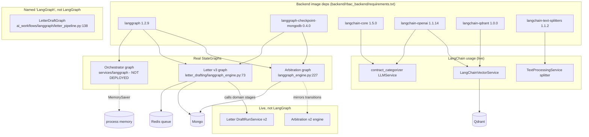
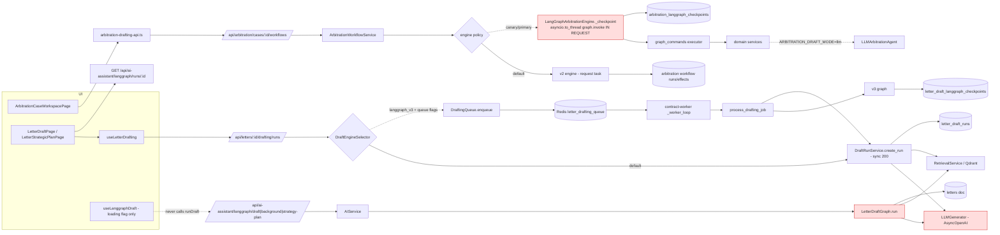
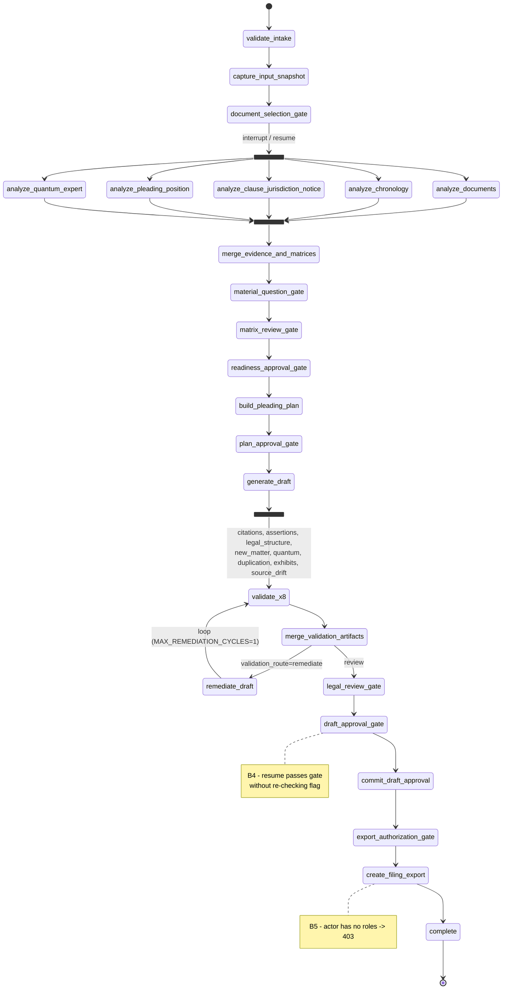
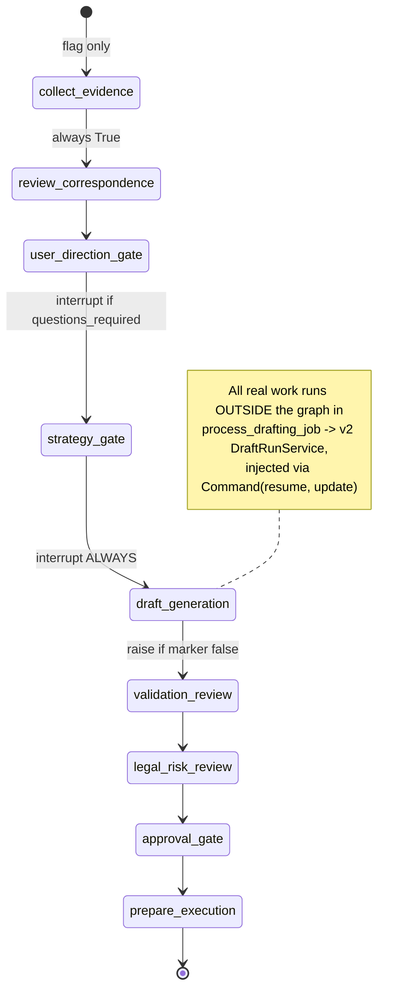
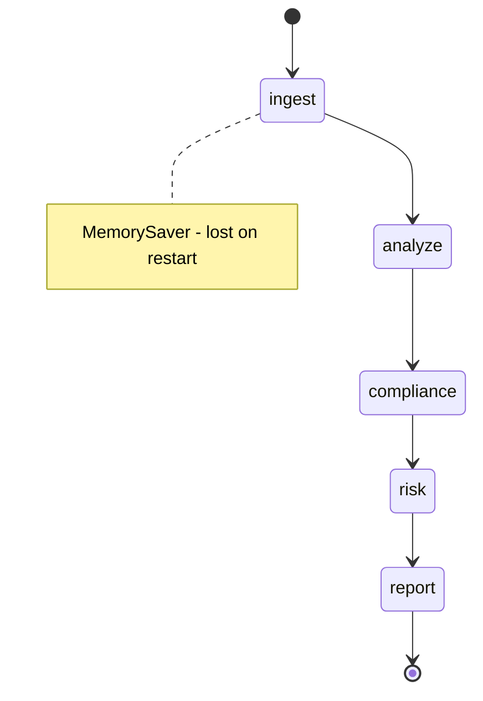
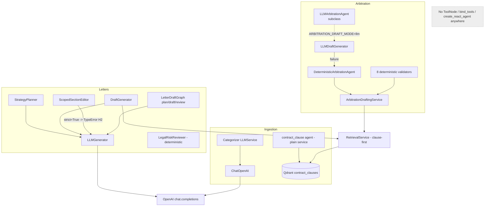
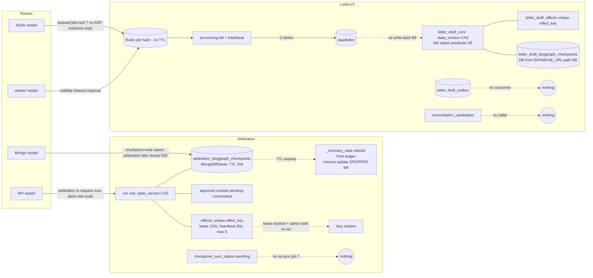
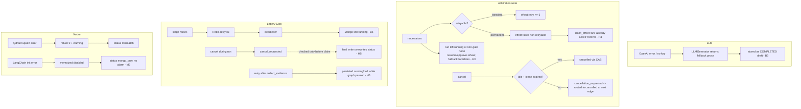
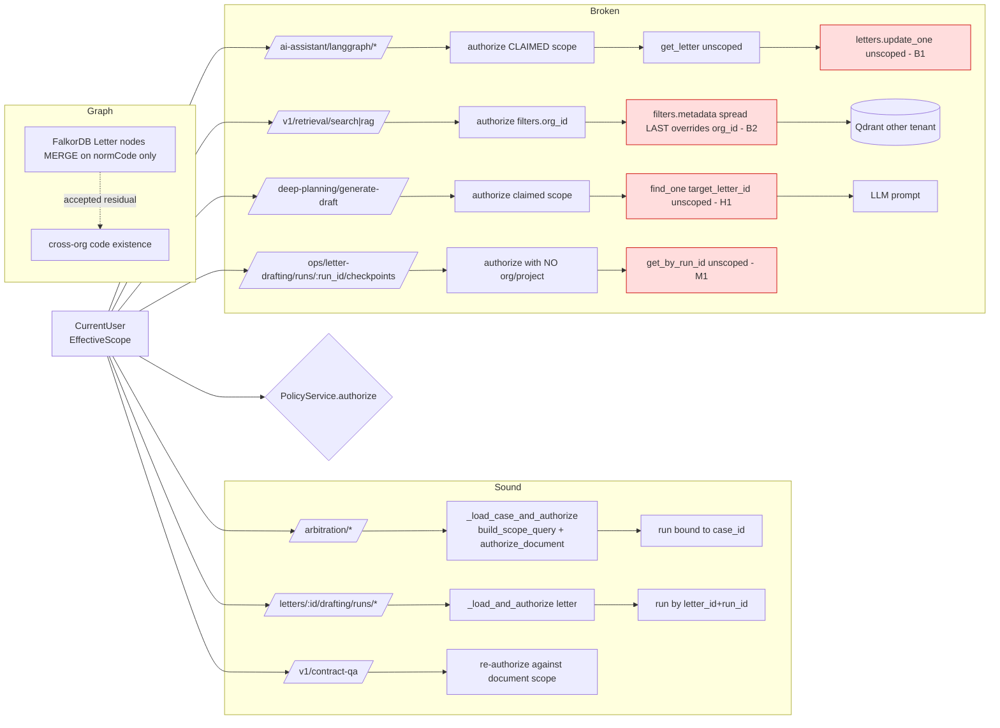
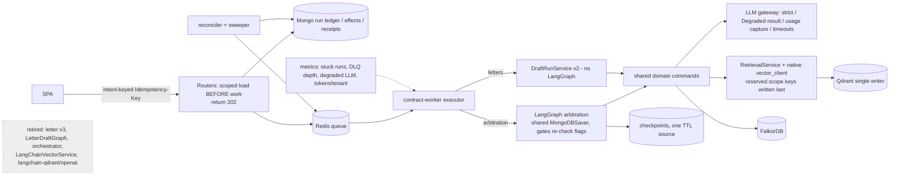

# LangChain / LangGraph — graphs

## Graphify output

- **Where it is:** [`langchain-langgraph-graphify/graph.html`](langchain-langgraph-graphify/graph.html) (interactive) and [`GRAPH_REPORT.md`](langchain-langgraph-graphify/GRAPH_REPORT.md).
- **What it covers:** the 73 AI-surface files, 36,151 lines:
  - `services/arbitration_drafting/**`
  - `services/letter_drafting/**`
  - `ai_workflows/**`
  - `services/langgraph/*`
  - the three AI routers
  - the LangChain services
  - `ai_service`, `llm_config_service`, `letter_service`, `workflow`, `contract_clause/agent`, `models/langgraph_run`, `main`
- **Result:** 1,854 nodes, 4,996 edges, 54 communities. Extraction is 97% EXTRACTED and 3% INFERRED; the INFERRED edges are 158 "uses" edges with an average confidence of 0.63.
- **How it was built:** an AST-only build, with no LLM and no tokens spent. The corpus was copied to a scratch directory so the repo's existing `graphify-out/` was not overwritten. Communities are left numbered rather than hand-labelled.
- **What it found:**
  - God nodes: `DraftRunService` (139 edges), `ArbitrationCaseWorkspaceService` (129), `ArbitrationDraftingService` (79), `ArbitrationWorkflowRepository` / `ArbitrationWorkflowService` (44 each).
  - One import cycle: `ai_workflows/langgraph/letter_pipeline.py` ↔ `services/letter_service.py` (M11).

**Honesty note.** Graphify renders one whole-corpus graph. It cannot produce the eight task-specific views below. Those are **Mermaid diagrams I derived by hand** from the verified evidence (file:line in the [current state](langchain-langgraph-current-state.md) and [blockers](langchain-langgraph-blockers.md)).

In every diagram:
- A solid arrow (`-->`) is an edge verified in code.
- A dotted arrow (`-.->`) is conditional or flag-gated.
- An edge labelled `?` is **unproven**.
- A red node is a defect site.

---

## Graph 1 — Current LangChain / LangGraph architecture



Three real graphs: two are gated off by default and one is undeployed. The live paths (v2 engines, legacy pipeline, LangChain services) are not LangGraph.

---

## Graph 2 — Runtime call graph (UI → API → service → queue → worker → graph → LLM/tools → persistence)



- `LLMG` is marked as a defect site for B3 (silent fallback prose), `LDG` for B1 (unscoped load and write), and `LGE` for H7 (in-request execution).
- The exports that follow approval are omitted here.

---

## Graph 3 — Every LangGraph state machine

### 3a. Arbitration (`langgraph_engine.py:304-408`)



- Every step also has a `continue_or_cancel` / `fanout_or_cancel` edge to `cancelled`, then `[*]`. They are omitted for legibility.
- Gates: `document_selection`, `material_question`, `matrix_review`, `readiness_approval`, `plan_approval`, `legal_review`, `draft_approval`, `export_authorization`. Each calls `interrupt({kind, run_id, state_version})`.

### 3b. Letter drafting v3 (`letter_drafting/langgraph_engine.py:151-160`)



This graph has no conditional edges and no loops. `cancellation_requested` is never set to True (`:878`).

### 3c. Standalone orchestrator (`services/langgraph/orchestrator.py:113-126`, not deployed)



### Not a state machine: `LetterDraftGraph`

It runs its nodes in a fixed order through `_exec_node`:

```
load_state → collect_context → retrieve_sources → plan_response (LLM) → draft_letter (LLM) → review_draft (LLM) → validate_and_route → Falkor write
```

It returns early on `analysis_only`. There is no checkpoint and no interrupt.

---

## Graph 4 — Agent / tool relationships



"Agents" are service classes or prompt wrappers. None of them selects tools.

---

## Graph 5 — Persistence, checkpoint and recovery



- The Redis restart edge is **unproven**: I did not inspect the persistence settings of the production Redis.
- **No startup recovery loop exists in `main.py`.**

---

## Graph 6 — Failure, retry and cancellation paths



---

## Graph 7 — RBAC and tenant boundaries around AI workflows



---

## Graph 8 — Proposed target architecture

See [target architecture](langchain-langgraph-target-architecture.md#target-shape) for the rationale.


