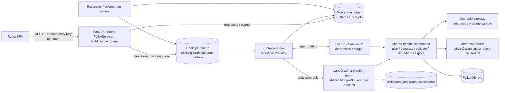

# LangChain / LangGraph — minimum production target architecture

This proposal is based only on findings in [current state](langchain-langgraph-current-state.md) and [blockers](langchain-langgraph-blockers.md). The guiding rule is to **consolidate before adding anything**. No new framework is proposed.

## Verdicts

**Should LangGraph remain? PARTIAL.** Keep it for **arbitration pleadings only**, and move execution off the request thread first. Retire letter-drafting v3. Delete the standalone orchestrator.

| Question | Answer | Why (evidence) |
|---|---|---|
| Which workflows genuinely benefit from LangGraph? | **Arbitration pleadings.** | It has 8 human gates, two fan-outs (5 analysis branches, 8 validators), a bounded remediation loop, runs that last days or weeks, and a need for resume after TTL or restart. The graph is real: its nodes own the domain commands. It also carries most of the durability engineering already done (effect leases, compare-and-set transitions, checkpoint validation). |
| Which should stay ordinary deterministic services? | **Letter drafting** (v2), contract categorization, chunking, embeddings, retrieval, deep planning, section editing, appraisal. | Letter v3 is a 10-node line of deterministic markers (`letter_drafting/langgraph_engine.py:73-161`). All the work happens *outside* the graph in v2 and is injected with `Command(update)`. The graph adds a Redis queue, a second checkpoint store and B6/H5/H6/M12 without taking over any logic. v2 already has idempotency keys, compare-and-set, stage gates and approvals. |
| Where is LangChain useful? | **`langchain-text-splitters` only**, and even that is optional. `langchain-core` stays as a transitive dependency of `langgraph`. | The splitter is a small, stable utility with a fallback already in place. |
| Where does LangChain add unnecessary abstraction? | `langchain-qdrant` + `OpenAIEmbeddings` (`LangChainVectorService`); the `ChatPromptTemplate \| ChatOpenAI` categorizer; root-manifest extras (`langchain`, `-classic`, `-community`, `langgraph-prebuilt`, `langgraph-sdk`). | The Qdrant wrapper nests payload under `metadata.`, which diverges from the native `vector_client` flat schema. That forced dual-schema delete filters and probably breaks vector-search filtering (M2). It also re-embeds every chunk that LlamaIndex already embedded (M14). The categorizer chain breaks on braces in the input and blocks the event loop (M3). |

## Target shape

## Component decisions

| Concern | Target | Change from today |
|---|---|---|
| **API layer** | Routers authorize, create a run row, enqueue and return 202. **No graph execution in the request.** | Arbitration currently runs the whole graph inside the request (H7). |
| **Job dispatch** | Reuse `DraftingQueue` (Redis: list + `BRPOPLPUSH` + heartbeat + dead-letter) for arbitration as well, keyed by `run_id`. The Redis job hash gets a TTL. | Arbitration has no queue today. Letter v3 has one and uses it only for the graph. |
| **Workflow ownership** | `contract-worker` owns execution. The Mongo run row is the source of truth and Redis is only transport. Each claim is a compare-and-set on `{run_id, status in claimable, state_version}` that writes the lease owner and expiry. | Adds a status predicate (H5). |
| **LangGraph execution** | Arbitration only. Build the graph **once per process**, with one shared `MongoDBSaver` and `MongoClient`. Sync graph invokes run in a thread, and every loop bridge call gets a timeout. `_gate` re-checks its flag after resume (B4). | Fixes B4 and H7. Removes letter v3. |
| **Checkpoint persistence** | `MongoDBSaver` in the app database (not the `DATABASE_URL` path), with **one TTL source** shared by migration and runtime. Every TTL reconstruction raises an alert, and the resume is applied after reconstruction. | Fixes M5 and M6. |
| **Idempotency** | Client key = hash(letter or case, mode, payload); server keeps uuid5(scope, key) run ids and unique `effect_key`s (already present). | Fixes M10. |
| **Human review** | Gates stay `interrupt()` in arbitration. A rejection **rewinds the checkpoint** (`update_state(as_node=gate)`) so graph and run position never diverge. Approvals are bound to content hashes, not timestamps. | Fixes B4 and M7. |
| **Cancellation** | Cancel is a compare-and-set on the run. The worker checks it between nodes and in the final write. Idle or failed runs are finalized immediately. | Fixes the lost-cancel part of H5, and B6. |
| **Recovery** | A reconciler on the worker finds `running` runs whose lease has expired and re-enqueues them or marks them `failed`. It re-syncs `checkpoint_sync_status=pending`. Operators can retry a failed effect through an audited admin route. | Fixes B6 and H3. `reconciliation_candidates` already exists but has no callers. |
| **LLM abstraction** | One gateway (evolve `retrieval/generator.LLMGenerator`): `strict=True` raises a typed error; non-strict returns an explicit `Degraded` result, never prose. It captures `usage` (tokens, model, latency) on every call, uses JSON-schema/structured output where outputs are parsed, and takes per-call timeouts. PydanticAI, LangChain `ChatOpenAI` and direct LlamaIndex LLM use all move behind it. | Fixes B3, H2 and M3, and adds cost tracking, which is absent today. |
| **RAG** | `RetrievalService` + native `vector_client` only. **Authorized scope keys are written last and reserved keys are rejected in metadata** (B2). Clause-first stays. | Fixes B2. |
| **Qdrant** | Single writer: the native `vector_client`, flat payload with `org_id`/`project_id`. Retire `LangChainVectorService`, which ends the double embedding. Do a one-time re-index/reconcile of `metadata.`-nested points with the existing `scripts/reconcile_vectors.py`. | Fixes M2 and M14. |
| **Embeddings** | One embedding call per chunk, whose result feeds both the Mongo `document_vectors` and Qdrant writes. | Halves embedding cost. |
| **FalkorDB** | Unchanged. `GRAPH.*` references only; the `normCode` sharing residual stays accepted and pinned. | — |
| **Mongo** | The run ledger, effects, receipts and snapshots stay as they are. They are already the strongest part of the design. | — |
| **Observability** | Metrics for: runs by status, age of the oldest `running`/`awaiting` run, dead-letter depth, lease expiries, fallback/degraded activations, TTL reconstructions, tokens per tenant. The existing `config/monitoring/arbitration-langgraph-*` alerts are extended to these. | — |
| **RBAC** | Every AI route loads its resource through `build_scope_query` or `authorize_document` **before** any node runs. Run ids are always bound to a scoped parent. No route authorizes a payload-claimed scope and then loads by id. | Fixes B1, H1 and M1. |
| **Tenant isolation** | `thread_id` stays opaque (`arbitration:{run_id}`); isolation is enforced by run→case binding, which already holds. Checkpoint reads are admin-only and bound to their case. | — |
| **Audit trail** | Keep `letter_draft_events` / arbitration events. Add the LLM call record (model, prompt version, token usage, degraded flag) to each run. | — |
| **Cost/token tracking** | From the LLM gateway, per tenant, project and run, feeding metering. | New. |

## Retire list

Each item is deleted only after a zero-reference proof.

| Item | Why |
|---|---|
| Letter-drafting v3 (`services/letter_drafting/langgraph_engine.py`, `engines/*` v3 path, `letter_draft_langgraph_checkpoints*`, `DRAFT_ENGINE_*` LangGraph flags, v3 client polling branch) | A shell with no logic; source of B6, H5, H6 and M12 |
| `ai_workflows/langgraph/` (`LetterDraftGraph`) + `/ai-assistant/langgraph/{draft,background,strategy-plan}` | A fake graph; B1; M7; M11; duplicates v2's plan, draft and review. Keep `GET …/runs/{id}` only until `LetterDraftPage.tsx:95` stops reading it, or serve it from v2 data |
| `services/langgraph/` orchestrator + its CI image build/scan | Not deployed; `MemorySaver` |
| `models/langgraph_run.py`, `ai_workflows/langgraph.py`, `useLanggraphStrategyPlan.ts`, the unused `useLanggraphDraft.runDraft` | Dead code |
| `LANGGRAPH_ENABLED`, `LANGGRAPH_API_TOKEN` (prod compose `:?` requirement), `LANGGRAPH_*_MODEL` once the legacy pipeline is gone | Misleading flags (M4) |
| `LangChainVectorService`, `langchain-qdrant`, `langchain-openai` | M2, M14 |
| Root `requirements.txt` | Orphan manifest with drifted pins (L1) |

## Sequencing

This is a recommendation; every step is reversible until the deletes.

1. **Now, independent of any LangGraph decision (live exposure):**
   - B1: scope the load and write.
   - B2: reserved filter keys.
   - H1: deep planning.
   - B3 + H2: LLM strict mode and degraded marking.
   - M1.
   - A red test for each.
2. **Arbitration LangGraph correctness:** B4 (gate re-check or rewind), B5 (export principal + acceptance evidence writer), H4 (canary production gate), and H3's reconciler.
3. **Execution ownership:** move arbitration execution to `contract-worker` through the queue (H7), with a shared saver. Add a replica-set Mongo to CI and run the drills there (H8).
4. **Consolidation:** retire letter v3 and the legacy pipeline. Put LLM clients behind one gateway. Make Qdrant single-writer and embed once.
5. **Only then:** the canary → acceptance-evidence → primary chain for arbitration, as documented.

## Explicit non-goals

- No LangChain agents, `ToolNode` or `create_react_agent`. No workflow here needs autonomous tool selection. Every step is a known domain command.
- No LangGraph Platform, LangSmith or `langgraph-sdk`. Self-hosted `MongoDBSaver` is enough.
- No second checkpointer backend (Postgres, Redis or SQLite).
